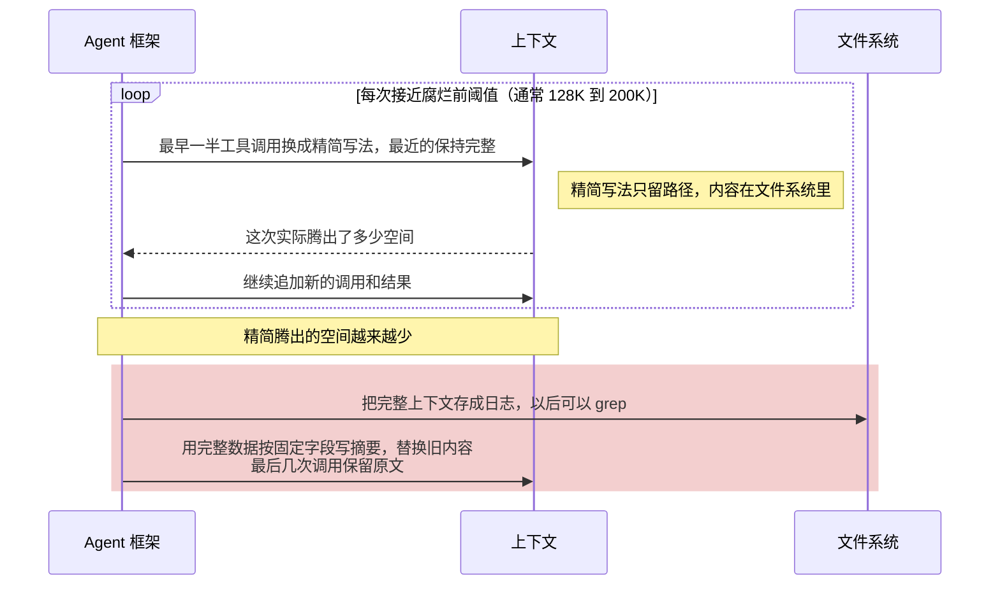
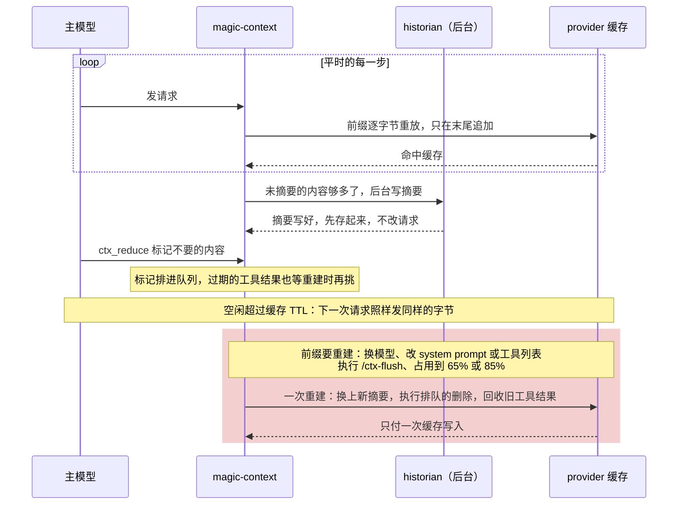
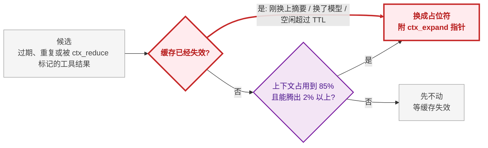

<div style="color: #666; font-style: italic; font-size: 0.9em; margin-bottom: 1em;">
本文内容由 AI 协助生成，资料截至 2026-11-24，出处见文中链接和文末清单。
</div>

**结论：给 agent 腾上下文，业界的共识是先用不丢信息的办法，会丢信息的摘要放到最后。** 大的工具结果写进文件，旧的工具结果换成占位符，原文都还找得回来，代价也低。Deep Agents、Strands、Google ADK 这些框架都已内置，Anthropic API 也提供了清除旧工具结果。摘要会丢细节，前两种办法不够用时才用。学术界在研究让模型自己学会压缩已经走过的步骤，这需要训练模型，或者专门调优压缩指引，自己搭 agent 的团队暂时用不上。

评判一个方案主要看三点：删掉的内容还能不能找回来；删的时机会不会让 prompt 缓存失效；什么时候压缩、由谁来定。各家现成组件差别最大的是第二点。开源插件 [magic-context](https://github.com/cortexkit/magic-context) 在这一点上做得最彻底：它把缓存当作硬约束，所有自动删除都攒到前缀必须重建时一起做（见 2.5 节）。DSH 插件 [dsh-hippocampus](https://github.com/Edison-A-N/dsh-hippocampus) 把这套设计移植到了 DeepSeek Harness 上（见第 5 节）。

---

## 1. 四层做法

按代价从低到高，业界的做法可以分成四层。


**前两层不丢信息，应当默认开启；后两层有代价，按需再上。**

| 层次 | 做法 | 原文能否找回 | 代表实现 |
|---|---|---|---|
| 1. 大结果落盘 | 超过阈值的工具结果写进文件，上下文里只留路径和预览 | 能 | Deep Agents，阈值 2 万 token（[源码](https://github.com/langchain-ai/deepagents/blob/deepagents%3D%3D0.7.34/libs/deepagents/deepagents/middleware/filesystem.py#L1932-L1933)）；Strands 的 `context_manager="auto"`，超过 1500 token 的结果只留 750 token 预览（[文档](https://strandsagents.com/docs/user-guide/sdk/context-management/built-in-modes/)，[源码](https://github.com/strands-agents/harness-sdk/blob/python/v1.66.0/strands-py/src/strands/_context_manager/context_manager.py#L35-L38)）；Google ADK，大块数据放进工件存储，只给模型引用（[文档](https://adk.dev/artifacts/)） |
| 2. 清除旧工具结果 | 留下「调用过某个工具」的记录，把旧结果换成占位符，需要时模型再调一次 | 能，前提是结果可以重新获取 | Anthropic `clear_tool_uses_20250919`（[文档](https://platform.claude.com/docs/en/build-with-claude/context-editing)）；LangChain `ContextEditingMiddleware`（[源码](https://github.com/langchain-ai/langchain/blob/langchain%3D%3D1.4.9/libs/langchain_v1/langchain/agents/middleware/context_editing.py#L58-L76)）；Manus 的精简写法（[分享整理](https://www.zenml.io/llmops-database/context-engineering-for-production-ai-agents-at-scale)）；magic-context 的按新旧回收（[文档](https://github.com/cortexkit/magic-context/blob/11a19167bbb0752cc4d1a710e977264dfdac366f/docs/architecture/reclaim.md?plain=1#L60-L64)） |
| 3. 摘要 | 让模型把会话里较早的对话概括成一段摘要，替换原文 | 模型只能看到摘要；原文有没有另存，看具体实现 | Anthropic 服务端 compaction（[文档](https://platform.claude.com/docs/en/build-with-claude/compaction)）；OpenAI Responses API compaction（[文档](https://developers.openai.com/api/docs/guides/compaction)）；Deep Agents 的摘要中间件和 `compact_conversation` 工具（[源码](https://github.com/langchain-ai/deepagents/blob/deepagents%3D%3D0.7.34/libs/deepagents/deepagents/middleware/summarization.py#L1-L50)）；magic-context 的 historian 分段摘要（[文档](https://github.com/cortexkit/magic-context/blob/11a19167bbb0752cc4d1a710e977264dfdac366f/docs/architecture/historian.md)） |
| 4. 模型自己折叠 | 训练或调优模型，让它主动压缩自己已经走过的步骤 | 看具体方法 | ACON（[arXiv](https://arxiv.org/abs/2510.00615)）、AgentFold（[arXiv](https://arxiv.org/abs/2510.24699)）、Context-Folding（[arXiv](https://arxiv.org/abs/2510.11967)）；OpenAI GPT-5.1-Codex-Max（[官方博客](https://openai.com/index/gpt-5-1-codex-max/)） |

---

## 2. 工程实践

### 2.1 Manus：删掉的东西要能找回来

Manus 公开分享的上下文工程经验最详细。下面第一条和最后一条出自 Manus 联合创始人季逸超 2025 年 7 月的博客 [Context Engineering for AI Agents: Lessons from Building Manus](https://manus.im/blog/Context-Engineering-for-AI-Agents-Lessons-from-Building-Manus)，其余几条出自 2025 年 10 月 LangChain 和 Manus 的一场直播分享（[视频](https://www.youtube.com/watch?v=6_BcCthVvb8)），引用的是 TextPurr 的[逐字稿](https://www.textpurr.com/transcript/context-engineering-for-ai-agents-with-langchain-and-manus)，括号里标的是视频时间。

- **文件系统就是上下文**：博客原话是压缩策略「总是设计成可还原的」，网页正文可以从上下文里删掉，只要 URL 还在；文档内容也可以删，只要沙箱里还留着路径（博客「Use the File System as Context」一节）。
- **每个工具调用都有完整和精简两种写法**：精简写法去掉能从文件系统或外部状态恢复的部分。比如写文件的调用，文件写到磁盘以后，上下文里只留路径就够了，要看内容再读一次文件（15:22）。
- **按效果下滑的位置触发，不按窗口上限**：要盯两条线。一条是模型能接受的上限，他举的例子是现在常见的 1M token。另一条是效果开始下滑的位置，Manus 叫它「腐烂前阈值」（pre-rot threshold）。他说大多数模型在 200K 左右就开始出现重复、推理变慢、质量下降，这条线要靠大量评测找出来，「通常在 128K 到 200K」，用它作为开始压缩的触发线（17:14）。
- **先精简，最近的留完整**：接近触发线时先精简，不先摘要。也不是整段历史都精简，比如只精简最早的一半工具调用，最近的保持完整。原因是模型会照着上下文里的例子学工具用法，最近的调用要是也成了精简写法，「最坏情况下模型会模仿，输出缺字段的精简格式」（18:04）。
- **摘要留到最后**：每次精简后都要算实际腾出了多少空间。精简过的调用也占地方，几轮以后腾出的空间会越来越少，这时才做摘要（18:38）。摘要有几个讲究：
  - 用完整版的数据写，不用精简版。
  - 最后几次工具调用和结果保留原文，模型才知道做到哪了。不然摘要以后模型有时会换风格、换语气。
  - 摘要前可能先把完整上下文存成日志文件，以后可以用 grep 找回（16:29）。
  - 按固定字段写，比如改了哪些文件、用户目标、做到哪一步，不写自由发挥的段落（37:57）。
- **缓存优先**：Manus 里输入和输出 token 之比平均约 100:1；以 Claude Sonnet 为例，命中缓存的输入 token 每百万 0.30 美元，没命中是 3 美元，差 10 倍。所以上下文要只追加，不改之前的动作和观察，序列化也要保证结果确定（博客「Design Around the KV-Cache」一节）。

第三到第五条是一套连续的流程：



每一步各防一种失败：模型窗口没满，效果就先变差；精简以后，模型照着精简格式学错工具用法；反复精简，却腾不出空间；摘要以后，模型接不上之前的进度。

### 2.2 Anthropic：API 层的上下文管理

Anthropic 在 API 层提供了下面几种能力：

| 能力 | 做什么 | 默认参数与出处 |
|---|---|---|
| 清除工具结果 `clear_tool_uses_20250919` | 从最早的开始，把工具结果换成占位符，调用记录保留 | 超过 10 万输入 token 触发，保留最近 3 次；可设 `clear_at_least`、`exclude_tools`；`clear_tool_inputs` 默认关闭（[参数表](https://platform.claude.com/docs/en/build-with-claude/context-editing#configuration-options-for-tool-result-clearing)） |
| 清除思考块 `clear_thinking_20251015` | 清掉较早轮次的 thinking 块 | 按轮数保留（[文档](https://platform.claude.com/docs/en/build-with-claude/context-editing)） |
| 按阈值的服务端 compaction `compact_20260112` | 输入达到阈值时，服务端生成一个摘要块，之后的请求自动丢掉摘要块之前的消息 | 默认 15 万 token 触发，最低可设 5 万（[文档](https://platform.claude.com/docs/en/build-with-claude/compaction-threshold)）。另有按需 compaction（beta 头 `compact-2026-09-04`），由应用自己决定什么时候摘要，可以保留最近几轮原文，也可以在后台做（[总览](https://platform.claude.com/docs/en/build-with-claude/compaction)） |
| memory 工具 | 模型自己读写记忆文件，跨会话保留 | 和清除工具结果一起用时，上下文接近清除阈值，模型会收到自动提醒，先把要点写进记忆（[文档](https://platform.claude.com/docs/en/build-with-claude/context-editing#using-with-the-memory-tool)） |

官方 Cookbook 的建议很直接：上下文变大如果主要是因为能重新获取的工具结果，清除更省钱，也不丢信息，因为模型可以再调一次工具；如果是没法重新获取的对话和推理，就用 compaction，但它会丢掉原话细节（[Cookbook 笔记本](https://github.com/anthropics/claude-cookbooks/blob/main/tool_use/context_engineering/context_engineering_tools.ipynb)）。文档也写明，清除工具结果会让已缓存的 prompt 前缀失效，所以建议用 `clear_at_least` 保证每次清得够多，才值得付这次缓存失效的代价（[文档](https://platform.claude.com/docs/en/build-with-claude/context-editing#context-editing-and-prompt-caching)）。

效果数据出自 Anthropic 2025 年 9 月 29 日的文章 [Managing context on the Claude Developer Platform](https://claude.com/resources/articles/context-management)：在内部的 agentic search 评测集上，单用上下文编辑，表现比基线提升 29%，再加上 memory 工具提升 39%；在 100 轮的网页检索评测里，上下文编辑让原本会因上下文耗尽而失败的流程跑完，token 消耗少了 84%。

### 2.3 OpenAI

Responses API 有两种 compaction（[官方指南](https://developers.openai.com/api/docs/guides/compaction)）：

- **服务端自动压缩**：创建请求时在 `context_management` 里设 `compact_threshold`，渲染后的 token 数超过阈值，服务端就在同一次请求里压缩，并在输出里返回一个 compaction 项。
- **单独的 `/responses/compact` 接口**：应用自己决定什么时候压，把当前窗口发过去，拿回压缩后的窗口（[API 参考](https://developers.openai.com/api/reference/resources/responses/methods/compact)）。

两种方式返回的 compaction 项都是加密的，官方说明它「不透明，不是给人读的」，只能原样传回去。

在模型上，OpenAI 说 GPT-5.1-Codex-Max 是它「第一个原生训练成跨多个上下文窗口工作的模型」：在 Codex 里接近上下文上限时，模型自动压缩会话，换一个新窗口接着做，直到任务完成；内部评测里观察到它在一个任务上连续工作超过 24 小时（[官方博客，2025-11-19](https://openai.com/index/gpt-5-1-codex-max/)）。

### 2.4 开源框架

- **LangChain Deep Agents**：前三层都有现成组件，见 2.6。
- **AWS Strands Agents**：一行 `Agent(context_manager="auto")` 打开默认的上下文管理：大的工具结果换成截断预览，上下文用到 85% 时把最早的消息压成结构化摘要。官方博客说，在真实的代码排查任务上，成本降了 55%，准确率从 68% 升到 98%，评测方法说要另文介绍（[Strands 博客，2026-06](https://strandsagents.com/blog/reduced-cost-better-isolation-more-resilience/)）。具体阈值是超过 1500 token 的结果只留 750 token 预览，摘要时保留最近 4 条消息（[文档](https://strandsagents.com/docs/user-guide/sdk/context-management/built-in-modes/)，源码见[阈值](https://github.com/strands-agents/harness-sdk/blob/python/v1.66.0/strands-py/src/strands/_context_manager/context_manager.py#L35-L38)和[保留条数](https://github.com/strands-agents/harness-sdk/blob/python/v1.66.0/strands-py/src/strands/_context_manager/context_manager.py#L91)）。单独的 ContextOffloader 插件默认阈值是 2500 token、预览 1000 token（[源码](https://github.com/strands-agents/harness-sdk/blob/python/v1.66.0/strands-py/src/strands/vended_plugins/context_offloader/plugin.py#L144-L147)）。
- **Google ADK**：大块数据放进工件存储，模型默认只看到一个轻量引用（名字和摘要），需要原始内容时才调 `LoadArtifactsTool` 临时加载，调用结束后默认移出上下文；会话历史达到可配置的阈值（比如调用次数）后，在后台异步用滑动窗口把较早的事件做成摘要（[Google 开发者博客](https://developers.googleblog.com/architecting-efficient-context-aware-multi-agent-framework-for-production/)；文档见 [Artifacts](https://adk.dev/artifacts/) 和 [Context compaction](https://adk.dev/context/compaction/)）。
- **magic-context**：后台做摘要、按缓存时机回收，见 2.5。

### 2.5 magic-context：改动攒到前缀重建时再做

[magic-context](https://github.com/cortexkit/magic-context) 是 CortexKit 出的开源插件，支持 OpenCode、Pi 和 Oh My Pi（[README](https://github.com/cortexkit/magic-context/blob/11a19167bbb0752cc4d1a710e977264dfdac366f/README.md?plain=1#L63)），MIT 许可。它的目标是一个会话能连续跑几周甚至几个月，中途不因为压缩停下来。下面的机制和数字都出自它仓库里的架构文档，主要是 [historian.md](https://github.com/cortexkit/magic-context/blob/11a19167bbb0752cc4d1a710e977264dfdac366f/docs/architecture/historian.md) 和 [reclaim.md](https://github.com/cortexkit/magic-context/blob/11a19167bbb0752cc4d1a710e977264dfdac366f/docs/architecture/reclaim.md)。

**核心规则是自动删除从不单独让缓存失效**（[reclaim.md](https://github.com/cortexkit/magic-context/blob/11a19167bbb0752cc4d1a710e977264dfdac366f/docs/architecture/reclaim.md?plain=1#L23)）。删除和新写好的摘要都先攒着，等前缀必须重建时一起生效。这样的时候有两类：一类是缓存已经保不住，比如换了模型、改了 system prompt 或工具列表，或者手动执行 `/ctx-flush`；另一类是上下文占用到了执行阈值（默认 65%），到强制线（85% 与执行阈值加 2% 中较大的那个）时还会再做紧急回收（[配置说明](https://github.com/cortexkit/magic-context/blob/11a19167bbb0752cc4d1a710e977264dfdac366f/CONFIGURATION.md?plain=1#L242)，[ARCHITECTURE.md](https://github.com/cortexkit/magic-context/blob/11a19167bbb0752cc4d1a710e977264dfdac366f/ARCHITECTURE.md?plain=1#L35-L38)）。



空闲超过缓存 TTL 不算重建的时机。缓存过期以后，下一次请求原样重发同样的字节，Anthropic 签过名的思考块仍然有效；要是借这个机会改写，这些思考块就得作废。magic-context 早先也在空闲超时后重建，0.49.44 起改掉了（[提交说明](https://github.com/cortexkit/magic-context/commit/f3093721b09994fbf768db27c304064c59cefcdd)）。

它在第 2、3 层上各有一套机制：

| 机制 | 做什么 | 出处 |
|---|---|---|
| historian 分段摘要 | 后台模型把当前会话里较早的对话切成按工作单元划分的分段（compartment），每段有四档详略不同的摘要和一个重要度。未摘要的内容达到触发预算的 3 倍就开始做，触发预算是可用上下文的 5%，限制在 5000 到 5 万 token 之间。historian 可以用便宜模型甚至本地模型 | [触发](https://github.com/cortexkit/magic-context/blob/11a19167bbb0752cc4d1a710e977264dfdac366f/docs/architecture/historian.md?plain=1#L21-L30)，[README](https://github.com/cortexkit/magic-context/blob/11a19167bbb0752cc4d1a710e977264dfdac366f/README.md?plain=1#L184) |
| 衰减渲染 | 不调用模型，按一条衰减曲线给每个分段挑档位：重要度越高衰减越慢，分段摘要的总预算（默认可用上下文的 15%）越紧衰减越快。近的、重要的保留全文，旧的例行工作缩成一行或者归档。重要度由 historian 按「细节要原样记住多久」来打。这种按年龄和重要度衰减的做法，人的记忆研究和 agent 记忆系统里都有先例，见《[长对话怎么记](/2026/11/25/long-conversation-memory/)》 | [衰减渲染](https://github.com/cortexkit/magic-context/blob/11a19167bbb0752cc4d1a710e977264dfdac366f/docs/architecture/historian.md?plain=1#L92-L102) |
| 保护尾 | 最近的一段原文不做摘要，长度按上下文占用动态调整；一次工具调用和它的结果不会被拆到两边 | [保护尾](https://github.com/cortexkit/magic-context/blob/11a19167bbb0752cc4d1a710e977264dfdac366f/docs/architecture/historian.md?plain=1#L34-L45) |
| 按新旧回收 | 一个工具结果后面已经有 3 条用户消息，或者后面的新内容达到可用上下文的 25%，就换成占位符。不到 250 token 的结果不回收 | [按新旧回收](https://github.com/cortexkit/magic-context/blob/11a19167bbb0752cc4d1a710e977264dfdac366f/docs/architecture/reclaim.md?plain=1#L60-L64) |
| 去重和替代 | 只读工具的重复结果只留最新一份；同一文件后来又改过的旧 `edit`，只留路径和改动的前 40 个字符；`todowrite` 只留最新一次 | [去重](https://github.com/cortexkit/magic-context/blob/11a19167bbb0752cc4d1a710e977264dfdac366f/docs/architecture/reclaim.md?plain=1#L81)，[替代](https://github.com/cortexkit/magic-context/blob/11a19167bbb0752cc4d1a710e977264dfdac366f/docs/architecture/reclaim.md?plain=1#L68-L73) |
| 紧急回收 | 到强制线时按工具类别从旧到新删，先删 `bash` 这类，再删 `edit`、`grep`，最后才删 `read`；目标是降到工作空间的约 30%。到 95% 时，最近一段的保护窗口和每一类里最新的 20% 也可以删 | [紧急回收](https://github.com/cortexkit/magic-context/blob/11a19167bbb0752cc4d1a710e977264dfdac366f/docs/architecture/reclaim.md?plain=1#L83-L90) |
| `ctx_reduce` | 模型自己标记要丢的内容，标记先排队，等下一次前缀重建时一起执行 | [ctx_reduce](https://github.com/cortexkit/magic-context/blob/11a19167bbb0752cc4d1a710e977264dfdac366f/docs/architecture/reclaim.md?plain=1#L46) |
| `ctx_expand` | 原始对话一直保存着，模型需要细节时可以把一段做过摘要的对话还原成原文 | [README](https://github.com/cortexkit/magic-context/blob/11a19167bbb0752cc4d1a710e977264dfdac366f/README.md?plain=1#L231-L241) |

几条从实际使用里得来的经验也写在文档里（[reclaim.md](https://github.com/cortexkit/magic-context/blob/11a19167bbb0752cc4d1a710e977264dfdac366f/docs/architecture/reclaim.md?plain=1#L50-L52)）：

- **工具调用参数要么原样保留，要么整条删掉**。往参数里放任何占位内容，模型都会抄进新的调用：截断成 5 个字符的路径被当真执行，占位标记被反复调用，有个 worker 连续 68 次撞上拒绝。最近 20 次调用里输入小的，保留调用、只替换结果；把最近的调用全删掉，模型又会开始用纯文本伪造工具调用。
- **占位符只能由编号算出来**，不能依赖当前内容，否则两次渲染的结果不一样，缓存还是会失效。
- **每次删除只决定一次，之后原样重放**，保证同一段对话每次渲染出来的字节完全一样。

上下文之外，magic-context 还做记忆：historian 做摘要时顺带把决策、约束、约定提取成项目记忆；dreamer 在空闲时对照代码核实记忆、合并重复；`ctx_search` 能同时搜记忆、原始对话记录、git 提交和笔记（[README](https://github.com/cortexkit/magic-context/blob/11a19167bbb0752cc4d1a710e977264dfdac366f/README.md?plain=1#L195-L240)）。

### 2.6 LangChain 与 Deep Agents 的组件

下表依据 `deepagents` 0.7.34 和 `langchain` 1.4.9 的源码整理，每行都链到对应版本的源码行。官方介绍见 LangChain 博客 [Context Management for Deep Agents](https://www.langchain.com/blog/context-management-for-deepagents)（2026-01-28）和 [Context Engineering with Deep Agents](https://www.langchain.com/blog/context-engineering-deep-agents-remember)（2026-10-14）。「默认」一列指 `create_deep_agent` 会不会自动挂上该组件（[组装代码](https://github.com/langchain-ai/deepagents/blob/deepagents%3D%3D0.7.34/libs/deepagents/deepagents/graph.py#L909-L957)）。

| 层次 | 组件 | 做什么 | 默认 |
|---|---|---|---|
| 1 落盘 | `FilesystemMiddleware`，参数 `tool_token_limit_before_evict` | 工具结果超过 2 万 token 就写到 `/large_tool_results/{tool_call_id}`，上下文里留首尾预览和路径（[默认值](https://github.com/langchain-ai/deepagents/blob/deepagents%3D%3D0.7.34/libs/deepagents/deepagents/middleware/filesystem.py#L1932-L1933)）；`ls`、`glob`、`grep`、`read_file`、`edit_file`、`write_file` 等文件工具不落盘（[排除名单](https://github.com/langchain-ai/deepagents/blob/deepagents%3D%3D0.7.34/libs/deepagents/deepagents/middleware/filesystem.py#L1783-L1791)） | 挂 |
| 1 落盘 | 同上，参数 `human_message_token_limit_before_evict` | 用户消息超过 5 万 token 也同样落盘（[默认值](https://github.com/langchain-ai/deepagents/blob/deepagents%3D%3D0.7.34/libs/deepagents/deepagents/middleware/filesystem.py#L1932-L1933)） | 挂 |
| 1 落盘 | `_blob_offload`（内部模块），由 `FilesystemMiddleware` 的 `offload_binary_content` 参数打开 | 二进制内容按 sha256 存到 `blobs/` 目录，消息里只留引用（[源码](https://github.com/langchain-ai/deepagents/blob/deepagents%3D%3D0.7.34/libs/deepagents/deepagents/middleware/_blob_offload.py#L1-L10)）。这个参数默认关闭（[源码](https://github.com/langchain-ai/deepagents/blob/deepagents%3D%3D0.7.34/libs/deepagents/deepagents/middleware/filesystem.py#L1937)） | 不挂 |
| 1 落盘 | `SkillsMiddleware` | system prompt 里只放 skill 的名字和描述，模型需要时再用 `read_file` 读全文（渐进披露，[源码](https://github.com/langchain-ai/deepagents/blob/deepagents%3D%3D0.7.34/libs/deepagents/deepagents/middleware/skills.py#L885-L888)） | 传了 `skills` 才挂 |
| 2 清除 | `ContextEditingMiddleware` + `ClearToolUsesEdit`（langchain 内置） | 仿照 Anthropic `clear_tool_uses`，任何模型都能用：上下文超过 `trigger`（默认 10 万 token）后，从最早的开始把工具结果换成占位符，保留最近 `keep` 次（默认 3 次）；可配置 `clear_at_least`、`exclude_tools`、`clear_tool_inputs`、`placeholder`（[参数](https://github.com/langchain-ai/langchain/blob/langchain%3D%3D1.4.9/libs/langchain_v1/langchain/agents/middleware/context_editing.py#L58-L76)）。只改发给模型的请求，state 里保存的消息不变（[源码](https://github.com/langchain-ai/langchain/blob/langchain%3D%3D1.4.9/libs/langchain_v1/langchain/agents/middleware/context_editing.py#L250-L274)） | 不挂 |
| 2 清除 | 摘要中间件的参数截断（`truncate_args_settings`） | 上下文用到 85% 时（模型没有 profile 信息时改成超过 20 条消息），截掉旧的 `write_file`、`edit_file` 调用里的大参数，因为文件已经写到了磁盘上（[默认值](https://github.com/langchain-ai/deepagents/blob/deepagents%3D%3D0.7.34/libs/deepagents/deepagents/middleware/summarization.py#L294-L331)） | 挂 |
| 3 摘要 | 摘要中间件（`create_summarization_middleware`） | 上下文用到模型 `max_input_tokens` 的 85% 时做摘要，保留最近 10%；模型没有 profile 信息时改成 17 万 token 触发、保留最近 6 条消息（[默认值](https://github.com/langchain-ai/deepagents/blob/deepagents%3D%3D0.7.34/libs/deepagents/deepagents/middleware/summarization.py#L294-L331)）。移出去的原文写到 `/conversation_history/{session_id}.md`，模型可以用文件工具找回（[源码](https://github.com/langchain-ai/deepagents/blob/deepagents%3D%3D0.7.34/libs/deepagents/deepagents/middleware/summarization.py#L1-L50)） | 挂 |
| 3 摘要 | 同上，超长兜底 | 请求因超长被拒绝时（`ContextOverflowError`，或 400/413/422 里的超长报错，[判断](https://github.com/langchain-ai/deepagents/blob/deepagents%3D%3D0.7.34/libs/deepagents/deepagents/middleware/summarization.py#L532-L536)），先做摘要，再把末尾一批工具结果裁短：`read_file` 的结果只留开头并注明原路径，其他结果落盘（[源码](https://github.com/langchain-ai/deepagents/blob/deepagents%3D%3D0.7.34/libs/deepagents/deepagents/middleware/_overflow_clip.py#L1-L12)） | 挂 |
| 3 摘要 | `SummarizationToolMiddleware`（`create_summarization_tool_middleware`） | 给模型一个 `compact_conversation` 工具，由模型在任务告一段落时自己决定压缩；上下文达到自动阈值的一半才允许调用（[源码](https://github.com/langchain-ai/deepagents/blob/deepagents%3D%3D0.7.34/libs/deepagents/deepagents/middleware/summarization.py#L2340-L2348)） | 不挂 |
| 隔离 | `SubAgentMiddleware`（`task` 工具） | 子任务在子 agent 自己的上下文里执行，只把结果交回主 agent（[源码](https://github.com/langchain-ai/deepagents/blob/deepagents%3D%3D0.7.34/libs/deepagents/deepagents/middleware/subagents.py#L963)） | 挂 |
| 缓存 | `_prompt_caching`（内部模块） | 自动加缓存标记：Anthropic 模型总是加；装了 `langchain-aws` 或 `langchain-fireworks` 时，Bedrock 和 Fireworks 模型也加（[说明](https://github.com/langchain-ai/deepagents/blob/deepagents%3D%3D0.7.34/libs/deepagents/deepagents/graph.py#L405-L412)） | 挂 |

有两点容易搞混：

- `ContextEditingMiddleware` 属于 langchain 本体，deepagents 默认不挂，要自己加进 `middleware=[...]`。它只改发给模型的请求，checkpoint 里保存的消息原样保留，所以随时能关，也不影响回放。
- `compact_conversation` 让模型自己挑时机压缩，本身还是第 3 层的摘要，会丢细节，只是把什么时候压交给了模型。思路和 3.2 的 AgentFold 相近，但不用训练。

读 `ContextEditingMiddleware` 的源码（[`ClearToolUsesEdit`](https://github.com/langchain-ai/langchain/blob/langchain%3D%3D1.4.9/libs/langchain_v1/langchain/agents/middleware/context_editing.py#L58-L76)），还有几处要留意：

- **只能排除，不能指定**：`exclude_tools` 列的是不清的工具，没有「只清某个工具」的选项。想只清 `read_file` 的结果，就得把其他工具全列进排除名单，工具有增减时名单也要跟着改。
- **占位符是固定文本**（默认 `[cleared]`，[源码](https://github.com/langchain-ai/langchain/blob/langchain%3D%3D1.4.9/libs/langchain_v1/langchain/agents/middleware/context_editing.py#L35)），不写原路径。好在 `clear_tool_inputs` 默认关闭，AI 消息里的调用参数还在，模型能看到当时读的是哪个文件。
- **每次请求都重新计算**：超过阈值后，除最近 `keep` 次以外的候选全部清掉（`clear_at_least` 为 0 时）。每多一次工具调用，清除的边界就往后挪一格，缓存从边界处开始失效。
- **只按 token 总量触发**：想在「新一轮对话开始」这类时间点清，得自己实现一个 `ContextEdit`（接口只有一个 `apply` 方法，[源码](https://github.com/langchain-ai/langchain/blob/langchain%3D%3D1.4.9/libs/langchain_v1/langchain/agents/middleware/context_editing.py#L44-L56)）。

---

## 3. 学术研究

### 3.1 直接清除，效果不输摘要

JetBrains Research 和慕尼黑工业大学的论文 [The Complexity Trap: Simple Observation Masking Is as Efficient as LLM Summarization for Agent Context Management](https://arxiv.org/abs/2508.21433) 用 SWE-agent 在 SWE-bench Verified 上比较了几种做法，覆盖五种模型配置（下面的节号和表号对应 [v3 版](https://arxiv.org/html/2508.21433v3)）：

- 在预实验里（SWE-bench Lite 的 50 个任务），环境观察（即工具结果）平均占 SWE-agent 每一轮 token 的约 84%（§1、附录 D.4）。
- 把 10 轮以前的旧观察换成占位符（论文叫 observation masking），五种配置里有四种成本比不处理时低一半以上，解决率和 LLM 摘要相差很小，有的配置高一些，有的低一些（Table 1）。例外是 Qwen3-32B 开思考模式，只省了 9.8%。在 Qwen3-Coder 480B 上，masking 的解决率是 54.8%，摘要是 53.8%（§4.3）。
- **摘要会让轨迹变长**。在 Qwen3-Coder 480B 上，摘要的平均轨迹比 masking 长 13%，比不处理长 15%；在 Gemini 2.5 Flash 上比 masking 长 15%（§4.4）。Qwen3-32B 上情况反过来，是 masking 让轨迹变长。作者推测，摘要掩盖了本该让 agent 早点停下的失败信号，于是它一直试下去（Figure 4 说明）。
- 混合方案是先 masking，轨迹特别长时再做摘要。它只在 Qwen3-Coder 480B 和 50 个任务的子集上测过：比单用 masking 省 7%，比单用摘要省 11%，解决率比不处理高 2.6 个百分点（§5.3）。
- 保留多少轮要按框架调：SWE-agent 上 10 轮最好（§3.2、附录 D.1）；v3 新增的 OpenHands 实验里，直接沿用 10 轮效果明显变差，调到 58 轮才复现出原来的结论（§5.1）。

### 3.2 让模型学会压缩

| 工作 | 做法 | 结果 |
|---|---|---|
| [ACON](https://arxiv.org/abs/2510.00615)（KAIST、微软） | 收集成对的轨迹（完整上下文能成功，压缩后失败），让优化模型（o3）对比压缩前后的上下文，找出失败原因，据此修改压缩指引；这一步不动模型权重（§3.3、附录 B.3） | 峰值 token 降低 26% 到 54%（论文摘要）；再用 LoRA 把压缩器蒸馏到 Qwen3-14B、Qwen3-8B、Phi-4 等小模型，表现保持在 gpt-4.1 教师模型的 95% 以上（§4.3） |
| [AgentFold](https://arxiv.org/abs/2510.24699)（阿里通义实验室） | 对 Qwen3-30B-A3B 做监督微调，让模型每一步同时输出工具调用和折叠指令：可以只压最近一步，也可以把做完的子任务整段压掉（§3） | 100 轮后上下文约 7K token；跑到 500 轮时上下文大多仍在 2 万 token 以下，不过准确率只测到 256 轮（§4.1）；在 BrowseComp 上得分 36.2% |
| [Context-Folding](https://arxiv.org/abs/2510.11967)（字节 Seed、CMU、斯坦福） | 用强化学习框架 FoldGRPO 训练，模型为子任务开一条分支轨迹，做完后折叠成一段简短结论 | 活跃上下文只有基线的十分之一，效果持平或超过 ReAct，明显好于摘要式的上下文管理（论文摘要） |

这几项工作方向相同：什么时候压、压哪些，交给模型按任务判断，不靠固定阈值。代价是要训练模型或针对任务调优，而且评测基本只覆盖写代码和网页检索两类任务。

---

## 4. 清除旧结果要算缓存账

第 2 层的清除看上去几乎不花钱，其实要算一笔缓存账，magic-context 把删除攒到前缀重建时才做，就是因为这笔账。provider 按前缀逐字匹配缓存，只要改动了位置 p 上的一条消息，p 之后的整段前缀都得重新写入缓存。

按 Anthropic 的价格粗算（5 分钟缓存的写入价是原价的 1.25 倍，读取价是 0.1 倍，[定价](https://platform.claude.com/docs/en/build-with-claude/prompt-caching#pricing)）：清掉 X 个 token，之后每次调用省下 0.1·X；代价是把 p 之后的 S 个 token 重新写一遍缓存，一次性多花约 1.15·S。这样要再调用约 **11.5·S/X 次**才能把这笔钱省回来，前提还是中间没有别的原因让缓存失效。比如 S 为 30 万、X 为 5 万，要 69 次调用才回本（这个算式出自 dsh-hippocampus 的[设计说明](https://github.com/Edison-A-N/dsh-hippocampus/blob/2195942524f5a2bffceee7752154ef4feccfe3d9/docs/adr/ADR-10-tool-output-reclaim.md?plain=1#L13)）。同一份定价表里，Claude Opus 5.5 和 Sonnet 5.5 的缓存读取价只有 0.05 倍，另有几个模型是 0.025 倍。按这两个价格算，回本次数分别约为 24·S/X 和 49·S/X，是上面的 2 倍和 4 倍多。

由此可以推出几条规律：

- **缓存还热的时候清，往往亏钱**。会话剩下的调用次数不够，或者清掉的量比后面的前缀小太多，省下的钱都抵不上重建缓存的开销。
- **每次请求都重算边界的清除方式最费钱**。`ContextEditingMiddleware` 和 Anthropic `clear_tool_uses` 超过阈值后，边界随每次工具调用往后挪，相当于每一步都让一段前缀失效。
- **趁缓存失效时清，基本不多花钱**。换了模型、空闲超过缓存 TTL、刚把一次摘要替换上去，这些时候前缀已经作废，这时清掉旧结果没有额外成本。
- **路由没有 prompt 缓存时，这笔账不成立**。每次调用都按全价计费，越早清越省。

所以要不要开清除，先看两个数：缓存命中率，以及清除之后一般还有多少次调用。命中率低，或者后面还有很多次调用，清除才明显划算。

---

## 5. dsh-hippocampus：magic-context 在 DSH 上的移植

### 5.1 插件概况

[dsh-hippocampus](https://github.com/Edison-A-N/dsh-hippocampus) 是 [DeepSeek Harness](https://github.com/deepseek-ai/deepseek-harness)（DSH）的一个插件，负责项目记忆和后台上下文管理。**它的设计来自 magic-context**：historian 分段摘要、衰减渲染、保护尾、按新旧回收、按工具类别的紧急回收、`ctx_reduce`、historian 顺带提取记忆、把改动攒到前缀重建时才做、工具参数不放占位内容，都是 magic-context 先做出来的，dsh-hippocampus 在 DSH 上重新实现了一遍。它没有复制 magic-context 的源码，和 magic-context 项目也没有隶属关系。借鉴了哪些内容、参照的是 magic-context 哪个提交，写在仓库的 [THIRD_PARTY_NOTICES.md](https://github.com/Edison-A-N/dsh-hippocampus/blob/2195942524f5a2bffceee7752154ef4feccfe3d9/THIRD_PARTY_NOTICES.md?plain=1#L38-L54) 里。

移植的难点来自 DSH 的一条设计约定：**每次模型请求都完全由事件日志推导出来**，宿主不提供在请求前改写消息的钩子。magic-context 正是靠每次请求前改写消息来工作的；dsh-hippocampus 只能往日志里追加事件，替换也只是在视图里盖住旧消息（[设计说明](https://github.com/Edison-A-N/dsh-hippocampus/blob/2195942524f5a2bffceee7752154ef4feccfe3d9/docs/adr/ADR-9-compartment-compaction.md?plain=1#L17-L24)）。原始内容一直留在日志里，可以用 `ctx_expand` 按序号取回。后面几节讲到的差异，大多是这条约定造成的。

### 5.2 安装与开关

插件以 DSH bundle 的形式发布，要求 DSH 版本不低于 0.2.2-rc.3 且仍在 0.2 系列（[README](https://github.com/Edison-A-N/dsh-hippocampus/blob/2195942524f5a2bffceee7752154ef4feccfe3d9/README.zh.md?plain=1#L137)），用一条命令装进 Web profile（[README](https://github.com/Edison-A-N/dsh-hippocampus/blob/2195942524f5a2bffceee7752154ef4feccfe3d9/README.zh.md?plain=1#L24-L26)）：

```bash
dsh plugin --profile web add github:Edison-A-N/dsh-hippocampus
```

bundle 自带的 patch 会先停用 profile 宿主层的 `compaction-basic`，再插入 `hippocampus`。这是因为插件注册的也是 `compaction` 服务，而 cordis 不允许同名服务有两个提供者（[README](https://github.com/Edison-A-N/dsh-hippocampus/blob/2195942524f5a2bffceee7752154ef4feccfe3d9/README.zh.md?plain=1#L28)）。装好后重启 DSH，刷新页面就能用。各项能力的开关如下（[配置说明](https://github.com/Edison-A-N/dsh-hippocampus/blob/2195942524f5a2bffceee7752154ef4feccfe3d9/README.zh.md?plain=1#L92-L110)）：

| 能力 | 默认 | 怎么打开 |
|---|---|---|
| 记忆工具（`ctx_memory`、`ctx_note`、`ctx_search` 的记忆部分）、会话开头的记忆注入 | 开 | 不用配置 |
| 后台分段摘要、工具输出回收、`ctx_reduce` | 开 | 不用配置；设 `HIPPOCAMPUS_COMPACTION=checkpoint` 可切回单份摘要引擎，这时没有 `ctx_reduce` |
| historian 顺带提取记忆 | 开 | 设 `HIPPOCAMPUS_HISTORIAN_FACTS=off` 关闭 |
| `ctx_expand` 取回原文、`ctx_search` 检索历史会话 | 关 | 在 profile 的 `cordis.patch.yml` 里把 DSH 的 `session-query-sqlite` 设为 `openAt: first-search`，默认是 `never`（[README](https://github.com/Edison-A-N/dsh-hippocampus/blob/2195942524f5a2bffceee7752154ef4feccfe3d9/README.zh.md?plain=1#L30-L36)） |
| 语义检索 | 关 | 设 `HIPPOCAMPUS_EMBEDDING_API_KEY`；不设时只有全文检索 |
| 后台核实和整理记忆（dreamer） | 关 | 同时设 `HIPPOCAMPUS_DREAMER_PROVIDER` 和 `_MODEL` |

> **ℹ️ 找回原文要先打开会话索引**
>
> 摘要标题里的事件序号、占位符里的 `ctx_expand` 指针，都要打开会话索引才能用。不打开时原文还在日志里，但模型取不回来，「能找回」就只对翻日志的人成立。

缓存 TTL 默认是 5 分钟（`HIPPOCAMPUS_CACHE_TTL`），和 magic-context 的 `cache_ttl` 通用默认值一样（[magic-context 配置](https://github.com/cortexkit/magic-context/blob/11a19167bbb0752cc4d1a710e977264dfdac366f/CONFIGURATION.md?plain=1#L240-L247)）。如果路由的缓存能保留 1 小时，要改成 `1h`，否则插件会把还热的缓存当成已经失效。数据存在 `$DSH_HOME/storages/hippocampus/memory.db`，项目按 git 根提交区分（[README](https://github.com/Edison-A-N/dsh-hippocampus/blob/2195942524f5a2bffceee7752154ef4feccfe3d9/README.zh.md?plain=1#L112-L115)）。historian 和 dreamer 只把内容发给你配置好的模型路由；historian 调用还会带上项目现有的记忆，用来避免重复提取。

### 5.3 逐层对照

| 层次 | 业界常见做法 | magic-context | dsh-hippocampus 的移植 |
|---|---|---|---|
| 1 大结果落盘 | 超过阈值就写文件，上下文里留路径和预览 | 不管，交给宿主 | 同样不管，由 DSH 宿主处理。`bash` 输出过长时只返回末尾，全文存进文件并给出路径；`grep`、`glob` 结果过多时也会说明完整列表存在哪里（[工具说明](https://github.com/deepseek-ai/deepseek-harness/blob/dsh-v0.2.2-rc.3/docs/tool-catalog.md)）。agent preset 里的 tool-result-pruner 在它自己的 compaction 触发时（上下文用到 80%，[回收设计](https://github.com/Edison-A-N/dsh-hippocampus/blob/2195942524f5a2bffceee7752154ef4feccfe3d9/docs/adr/ADR-10-tool-output-reclaim.md?plain=1#L9)），把超过 8192 字符的结果裁成开头 4096 字符加结尾 1024 字符（[pruner README](https://github.com/deepseek-ai/deepseek-harness/blob/dsh-v0.2.2-rc.3/packages/compaction/compaction-tool-result-pruner/README.md)）。图片超出路由的预算时，由 image-offload 换成附件路径（[image-offload README](https://github.com/deepseek-ai/deepseek-harness/blob/dsh-v0.2.2-rc.3/packages/compaction/compaction-image-offload/README.md)） |
| 2 清除旧工具结果 | 超过 token 阈值后，从最早的开始换成占位符，保留最近 N 次 | 按新旧回收（3 条用户消息或 25%）、只读结果去重、旧 `edit` 压缩、到强制线按工具类别紧急回收、模型用 `ctx_reduce` 主动丢弃；占位符是 `[dropped §N§]`（[源码说明](https://github.com/cortexkit/magic-context/blob/11a19167bbb0752cc4d1a710e977264dfdac366f/docs/architecture/reclaim.md?plain=1#L50)） | 移植了按新旧回收、只读结果去重、紧急回收和 `ctx_reduce`（[回收设计](https://github.com/Edison-A-N/dsh-hippocampus/blob/2195942524f5a2bffceee7752154ef4feccfe3d9/docs/adr/ADR-10-tool-output-reclaim.md?plain=1#L19-L28)，[补充设计](https://github.com/Edison-A-N/dsh-hippocampus/blob/2195942524f5a2bffceee7752154ef4feccfe3d9/docs/adr/ADR-11-agent-drops-pressure-tiers-historian-facts.md?plain=1#L17-L30)）。占位符改成保留原输出的前 4 行、后 2 行，再加 `ctx_expand` 指针。旧 `edit` 压缩没做，原因见 5.5 |
| 3 摘要 | 上下文用到 85% 左右时，把之前的对话一次性摘要成一段 | historian 分段摘要、四档详略、衰减渲染、保护尾 | 分段和衰减照 magic-context 实现。换上摘要的时机是缓存已冷（包括空闲超过缓存 TTL）或上下文占用到 65%。有两处不同：触发条件把工具输出也算进去，工具多的会话会更早开始摘要；magic-context 不给子 agent 做摘要，dsh-hippocampus 做，但保留子 agent 收到的任务原文（[摘要设计](https://github.com/Edison-A-N/dsh-hippocampus/blob/2195942524f5a2bffceee7752154ef4feccfe3d9/docs/adr/ADR-9-compartment-compaction.md?plain=1#L49-L50)） |
| 4 模型自己折叠 | 训练或调优模型 | 没有 | 没有 |
| 跨会话记忆 | Anthropic memory 工具：模型自己读写记忆文件 | historian 顺带提取记忆，会话中新写的记忆也能进上下文（[memory-and-search.md](https://github.com/cortexkit/magic-context/blob/11a19167bbb0752cc4d1a710e977264dfdac366f/docs/architecture/memory-and-search.md?plain=1#L31-L36)）；dreamer 做核实、整理、打分等多种任务；`ctx_search` 还能搜 git 提交（[README](https://github.com/cortexkit/magic-context/blob/11a19167bbb0752cc4d1a710e977264dfdac366f/README.md?plain=1#L195-L240)） | 记忆分类和准入规则沿用 magic-context。记忆只在会话开头注入一次，会话中新写的要到下个会话才看得到；dreamer 只做核实和整理，每 15 分钟一次（[README](https://github.com/Edison-A-N/dsh-hippocampus/blob/2195942524f5a2bffceee7752154ef4feccfe3d9/README.zh.md?plain=1#L13-L16)）。historian 也顺带提取记忆，但优先级比 agent 自己写的低，已经归档的不会被重新写回来（[README](https://github.com/Edison-A-N/dsh-hippocampus/blob/2195942524f5a2bffceee7752154ef4feccfe3d9/README.zh.md?plain=1#L76)） |

### 5.4 什么时候回收

回收的时机如下（[回收设计](https://github.com/Edison-A-N/dsh-hippocampus/blob/2195942524f5a2bffceee7752154ef4feccfe3d9/docs/adr/ADR-10-tool-output-reclaim.md?plain=1#L33-L37)）：



**缓存还热的时候，只有上下文快满、而且能腾出足够空间，才会回收；其余情况都等缓存自然失效。**

85% 的强制线来自 magic-context（[ARCHITECTURE.md](https://github.com/cortexkit/magic-context/blob/11a19167bbb0752cc4d1a710e977264dfdac366f/ARCHITECTURE.md?plain=1#L38)），「至少腾出 2%」沿用了它给 `ctx_reduce` 排队删除定的门槛（[reclaim.md](https://github.com/cortexkit/magic-context/blob/11a19167bbb0752cc4d1a710e977264dfdac366f/docs/architecture/reclaim.md?plain=1#L46)）。这和 Manus「上下文只追加」的思路一致，比 `ContextEditingMiddleware` 每次请求都清省得多。代价是：一段工具循环如果长时间不停，中间既没有空闲，也没换模型或替换摘要，旧输出就会一直留着，直到下一次替换摘要或者占用到 85%。

后来又加了两种回收方式，时机规则不变（[补充设计](https://github.com/Edison-A-N/dsh-hippocampus/blob/2195942524f5a2bffceee7752154ef4feccfe3d9/docs/adr/ADR-11-agent-drops-pressure-tiers-historian-facts.md?plain=1#L17-L30)）：

- **`ctx_reduce`：**模型可以标记自己不再需要的工具输出。标记只是排进队列，等插件下一次做回收时一起换成占位符，标记本身从不让热缓存失效。
- **按压力分级回收**：到了强制线，过期和重复的结果又腾不出足够空间时，连还在用的工具输出也回收。先收 `bash`、网页这类，最后才收 `read` 和子 agent 的报告，最新一轮的结果总是保留。缓存还热时，每次进入强制线只回收一批，免得每一步都重写一次前缀。分级的顺序和回收目标都来自 magic-context 的紧急回收（见 2.5）。

### 5.5 和业界做法的差异

**相对现成组件的长处，大都来自 magic-context**

- **按新旧和是否重复决定清什么**（magic-context）。这和 3.1 节 JetBrains 论文的做法一致（把超过 N 轮的观察换成占位符）。比起按总量从最早的清起，这样更接近「这条结果还用不用得上」的判断。
- **不改工具调用参数**（magic-context）。2.5 节讲过这条规则背后的教训。`ClearToolUsesEdit` 打开 `clear_tool_inputs` 后就会碰到同样的问题。
- **摘要能还原成原文**（magic-context 的 `ctx_expand`；dsh-hippocampus 把它也用在了工具结果的占位符上）。模型想核对细节时可以展开原文，摘要丢细节的问题就不大了，JetBrains 论文说的「摘要掩盖失败信号」也能缓解一部分。dsh-hippocampus 上要先打开会话索引（见 5.2）。
- **占位符保留首尾几行**（dsh-hippocampus 自己加的）。报错和测试失败一般出现在输出末尾，模型不用重新调用就能看到结果；`[cleared]`、`[dropped §N§]` 这类纯标记给不了这些信息。
- **`ctx_reduce` 按模型自己写的参数指定要丢什么**（dsh-hippocampus 的改法）。magic-context 给每条消息注入 `§N§` 编号，模型按编号丢弃；DSH 不能改写消息，没法注入编号，就改成按工具名加调用参数里的一段文字来指定，比如 `{"tool":"bash","match":"npm test"}`（[README](https://github.com/Edison-A-N/dsh-hippocampus/blob/2195942524f5a2bffceee7752154ef4feccfe3d9/README.zh.md?plain=1#L74)）。

**magic-context 有、dsh-hippocampus 不做的**

- **清理推理内容**（magic-context 只保留最近约 1 万 token 的推理，[reclaim.md](https://github.com/cortexkit/magic-context/blob/11a19167bbb0752cc4d1a710e977264dfdac366f/docs/architecture/reclaim.md?plain=1#L94)；对应 Anthropic 的 `clear_thinking`），以及压缩被后来改动覆盖的旧编辑、压缩旧的 assistant 文本。这三件事都要改写 assistant 消息，DSH 不允许插件改写它们；在 Anthropic 路由上，除非正好在前缀重建时清，清掉旧的思考块还会让后面签过名的轮次失效。dsh-hippocampus 不做这三项（[补充设计](https://github.com/Edison-A-N/dsh-hippocampus/blob/2195942524f5a2bffceee7752154ef4feccfe3d9/docs/adr/ADR-11-agent-drops-pressure-tiers-historian-facts.md?plain=1#L42)）。

### 5.6 适用边界

上面这些取舍依赖四个条件，任何一个变了，结论都要重新算：

- **路由有 prompt 缓存**。没有缓存的话，等缓存失效再清只会多付全价，应该尽早清。
- **会话足够长**。几十步就结束的会话很少触发摘要和回收，四层机制基本用不上，真正起作用的只有第 1 层落盘。
- **窗口足够大**。1M 窗口很少用到 85%，回收几乎都发生在缓存失效时；换成 128K 窗口，85% 这条线会经常碰到，分级回收也会经常把还在用的输出一起收走，省缓存的效果就要打折扣。
- **模型在触发线之前不变差**。上面的触发线都按窗口比例算：magic-context 和 dsh-hippocampus 默认 65% 开始换摘要、85% 强制回收。放在 1M 窗口上，65% 大约是 65 万 token。一段工具循环如果一直不停，中间没有空闲，也没换模型，摘要就要等到这条线才换上。而 Manus 的经验是，很多模型在 200K 左右就开始变差（见 2.1）。窗口越大，省缓存和保住效果越容易冲突：等缓存失效再改，省的是钱，但模型在这段时间里可能已经在变差。magic-context 可以给每个模型设一个按 token 算的执行阈值 `execute_threshold_tokens`，比如 15 万，它的文档也说，窗口大小差别很大的模型，适合用这种设置（[配置说明](https://github.com/cortexkit/magic-context/blob/11a19167bbb0752cc4d1a710e977264dfdac366f/CONFIGURATION.md?plain=1#L446-L475)）。这条线该设多少，要拿自己用的模型评测，不能照搬别人的数字。

换到别的 agent 框架，判断顺序也一样：先确认原文能不能找回来，再算缓存账，最后再考虑要不要把压缩时机交给模型。

旧对话怎么按时间压缩、怎么按内容索引，认知科学、Transformer 长上下文结构和 agent 记忆系统里各有哪些做法，见《[长对话怎么记：按时间压缩，按内容索引](/2026/11/25/long-conversation-memory/)》。

---

## 出处与版本

源码链接都固定在下面的版本或提交上，以后上游改了，链接指向的内容也不会变。

- **Anthropic**：[Context editing](https://platform.claude.com/docs/en/build-with-claude/context-editing)、[Compaction](https://platform.claude.com/docs/en/build-with-claude/compaction)、[Prompt caching 定价](https://platform.claude.com/docs/en/build-with-claude/prompt-caching#pricing)、[Cookbook：context engineering tools](https://github.com/anthropics/claude-cookbooks/blob/main/tool_use/context_engineering/context_engineering_tools.ipynb)、[Managing context on the Claude Developer Platform](https://claude.com/resources/articles/context-management)
- **OpenAI**：[Compaction 指南](https://developers.openai.com/api/docs/guides/compaction)、[`/responses/compact` API 参考](https://developers.openai.com/api/reference/resources/responses/methods/compact)、[Building more with GPT-5.1-Codex-Max](https://openai.com/index/gpt-5-1-codex-max/)。这几个页面用浏览器能打开，命令行抓取会被拒绝
- **Manus**：[Context Engineering for AI Agents: Lessons from Building Manus](https://manus.im/blog/Context-Engineering-for-AI-Agents-Lessons-from-Building-Manus)，直播分享的[视频](https://www.youtube.com/watch?v=6_BcCthVvb8)和 [TextPurr 逐字稿](https://www.textpurr.com/transcript/context-engineering-for-ai-agents-with-langchain-and-manus)，另有 [ZenML 整理稿](https://www.zenml.io/llmops-database/context-engineering-for-production-ai-agents-at-scale)
- **LangChain**：`deepagents==0.7.34`、`langchain==1.4.9` 两个发布 tag 的源码；博客 [Context Management for Deep Agents](https://www.langchain.com/blog/context-management-for-deepagents)、[Context Engineering with Deep Agents](https://www.langchain.com/blog/context-engineering-deep-agents-remember)
- **Strands**：[官方博客](https://strandsagents.com/blog/reduced-cost-better-isolation-more-resilience/)、[Built-in Modes 文档](https://strandsagents.com/docs/user-guide/sdk/context-management/built-in-modes/)，源码为 `strands-agents/harness-sdk` 的 `python/v1.66.0`
- **Google ADK**：[Google 开发者博客](https://developers.googleblog.com/architecting-efficient-context-aware-multi-agent-framework-for-production/)、[Artifacts](https://adk.dev/artifacts/)、[Context compaction](https://adk.dev/context/compaction/)
- **论文**：[The Complexity Trap（arXiv 2508.21433 v3）](https://arxiv.org/html/2508.21433v3)、[ACON（arXiv 2510.00615）](https://arxiv.org/abs/2510.00615)、[AgentFold（arXiv 2510.24699）](https://arxiv.org/abs/2510.24699)、[Context-Folding（arXiv 2510.11967）](https://arxiv.org/abs/2510.11967)
- **magic-context**：[cortexkit/magic-context](https://github.com/cortexkit/magic-context)，提交 `11a1916`
- **dsh-hippocampus**：[Edison-A-N/dsh-hippocampus](https://github.com/Edison-A-N/dsh-hippocampus)，main 分支提交 `2195942`（0.2.0 之后的新功能还没有发版）
- **DeepSeek Harness**：[deepseek-ai/deepseek-harness](https://github.com/deepseek-ai/deepseek-harness)，tag `dsh-v0.2.2-rc.3`
