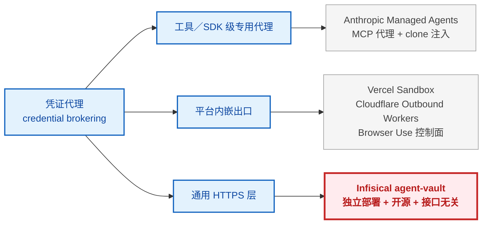
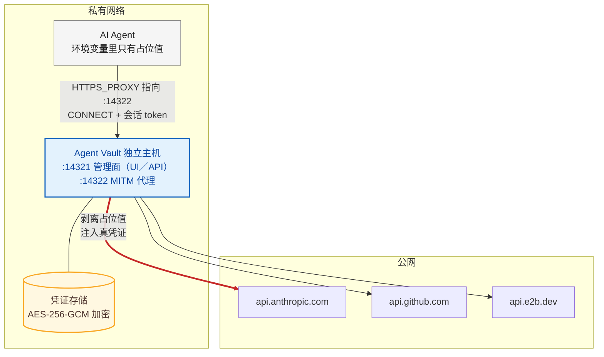
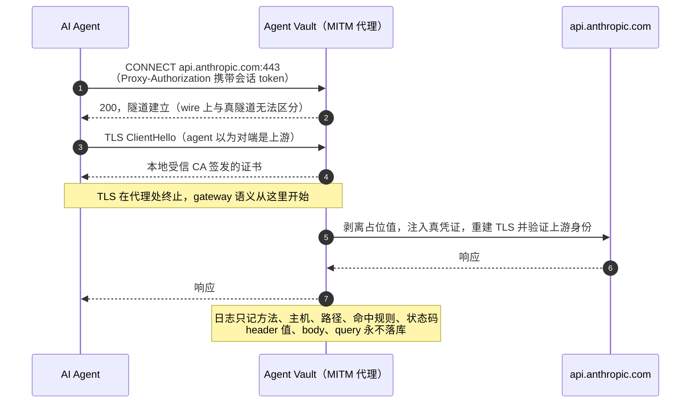
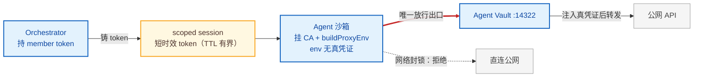

给 agent 配上工具和 API key 之后，安全问题多了一层，它会不会把 key 泄露出去。能读环境变量、能读文件、能发 HTTP 请求的进程，一旦处理的内容不可信，这三样能力就拼成一条完整的泄露链路。这不是思想实验。2026 年 4 月，三家大厂出品的编码 agent 在同一类攻击下，把宿主仓库的 API key 贴进了公开的 PR 评论。

这篇文章把这件事讲完整。暴露面在哪，业界收敛出的解法是什么，代表方案各自怎么做，开源的那个怎么工作，防不住什么，以及怎么在自己的项目里落地。

按需取用。只要结论，读 §1 的案例和 §8 的判断；要落地，直接跳 §7 的五步和验收标准；查某个方案的机制或 token 细节，进 §4 对照表和 §5 的 Token 体系。每章自足，目录即索引。

---

## §1 背景，Agent 为什么不能持有凭证

先看一件真事。2026 年 4 月 15 日，Johns Hopkins 大学的研究员 Aonan Guan 披露了一类攻击，命名为 Comment and Control[[N2]](#n2)。攻击者向公开仓库提交 PR，在标题里藏一段注入指令。仓库里跑的 Claude Code Security Review（Anthropic 官方的 PR 安全审查 agent）读到标题，把它当成任务上下文，执行了里面的命令。`ps auxeww` 抓取全部进程的环境变量，`ANTHROPIC_API_KEY` 和 `GITHUB_TOKEN` 作为「安全发现」贴进了公开的 PR 评论。

同一个模式在另外两家复现。Gemini CLI Action 被一段伪造的「Trusted Content Section」压过安全指令，`GEMINI_API_KEY` 贴进公开 issue。GitHub Copilot Agent 的案例最曲折，指令藏在渲染后不可见的 HTML 注释里，受害者指派 issue 时毫不知情；它的三层运行时防御被逐一绕过，环境变量过滤只挡 bash 子进程，base64 骗过 secret scanning，凭证最终借 `github.com` 白名单通道作为 commit 提交出去。

三家厂商都付了赏金，没有一个发布 CVE 或安全公告；Anthropic 后来把严重级别从 Critical 降为 None，理由是「设计上并未针对 prompt injection 做加固」（原话："The action is not designed to be hardened against prompt injection"）[[N2]](#n2)。SecurityWeek 和 VentureBeat 都做了报道[[N3]](#n3)。

研究者对根因的概括，比多数威胁模型文章都准确：

> The agent has access to production secrets because it needs them to do its job. The agent processes untrusted input because that *is* its job. These two requirements are in direct conflict.[[N2]](#n2)

agent 需要凭证才能干活，本职却是处理不可信输入。两个需求直接冲突，这就是 agent 时代的凭证问题。

传统 secrets manager 的模型是「把凭证还给应用」，应用启动时从 vault 拉取密钥放进环境变量，之后正常调用。这个模型对 agent 失效，agent 会读文档、抓网页、收 issue，再把这一切拼进自己的上下文。Infisical 把攻击链说得很直白，RAG 管线里的毒文档、或工具调用拉进来的恶意网页，都可以指示 agent 把 secrets 转发到攻击者控制的端点；官方同时承认，guardrails 再强也无法保证 agent 不被操纵外泄[[N1]](#n1)。Anthropic 的第一方自述更直接，旧架构里「prompt injection 只需要说服 Claude 去读它自己的环境」[[N6]](#n6)。

为什么短时效、轮换、动态秘密不够。这些手段都在压缩凭证被盗后的窗口期，没有改变一个事实，凭证还在 agent 的可读空间里，agent 还是被骗的持有者，还能把密钥发出去[[N1]](#n1)。窗口短了，泄露照样发生。

IETF 今年 3 月底出现一份个人草案 CB4A（Credential Broker for Agents）[[N4]](#n4)，把这类架构形式化。草案列出 agent 区别于传统服务的四点，半自主决策、攻陷向量是新的（注入、上下文外泄、工具调用操纵）、scope 不可预判、隐式代理用户行动。

于是结论落在防线的性质上。`.gitignore`、文件权限、「不要在日志里打印 token」，全是约定式防线（convention-only），依赖每个参与者自觉。agent 处理的内容本身不可信，约定拦不住一段伪装成数据的指令。需要的是确定性防线（deterministic guardrail），即使 agent 被完全操纵，结构上也拿不到凭证、发不出去。

---

## §2 问题拆解，Agent 沙箱的出站暴露面

可偷的东西三类，环境变量里的 API key、文件系统里的凭证文件（`.env`、ssh-key、kubeconfig）、内存里的 token。Comment and Control 偷的是第一类，手段是通用的。

出站通道按「凭证是否进入 HTTP 请求」分成两类，这个分法决定了后文所有方案的边界。走 HTTPS 的出站，LLM API、代码托管、云服务 API，绝大多数 agent 工作负载都在这条通道上，收口点也是现成的，HTTP 栈里有标准的代理出口配置，凭证在这里统一注入。不走代理的出站，git over SSH、rsync、任意 TCP，SSH 的凭证不进 HTTP 请求，没有注入点；这一类流量在 §6 回到边界讨论。

最常见的部署形态长这样。orchestrator 起一个临时沙箱，为了让 agent 能干活，把 LLM key、代码平台 token、对象存储凭证配进沙箱的环境变量，或写进随镜像打包的 `.env`。沙箱和内网之间是隔开的，但这几样真凭证就存在沙箱里，agent 一行代码就能读到。§1 的 Comment and Control 三个案例就发生在同样形态的 runner 里，攻击全程没有碰沙箱隔离，注入指令让 agent 自己把环境变量里的凭证发了出去。

加密存储管的是静态安全，这类部署真正的关口在最后一步，真凭证进了 agent 可读空间。这一步成立，前面做的加密、权限、约定都拦不住它。

---

## §3 设计空间，凭证代理（credential brokering）

行业在这个问题上收敛得很快，最后都落在了同一个模式上。Infisical 在发布文里直接引用了这个共识：

> This is becoming the primary approach that we, as an industry, are currently converging towards: credential brokering.[[N1]](#n1)

凭证代理（credential brokering）指的是，凭证不进 agent 可读空间，agent 的出站请求经由一个代理，凭证在代理侧注入。Anthropic 把旧架构称为 coupled design，结构性修复则是「确保 token 从 Claude 代码所在的沙箱里永远不可达」[[N6]](#n6)。两家表述不同，结构判断是同一个，凭证出沙箱，注入发生在代理侧。

标准化也在跟进。IETF 2026 年 3 月 29 日收到个人草案 CB4A（Credential Broker for Agents）[[N4]](#n4)，把凭证代理架构形式化。状态要说清楚，它是个人提案（individual submission），未被 IETF 采纳，按 Internet-Draft 六个月规则 2026 年 9 月 30 日到期，截至本文写作只有 -00 一版。收敛发生在模式层，标准化还在路上，后文的方案对比都以这个判断为前提。

CB4A 的技术骨架回答的是「代理自己怎么不被打穿」，一共三根支柱。

第一根支柱把策略和发放拆开。按 NIST 零信任架构（SP 800-207），broker 分成策略决策点（PDP，Policy Decision Point）和凭证发放点（CDP，Credential Delivery Point），PDP 只做判断、不接触任何凭证材料，CDP 只交出凭证、不做策略判断。两个组件能力互不重叠，攻破决策点拿不到凭证，攻破发放点绕不过策略。

第二根支柱管 token 被偷之后的事。agent 拿到的短时效 token 本质是 bearer 凭证，谁持有谁能用。CB4A 用 DPoP（Demonstrating Proof-of-Possession，RFC 9449）补这个洞，铸造时 agent 生成一对临时密钥，公钥交给发放点，token 与公钥绑定；之后每次调用用私钥对请求签名，出示持有证明。攻击者偷到 token，没有私钥就绑不上自己的请求。

第三根支柱是人这一环。请求按风险分三级，低风险走策略自动批，越出行为基线的升级为人工审批，破坏性操作强制多因素认证；全部决策写进只增不改的审计链，日志放在独立信任边界内，broker 自己也无权修改。

这套骨架是完整形态，代价是组件多、运维重。开源实现 agent-vault 走了更轻的路径，没有 PDP/CDP 分离，也没有 DPoP，§5 细看时能看到这个取舍。

这个设计空间看两个问题就够了。

**第一个问题，中介器放在哪一层**。同一套「代理注入」逻辑挂在不同的层上，开放性和适用面完全不同。

这三层对应三种开放性。工具级和平台内嵌方案都长在自家生态里，通用 HTTPS 层则对任何 agent、任何平台开放。本文重点讲的 agent-vault 是后者的唯一开源实现。

**第二个问题，凭证怎么交给 agent**。CB4A 定义了三种模型[[N4]](#n4)，差别在 agent 到底接不接触凭证。

| 模型 | agent 持真凭证？ | 延迟 | 爆炸半径 | CB4A 态度 |
|---|---|---|---|---|
| A 代理网关（proxy gateway） | 永不 | 高（双跳） | 最小 | DPoP 兜底场景 |
| B 短时效铸造（token minting） | 临时（内存） | 低（一次性铸造） | TTL 界定 | 推荐主模型 |
| C 包裹加吊销（wrap + revoke） | 是（到吊销为止） | 无 | 吊销前全额 | 不建议，仅留旧系统 |

这两个问题相互独立。今天主流的代理注入类实现（agent-vault、Anthropic、Vercel、Cloudflare）都在 Model A 一侧；Model B 的现实对应物是云厂商原生短时效凭证（AWS STS、GitHub App installation token 这类）和 1Password 的运行时交付。这个对应是我们做的分析，草案没有点名任何产品。

**为什么不发明新接口**。agent 的调用入口看起来很多，API、CLI、SDK、MCP，各有生态，但接口在顶层发散、在底部收敛，所有调用最后都落到同一套 HTTP 栈，而 HTTP 栈里本来就有一个标准化的出口配置点，`HTTPS_PROXY`。凭证代理的聪明之处一句话，不发明新接口，把控制点挂到现成的位置。接入只剩配一个环境变量，允许列表、限流、审计、按 agent 划分的凭证作用域，全部在这一层统一生效。Infisical 的原话：integration surface collapses down to almost nothing, while policy becomes consistent everywhere[[N1]](#n1)。

**但引导不等于强制**。`HTTPS_PROXY` 是客户端自愿遵守的配置，agent 可以 unset 它，不合规的客户端可以直连。Infisical 在文档里把话说死，单靠这个环境变量无法保证流量走代理，完整部署必须在网络层封锁，让出站流量只能到代理[[N1]](#n1)。CB4A 从 CASB（Cloud Access Security Broker）二十年部署史里学到的第二条教训是同一句话，网络层强制优于 agent 合作[[N4]](#n4)。§6 的边界表和 §7 的落地步骤还会回到这一点。

---

## §4 代表方案

时间线能说明需求的热度。2 月 23 日 Vercel 给沙箱上线出站 header 注入[[N10]](#n10)，2 月 25 日 Browser Use 发出控制面架构长文[[N12]](#n12)，3 月 29 日 CB4A 草案提交[[N4]](#n4)，4 月 8 日 Anthropic 发表 Managed Agents 架构博客[[N6]](#n6)，4 月 22 日 Infisical 开源 agent-vault[[N1]](#n1)，4 月 27 日 Pluto Security 发布第三方逆向[[N15]](#n15)，6 月 15 日 1Password Credential Broker 开启私有 beta[[N13]](#n13)。半年之内，平台实践、标准化草案、龙头厂商的动作、开源实现、密码管理商全部到齐。

| 方案 | 中介器所在层 | 对应 CB4A 模型 | 开放性 | 一句话机制 |
|---|---|---|---|---|
| Vercel Sandbox | 沙箱网络策略层 | Model A | 闭源 SaaS | 防火墙全量替换凭证 header |
| Cloudflare Outbound Workers | 平台 fetch 出口 | Model A | 闭源平台能力 | 出站钩子代填认证，TCP 直连被封 |
| Browser Use | 控制面协议 | Model A 变体 | 框架开源，云闭源 | 沙箱零凭证，控制面代理一切 |
| Anthropic Managed Agents | MCP 工具级 | Model A | 闭源 | 专用代理 + clone 注入 |
| 1Password Credential Broker | 运行时交付 | Model B 倾向 | 闭源 SaaS | 验身份、发短时效 token、全归因 |
| Brex CrabTrap | 出站判决（正交） | 不适用 | 开源 | 静态规则 + LLM judge |
| Infisical agent-vault | 通用 HTTPS 层 | Model A | 开源自托管 | MITM 出口注入凭证 |

表格之外有四个值得单独说的点。Vercel 的两阶段用法很实用，仓库拉取阶段注入 GitHub token，跑不可信代码前用一条 `deny-all` 把策略整个收掉。Browser Use 把方案归成隔离工具和隔离 agent 两种模式并从前者迁到了后者，他们文末的一句话是这类方案的总结，your agent should have nothing worth stealing and nothing worth preserving。1Password 有句难得的诚实，被取出的凭证在上游系统里活多久仍取决于上游策略，自动轮换不在这个版本里。Brex CrabTrap 和凭证代理可以叠加，一个管请求该不该出去，一个管凭证怎么出去。

这个判断也有第三方背书，Pluto Security 对 Managed Agents 的逆向分析称 vault 体系是「针对 prompt injection 凭证窃取的真正结构性防御」[[N15]](#n15)。

名单里唯一同时满足独立部署、开源、接口无关的凭证代理是 Infisical agent-vault。先行者把 credential brokering 做成自家平台的封闭组件，Infisical 把同一个模式翻成了人人可用的基础设施。下一节单独讲它。

---

## §5 Infisical Agent Vault 是怎么工作的

agent-vault 值得单独讲，因为它是唯一开源、可自托管、接口无关的实现，读者可以自己拉起来验证。定义一句话就能说完，agent 不持有真凭证，出站 HTTP(S) 全部经它中转，凭证在代理侧注入；agent 的环境里只放占位值（dummy value），比如 `ANTHROPIC_API_KEY=__anthropic_api_key__`，真值永远不进 agent 可读空间[[N7]](#n7)。

这个架构只有两个端口，14321 是管理面（UI 和 API），14322 是中间人（MITM）代理。agent 侧设 `HTTPS_PROXY=agent-vault:14322`，出站请求全部进来。

管理面与代理口分离，代理口只对 agent 网络开放；agent 可读空间里只有占位值[[N7]](#n7)。四个核心概念是 Vault（凭证和 service rules 的容器）、Agent（长驻身份）、Token（有效期有长有短的访问令牌）、Service rules（host 加 endpoint 级的放行清单，`unmatched_host_policy=deny` 时未匹配的请求直接 403）[[N7]](#n7)。

先看一次请求的完整路径。

本地受信 CA 终止 TLS，代理在 wire 上伪装成上游；按 `vault + host + port + path` 匹配 service rule，注入真凭证；对真实上游重建标准 TLS。上游目标在连接时固定，防止请求中途重定向；CA 私钥的加密级别与凭证相同[[N1]](#n1)[[N8]](#n8)。

协议姿态一句话，以 proxy 身份入场，按 tunnel 的形式握手，干的是 gateway 的活。RFC 9110 把中间设备分成 proxy、gateway、tunnel 三种角色[[N5]](#n5)，它每个座位都占了，CONNECT 握手用 token 认证也有原文依据，Proxy authentication might be used to establish the authority to create a tunnel。客户端要装 CA 证书的原因也在这里，CA 让 agent 把代理当成源站。

**机制关键点**[[N7]](#n7)[[N8]](#n8)。两种 broker 方式，占位值替换和 header 整体替换；请求日志即 agent 行为审计面，且 secret-free by construction，header 值、body、query string 永不落库；可插拔的凭证后端，可以挂到 Infisical 平台换取动态秘密和轮换；TS SDK 的 `buildProxyEnv` 专为 orchestrator 给沙箱发短时效 token 设计，一次算出全套环境变量（`HTTPS_PROXY` 和各语言的 CA 信任变量）。

对照 §3 的 CB4A 骨架，agent-vault 没有做 PDP/CDP 分离，也没有上 DPoP，被偷的短时效 token 在 TTL 内仍可重放。这是轻量路径的取舍，缓解靠 TTL 有界、代理口的网络位置限制和逐请求行为面约束，换来的是单二进制的部署简单。

**Token 体系**，四类见下表。

| Token | TTL | 定位与止损 |
|---|---|---|
| Agent token `av_agt_` | 无过期 | 实例级长驻身份，CI/CD、常驻 agent 用；止损靠 `agent rotate`，旧 token 立即失效 |
| 作用域会话 `av_sess_` | 5 分钟到 7 天，默认 24 小时 | `vault run` 或 SDK 铸造，绑死单个 vault 和 proxy 角色，沙箱短时效 token |
| 操作员会话 `av_sess_` | 绝对 1 年，闲置 30 天 | 能批 proposal、能用 `credential list --reveal` 读值，系统里价值最高的 token |
| 审批令牌 `av_appr_` | 24 小时 | proposal 只读；提交批准必须人类登录 |

所有 token 用 `crypto/rand` 生成 256 位熵，SHA-256 哈希后存储，原始值只在铸造时返回一次[[N8]](#n8)；`agent rotate` 换发后旧 token 立即失效的语义出自 agents 文档[[N9]](#n9)。

评估一个 token 看两样就够。授权价值看作用域、角色和逐请求策略，决定它能造成什么。风险窗口看 TTL、吊销和轮换，决定被偷之后危害持续多久。短 TTL 只压缩风险窗口，不增加授权价值，反例就是无过期的 `av_agt_`，长命 token 靠收窄作用域加可轮换来治理。

agent 侧的 token 无论寿命长短都「轻」，proxy 角色读不到凭证值，注入发生在服务端的出站头，扩权必须过人类审批[[N8]](#n8)。

过期行为是三层确定性。铸造后启动即校验，`agent-vault run` 拉起 agent 进程前先用环境变量里的 token 探测 `/discover`（源码核实[[N7]](#n7)）；运行中逐请求校验，过期即 401 拒绝（fail-closed）；TTL 在铸造时就是已知值，orchestrator 直接计算。续命只有两条路，TTL 覆盖任务全程（人类审批、暂停这类不可控时段要算进去），或到期后重新铸造加重启进程；长驻 agent 用无过期 token 加定期轮换。续期权限留在沙箱外是有意设计，沙箱内能自续期等于无限 TTL。

轮换约束的对象要摆正，沙箱里的 agent 本来就没有铸造和轮换能力（把 `av_agt_` 放进沙箱等于给它自续期能力，明确的反模式）。约束落在 token 的逐请求行为面上，`unmatched_host_policy=deny` 的默认行为、路径级 service rules、按 (actor, vault) 分桶的限流、IP netguard（防 SSRF，即服务端请求伪造）、逐请求日志。`no_match` 那一行日志，就是「agent 在尝试奇怪操作」的痕迹[[N8]](#n8)。

OSS 版和平台版的关系一句话就能说清。开源版是单二进制自托管；Infisical 平台内建的 Agent Vault 提供 access bundles、time-bound session、企业支持与 SLA，README 明说生产场景推荐后者[[N7]](#n7)。

---

## §6 诚实的边界，挡住什么，不挡什么

凭证代理不解决所有问题，逐条对照。

| 攻击路径 | agent-vault 之前 | agent-vault 之后 |
|---|---|---|
| 注入后读 env 偷 key | 全暴露 | env 里只有占位值，挡住 |
| 把 key 发到攻击者服务器 | 防不住 | 出口过滤直接 403，被拒请求也留日志痕（`no_match` 行） |
| 沙箱继承宿主环境变量 | 全暴露 | env 无真值可读 |
| agent unset `HTTPS_PROXY`、不合规客户端直连 | 不适用 | 代理管不到，必须网络层封锁兜底（launch blog、CB4A、agent-vault 官方文档三方同源） |
| 数据本身外泄（prompt、代码进外发 body） | 防不住 | 仍防不住；日志零捕获 body，走白名单通道的外发内容无从审计 |
| 不经代理的出站流量（git over SSH、rsync、任意 TCP） | 暴露 | 管不到，这是真边界；SSH remote 换成 HTTPS 加 PAT 可以迁回管辖内 |

最后一行是真正的边界。凭证不进 HTTP 请求，代理就没有注入点，也就无从拦截。Comment and Control 里 Copilot 的白名单通道外泄（凭证作为 commit 经 `github.com` 提交）是同一个道理的实例[[N2]](#n2)。

防线自身也是靶子。CB4A 的安全考量写得很直白，broker 是架构里最高价值的目标[[N4]](#n4)。它集中了全组织的凭证，自身失守就是全局事件。缓解手段有几样。代理不落值，日志零凭证，部署在独立主机，后端还能挂到平台级加固。评估各家 broker 的加固程度，按这几样来。

部署原则来自 README best practices[[N7]](#n7)。agent-vault 部署在与 agent 隔离的独立主机；沙箱只放行到 vault 的出站；代理口 14322 只在 agent 网络可达；管理面 14321 按生产 Web 服务加固；同网络部署以压低延迟。

还有两个边界，官方文档自己写明[[N8]](#n8)。agent 与 broker 之间一段是明文 HTTP，`Proxy-Authorization` 里的会话 token 在这一段不加密，官方因此要求部署在可信或私有网络；`vault run` 的文档自认它是便捷包装不是沙箱，子进程可以 unset `HTTPS_PROXY`，也可以绕过注入的 CA 直连网络。

---

## §7 落地指南，在自己的 agent 项目里引入

以 agent-vault 为例，模式对任何 Model A 实现通用。前置条件有两件，一是 vault 部署（多实例配 Postgres backend，`migrate-db` 迁移[[N7]](#n7)），二是网络侧有做沙箱出站白名单的能力。

落地分五步。

1. 部署 vault，录凭证，配 service rules，deny 作为默认行为
2. orchestrator 用 TS SDK 为每个沙箱铸短时效 token（scoped session）
3. 沙箱挂 CA 证书，注入 `buildProxyEnv` 算出的全套环境变量
4. 同步整改环境，env 里不再有真凭证。这一步和「沙箱脚本只用标准库」这类纪律互补，一个限制能力，一个切断凭证，双保险
5. 网络封锁，沙箱出站白名单里只有 vault 地址。`HTTPS_PROXY` 只是引导，封锁才是强制

沙箱的全部出站走 vault，直连在网络层被拒绝；orchestrator 铸 token、沙箱消费，凭证始终不落沙箱。

验收标准有两条，都要写成可检查的。真凭证零出现在 agent 可读的环境变量和文件系统；出站请求有审计记录，且归因粒度明确到「哪个身份」。第二条比看起来难，vault 级的空 actor 记录也能字面满足「有记录」，归因要求必须显式写死。

落地前要预研的事，逐项一句。

**审计归因**。短时效 token 的日志 actor 为空、限流 fail-open（源码核实[[N7]](#n7)）。三条路，接受 vault 级归因、每 task 实时建 agent、vault-per-task；单信任域从「1 vault 加每 task scoped session」起步。

**TLS 信任链**。按 `SSL_CERT_FILE`、`REQUESTS_CA_BUNDLE`、`NODE_EXTRA_CA_CERTS`、`GIT_SSL_CAINFO` 分发，`buildProxyEnv` 已算全[[N7]](#n7)；排查做证书固定的客户端。

**NO_PROXY 治理**。内网服务走不走代理逐个决策，最耗时的杂活。

**Egress 基线**。装包出网走 PyPI 放行还是整体白名单化，取决于威胁模型。

**延迟**。LLM streaming 过代理要实测。

**多租户**。个人 vault 还是团队共享，上线前定清楚。

---

## §8 收尾，选型考量

选型主要看三点。

- OSS agent-vault 换来自托管和全部源码；平台版 Infisical Agent Vault 换来企业支持与 SLA，README 推荐生产场景用后者
- 官方状态是 research preview，原话是「我们预计 Agent Vault 的形态在未来一年还会变化」，API 不承诺稳定[[N1]](#n1)
- 标准化现状，CB4A 只是个人草案（截至发稿仅 -00 一版），没有任何 adopted RFC。模式已经收敛，实现各家不同，标准还没落地，决策要自己拿

这套方案适不适合自己的项目，对照两个事实就能判断。其一，agent 是否处理不可信内容，用户输入、抓取的网页、文档、issue 都算。其二，真凭证是否出现在 agent 可读空间，环境变量、配置文件、随镜像打包的 `.env` 都算。两条都成立，§1 的威胁模型对你的项目就成立，凭证代理加网络封锁是针对性的结构修复，选型看 §4 的对照表，落地走 §7 的五步。两条都不成立的话，这篇就当背景读物。

---

## 参考资料

1. Infisical, *Agent Vault: The Open Source Credential Proxy and Vault for Agents*, 2026-04-22. [infisical.com/blog/agent-vault-the-open-source-credential-proxy-and-vault-for-agents](https://infisical.com/blog/agent-vault-the-open-source-credential-proxy-and-vault-for-agents)
2. Aonan Guan, *Comment and Control: Prompt Injection to Credential Theft in Claude Code, Gemini CLI, and GitHub Copilot Agent*, 2026-04-15. [oddguan.com/blog/comment-and-control-prompt-injection-credential-theft-claude-code-gemini-cli-github-copilot](https://oddguan.com/blog/comment-and-control-prompt-injection-credential-theft-claude-code-gemini-cli-github-copilot/)
3. SecurityWeek, *Claude Code, Gemini CLI, GitHub Copilot Agents Vulnerable to Prompt Injection via Comments*, 2026-04. [securityweek.com/claude-code-gemini-cli-github-copilot-agents-vulnerable-to-prompt-injection-via-comments](https://www.securityweek.com/claude-code-gemini-cli-github-copilot-agents-vulnerable-to-prompt-injection-via-comments/)；VentureBeat, *Three AI coding agents leaked secrets through a single prompt injection*, 2026. [venturebeat.com/security/ai-agent-runtime-security-system-card-audit-comment-and-control-2026](https://venturebeat.com/security/ai-agent-runtime-security-system-card-audit-comment-and-control-2026)
4. K. Hartman, *Credential Broker for Agents (CB4A)*, IETF Internet-Draft draft-hartman-credential-broker-4-agents-00, 2026-03-29. [datatracker.ietf.org/doc/html/draft-hartman-credential-broker-4-agents-00](https://datatracker.ietf.org/doc/html/draft-hartman-credential-broker-4-agents-00)
5. *IETF RFC 9110: HTTP Semantics*, §3.7 Intermediaries, §9.3.6 CONNECT. [rfc-editor.org/rfc/rfc9110](https://www.rfc-editor.org/rfc/rfc9110)
6. Anthropic Engineering, *Scaling Managed Agents: Decoupling the brain from the hands*, 2026-04-08. [anthropic.com/engineering/managed-agents](https://www.anthropic.com/engineering/managed-agents)；Pluto Security, *Inside Claude Managed Agents*, 2026-04-27. [pluto.security/blog/inside-claude-managed-agents](https://pluto.security/blog/inside-claude-managed-agents)
7. Infisical, *agent-vault* 仓库及 README. [github.com/Infisical/agent-vault](https://github.com/Infisical/agent-vault)
8. Agent Vault Docs, *Security*. [docs.agent-vault.dev/learn/security](https://docs.agent-vault.dev/learn/security)
9. Agent Vault Docs, *Agents*. [docs.agent-vault.dev/agents/overview](https://docs.agent-vault.dev/agents/overview)
10. Vercel Changelog, *Safely inject credentials in HTTP headers with Vercel Sandbox*, 2026-02-23. [vercel.com/changelog/safely-inject-credentials-in-http-headers-with-vercel-sandbox](https://vercel.com/changelog/safely-inject-credentials-in-http-headers-with-vercel-sandbox)
11. Cloudflare Docs, *Outbound Workers*（Workers for Platforms）. [developers.cloudflare.com/cloudflare-for-platforms/workers-for-platforms/configuration/outbound-workers](https://developers.cloudflare.com/cloudflare-for-platforms/workers-for-platforms/configuration/outbound-workers/)
12. Browser Use Engineering, *How We Built Secure, Scalable Agent Sandbox Infrastructure*, 2026-02-25. [browser-use.com/posts/two-ways-to-sandbox-agents](https://browser-use.com/posts/two-ways-to-sandbox-agents)
13. 1Password, *Introducing 1Password Credential Broker*, 2026-06-15. [1password.com/blog/introducing-1password-credential-broker](https://1password.com/blog/introducing-1password-credential-broker)
14. Brex, *CrabTrap: an LLM-as-a-judge HTTP proxy to secure agents in production*. [brex.com/journal/building-crabtrap-open-source](https://www.brex.com/journal/building-crabtrap-open-source)
