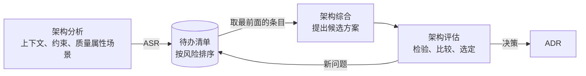

## 1. 架构是什么

Grady Booch 用变更成本来界定架构：

> Architecture represents the significant design decisions that shape a system, where significant is measured by cost of change.
>
> 架构是塑造系统的重要设计决策，"重要"以变更成本衡量。[1]

按这个标准，模块边界、模块间接口、状态的存储位置、对外部依赖的抽象都属于架构，因为这些决策落地后再修改，要跨模块、跨团队，甚至迁移数据。函数拆分、字段命名、局部算法只影响单个模块，修改成本低，留到实现阶段决定。

George Fairbanks 指出，有三种情况最需要专门的架构设计：解空间小，失败风险高，质量属性要求难以满足 [2]。三种情况都不符合的系统，不必单独做架构设计。

下文用一个例子贯穿始终：某电商平台要重建**下单服务**。它接收用户下单，调用外部支付渠道收款，并通知库存服务扣减库存。

## 2. 设计过程

Hofmeister、Kruchten、Nord 等人比较了五种工业界的架构设计方法，发现它们虽然术语各异，但都由三项活动组成 [3]：

- **架构分析**（architectural analysis）：界定架构要解决的问题，产出对架构有重大影响的需求（architecturally significant requirement，ASR）。
- **架构综合**（architectural synthesis）：针对 ASR 提出候选方案。这是从问题转向解法的一步，也是架构设计的核心。
- **架构评估**（architectural evaluation）：用 ASR 检验候选方案，确认决策正确。

三项活动不是按顺序各做一遍：

> [The three main activities] do not proceed sequentially, but rather proceed in small leaps and bounds as architects move constantly from one to another, "growing" the architecture progressively over time.
>
> 三项主要活动并不按顺序进行，而是小步推进，架构师不断在它们之间切换，让架构随时间逐步"生长"出来。[3]

这样做有两个原因：问题彼此关联、数量太多，无法一次全部解决；目标和约束等输入开始时往往不清楚，要等架构逐步成形才能明确 [3]。

推动这个循环的是一份待办清单（backlog）。清单上的条目形如"需要对 X 做出决策"或"应当研究 Y 以解决 Z"，来源有三处：分析中挑出的 ASR，评估中暴露的问题，架构师的经验与讨论。架构师按风险给清单排序，每次取最前面的少数几项做综合和评估。解决的条目移出清单，新发现的问题再放回清单 [3]。

清单不会一次清空，因此需要判断何时停止。Fairbanks 的风险驱动模型给出的规则是：设计投入与风险相称，风险小的问题不必精细设计，危及成败的问题不能草率处理 [2][4]。清单最前面的条目剩余风险都可以接受时，工作就转入以实现为主；实现中暴露的问题仍然放回清单。

第一版系统应当尽量简单。John Gall 观察到，能运行的复杂系统都是从能运行的简单系统演化而来的，从零设计的复杂系统无法运行，也修补不好 [5]。

## 3. 架构分析：界定问题

分析回答"这个系统难在哪里"。每一轮迭代开始前，都要把当时已知的上下文、约束和质量属性整理出来。后续发现新的内容，就补进待办清单。

### 3.1 上下文与干系人

先确定系统边界：哪些部分归本系统负责，哪些是外部系统，外部系统通过什么接口交互。再确定干系人：谁提出需求，谁验收，谁对取舍拍板。Hofmeister 等人把这些称为架构上下文，包括业务目标、组织特点（如团队技能、可用工具）和技术现状 [3]。

下单服务的上下文如下：

- **边界内**：订单的创建、支付、取消。
- **外部系统**：支付渠道（第三方）、库存服务（其他团队负责）、用户端应用。
- **干系人**：业务方提出可用性和接入新渠道的要求；运维团队负责部署平台。

### 3.2 约束

约束是不可协商的前提，常见的有预算、上线期限、既定技术栈、部署平台、合规要求和团队能力。下单服务的约束是：3 个月内上线；部署在公司现有的 Kubernetes 集群；团队熟悉 PostgreSQL；按合规要求，支付卡数据不得保存在本系统。

"服务要水平扩展"这类要求不算约束，属于质量属性，应当写成下一小节的场景。由它推出的"状态不能保存在进程内"是设计结论，属于综合阶段的产出。

### 3.3 质量属性场景

功能需求在大多数架构下都能实现，决定方案优劣的是可用性、性能、可修改性等质量属性。"高可用""易扩展"这样的表述无法检验，SEI 的质量属性场景（quality attribute scenario）把它们拆成六个部分 [6]。下单服务最重要的两个场景如下：

| 部分 | 场景 A：可用性 | 场景 B：可修改性 |
|---|---|---|
| 来源（Source） | 基础设施 | 业务方 |
| 刺激（Stimulus） | 数据库主节点宕机 | 要求接入第二家支付渠道 |
| 环境（Environment） | 业务高峰期 | 系统已上线运行 |
| 对象（Artifact） | 下单服务 | 下单服务代码 |
| 响应（Response） | 切换到备节点，已提交的订单不丢失 | 新增渠道接入，订单逻辑不变 |
| 响应度量（Response Measure） | 30 秒内恢复写入，订单丢失数为 0 | 2 人周内完成，订单模块零修改 |

响应度量必须可量化，评估阶段要用它逐项检验方案。

### 3.4 风险排序与场景分级

每个 ASR 都按"方案达不到它"的风险排序。Fairbanks 把风险定义为失败概率与影响的乘积 [7]。场景 A 一旦失败，高峰期会直接损失订单，排第一。场景 B 失败只会拖慢新渠道上线，排第二。

同时把场景分为三级，并与干系人确认：

- **当前支持**：高风险和必须支持的场景，例如场景 A。
- **预留扩展**：可能出现但尚不确定的场景，例如场景 B。第一版只接一家渠道，但结构上要能加第二家。
- **明确不支持**：例如跨区域多活。写入文档，避免每次评审重复讨论。

分级的作用是确定第一版不做什么。按 Gall 定律，第一版只实现"当前支持"一级。

## 4. 架构综合：提出候选方案

综合针对待办清单最前面的 ASR 提出方案。候选方案可以是相互替代的几个完整方案，也可以只是架构的局部片段 [3]。

### 4.1 候选方案的来源

候选方案很少凭空构思，通常来自已有的设计知识：

- **战术**（tactic）：Bass、Clements、Kazman 把战术定义为"影响某个质量属性响应控制的设计决策"[8]，并按质量属性整理了战术目录。例如，可用性战术里有主动冗余和被动冗余。
- **架构模式与参考架构**：模式是若干战术的组合 [8]，例如分层架构、端口与适配器。
- **已有系统的做法**：团队过去的方案，同行公开的案例。

风险最高的 ASR 建议至少准备两个候选方案。只有一个方案时，看不出它的代价，也就谈不上权衡。

以场景 A 为例，可用性战术给出两个候选方案：

- **方案 A1，同步复制**：主节点每次写入都要等备节点确认。主节点宕机后，备节点的数据与主节点一致，可以直接接管。
- **方案 A2，异步复制**：主节点写入后立即返回，再异步复制到备节点。宕机时，尚未复制的写入可能丢失。要做到零丢失，需要额外的补偿机制，例如先把订单写入消息队列，切换后重放。

### 4.2 不同的 ASR 在不同的视图里回答

Bass 等人把架构结构分为三类 [9]：

- **模块结构**：代码如何划分，各模块承担什么职责。
- **组件与连接件结构**：运行时有哪些组件，它们如何交互。
- **分配结构**：软件如何映射到硬件、部署环境和团队。

场景 A 是运行时问题，涉及节点、复制和切换，要在组件与连接件视图和部署视图中回答。场景 B 是代码组织问题，要在模块视图中回答。只画模块图的设计，回答不了可用性、性能、一致性这类问题。

下面三小节讲模块视图里的结构原则，以场景 B 为例。

### 4.3 从领域实体出发

先识别领域实体，明确每个实体何时创建、何时消亡，以及实体之间的关系。下单服务的实体有三个：

- **订单**：经历待支付、已支付、已取消、已完成几个状态。
- **支付单**：记录一次收款尝试。
- **支付渠道**：外部的收款方。

只要业务问题不变，这些实体就基本稳定，变化的是实体的实现方式。实体大致决定了模块边界的位置。边界具体怎么划、接口怎么定，取决于下一小节讲的易变决策。

### 4.4 按易变的设计决策划分模块

一种常见的划分方式是按处理流程拆，下单服务会被拆成下单处理器、支付处理器、支付回调处理器、超时取消处理器。这样一来，"订单状态如何流转"这一项决策，四个处理器都得知道。以后新增一个状态，四处都要改。

David Parnas 在 1972 年的论文里比较过这两种思路，结论是：

> it is almost always incorrect to begin the decomposition of a system into modules on the basis of a flowchart. We propose instead that one begins with a list of difficult design decisions or design decisions which are likely to change. Each module is then designed to hide such a decision from the others.
>
> 以流程图为依据开始将系统分解为模块，几乎总是错误的。我们建议从一份清单出发，列出困难的或可能变化的设计决策，然后让每个模块对其他模块隐藏其中一项。[10]

John Ousterhout 把按流程划分称为时序分解（temporal decomposition）。一项设计决策同时体现在多个模块中，他称为信息泄露（information leakage），并指出时序分解是信息泄露最常见的原因之一 [11][12]。

按 Parnas 的方法，下单服务先列出易变的决策：订单状态规则，与支付渠道交互的协议，库存扣减的方式。然后每项决策由一个模块封装：

- **订单模块**：封装订单状态规则。下单、回调、超时取消都通过它改变订单状态。
- **支付模块**：封装与渠道的交互，每家渠道一个适配器。
- **库存模块**：封装库存服务的调用方式。

衡量模块划分得好不好，Ousterhout 的标准是接口远比实现简单。这样的模块他称为深模块（deep module）：变更只要不碰接口，就不会影响其他模块 [12]。

以操作命名的模块（`Handler`、`Processor`、`Cleanup`）是一个预警信号。这类名称往往对应流程步骤，几个这样的模块很可能在共同承担同一项决策。

### 4.5 依赖方向：核心定义接口，外部实现接口

变化沿依赖传播：被依赖的一方变了，依赖它的一方也要跟着改 [13]。所以，稳定的部分不应依赖易变的部分。

Robert C. Martin 的依赖倒置原则（Dependency Inversion Principle）规定：高层模块不依赖低层模块，两者都依赖抽象；抽象不依赖细节，细节依赖抽象 [14]。Alistair Cockburn 的六边形架构（Hexagonal Architecture，又称端口与适配器）把这条原则用在系统边界上：核心逻辑定义端口，外部技术通过适配器接入 [15]。

在下单服务里，订单模块定义"支付网关"接口，每家渠道写一个适配器实现它，依赖方向从适配器指向订单模块。接入第二家渠道时，只需新增一个适配器，订单模块不动，满足场景 B 的响应度量。

## 5. 架构评估：检验与选择

评估把候选方案逐个对照 ASR。结果要么是选定方案、记录决策，要么是暴露出新问题，放回待办清单。

### 5.1 用场景检验

对每个场景，判断候选方案能否达到响应度量。纸面分析不够时，就做原型或局部实现来验证。Hofmeister 等人指出，评估最终要用到实现层面的知识，才能确认系统造得出来 [3]。

场景 A 的检验结果：

| 候选方案 | 订单丢失数为 0 | 30 秒内恢复写入 | 代价 |
|---|---|---|---|
| A1 同步复制 | 满足 | 需在集群上演练切换后确认 | 每次写入多一次网络往返，写延迟增加；备节点故障时，主节点要降级为单节点写入 |
| A2 异步复制加补偿 | 补偿机制正确时满足 | 满足 | 增加消息队列和重放逻辑；重放必须幂等，要多维护一个组件 |

场景 B 的检验用变化推演：列出可能发生的变化，统计每项变化涉及几个模块。

| 可能的变化 | 涉及的模块 | 是否符合预期 |
|---|---|---|
| 接入第二家支付渠道 | 新增一个支付适配器 | 符合 |
| 新增"部分退款"订单状态 | 订单模块 | 符合 |
| 库存服务改为异步扣减 | 库存模块，可能还有订单模块 | 需确认订单状态是否要新增"待确认库存" |

一项变化涉及多个模块，说明对应的决策没有封装好，要回到综合阶段调整。

### 5.2 比较方案

Mark Richards 和 Neal Ford 把"软件架构中的一切都是权衡"称为软件架构第一定律。由此可以推论，如果某个方案看起来没有代价，更可能是代价还没找到 [16]。所以上面的检验表里，每个方案都有"代价"一栏。

比较复杂度时，Rich Hickey 的区分很有用：简单（simple）指各部分不相互交织，是客观属性；容易（easy）指熟悉、顺手，是相对的 [17]。比较两个方案的复杂度，看的是各自有多少处交织，而不是用到的组件多不多、团队熟不熟。方案 A2 多出的消息队列和重放逻辑，与订单写入路径交织在一起：重放是否幂等，取决于订单模块的实现。这是 A2 复杂度的主要来源。

下单服务最终选择 A1。理由是：场景 A 风险最高，A1 用更少的机制满足"订单丢失数为 0"；写延迟增加在当前流量下可以接受，但需要压测确认。压测这一项放回待办清单。

评审已有方案时也要先识别权衡。对现有设计提出批评之前，应当先能说明它为什么这样设计，再判断它依赖的前提在新约束下是否仍然成立。

### 5.3 记录决策

选定方案后，用架构决策记录（Architecture Decision Record，ADR）写下背景、决策和后果 [18]。Richards 和 Ford 的第二定律是"为什么比怎么做更重要"[16]：后来的人只有知道决策的前提，才能判断前提变化后能否修改这项决策。Michael Nygard 要求后果一栏把正面、负面和中性的后果都列出来。他还指出，没有记录理由的决策，新成员只能盲目接受或盲目修改 [18]。

方案 A1 的 ADR 后果一栏应写明：写延迟增加；备节点故障时的降级策略；如果流量增长使写延迟不可接受，需要重新评估 A2。

## 6. 记录与表达

设计文档记录的是上述过程的产出。Simon Brown 的 C4 模型把架构图分为四个层级：系统上下文（Context）、容器（Container）、组件（Component）、代码（Code）。不同层级面向不同读者，多数团队画前两层就够了 [19]。

一张图只呈现一个层级，文字也一样。模块的内部实现，例如订单模块内部的状态表结构，只写在该模块的章节里，不放进总览。系统边界之外的部分，例如库存服务，只写它与本系统的接口。

设计文档可以按以下顺序组织：

1. **背景与问题**：上下文与干系人、约束、质量属性场景、风险排序、场景分级。
2. **领域模型**：实体、生命周期、业务规则。
3. **候选方案与比较**：每个高风险 ASR 的候选方案、检验结果、选择理由。关键决策另写 ADR。
4. **选定方案总览**：系统上下文图、容器图、模块划分与依赖方向，运行时与部署视图。
5. **模块设计**：每个模块一章，写职责、接口、内部结构和存储。
6. **迁移与后续**：迁移方案（有存量系统时）、待验证事项、剩余风险。

有存量系统时，在第 1 部分之后加一节"现有方案分析"：先说明现有方案为什么这样设计，再指出哪些前提已经不成立。

## 7. 自查清单

**分析**

- [ ] 系统边界和干系人是否明确？谁对取舍拍板？
- [ ] 约束是否只包含不可协商的前提？
- [ ] 关键质量属性是否都写成了带响应度量的场景？
- [ ] ASR 是否按风险排序？场景是否已分级并与干系人确认？

**综合**

- [ ] 风险最高的 ASR 是否有两个以上的候选方案？方案是否参考了已有的战术或模式？
- [ ] 运行时类的 ASR（可用性、性能、一致性）是否在运行时或部署视图里得到回答？
- [ ] 每个模块封装的是哪项设计决策，能否明确说出？
- [ ] 是否有以操作或流程步骤命名、共同承担同一项决策的模块？
- [ ] 外部依赖是否通过核心定义的接口接入？

**评估**

- [ ] 每个候选方案是否都对照场景的响应度量检验过？纸面分析不足的地方是否做了原型验证？
- [ ] 是否做过变化推演？
- [ ] 每个候选方案的代价是否写明？
- [ ] 关键决策是否写了 ADR，后果是否列全？

**表达**

- [ ] 每张图是否只呈现一个层级？
- [ ] 模块的内部细节是否只出现在该模块的章节中？

## 参考文献

| 编号 | 出处 | 核对程度 | 链接 |
|---|---|---|---|
| 1 | Grady Booch, "On Design", 2006；转引自 Buschmann 等, *Pattern-Oriented Software Architecture, Vol. 5*, 2007, p. 214 | 转引 | [Wikiquote](https://en.wikiquote.org/wiki/Grady_Booch) |
| 2 | George Fairbanks, *Just Enough Software Architecture: A Risk-Driven Approach*, 2010 | 作者书页原文 | [作者书页](https://georgefairbanks.com/book) |
| 3 | C. Hofmeister, P. Kruchten, R. L. Nord, H. Obbink, A. Ran, P. America, "A general model of software architecture design derived from five industrial approaches", *Journal of Systems and Software* 80(1), 2007, pp. 106–126 | 论文原文，逐字对照 | [论文 PDF](http://courses.ece.ubc.ca/417/public/Hofmeister.pdf)、[DOI](https://doi.org/10.1016/j.jss.2006.05.024) |
| 4 | George Fairbanks, "A Risk-Centric Model of Software Architecture" | 作者网站原文 | [原文](https://georgefairbanks.com/blog/risk-centric-model-of-software-architecture) |
| 5 | John Gall, *Systemantics*, 1975 | 转引，原书未核对 | [Laws of Software Engineering](https://lawsofsoftwareengineering.com/laws/galls-law/) |
| 6 | George Fairbanks, "Dilbert on quality attributes, and what you should know about quality attribute scenarios", 2010；模板源自 SEI | 经 Fairbanks 转述 | [原文](https://georgefairbanks.com/blog/dilbert-on-quality-attributes/) |
| 7 | George Fairbanks, *Just Enough Software Architecture*, 第 3 章 | 章节节选原文 | [Methods & Tools 节选](https://www.methodsandtools.com/archive/agilesoftwarearchitecture.php) |
| 8 | L. Bass, P. Clements, R. Kazman, *Software Architecture in Practice*, 2nd ed., 2003, §5.1–5.2 | 书籍原文（课程镜像） | [§5.1](https://people.ece.ubc.ca/matei/EECE417/BASS/ch05lev1sec1.html)、[§5.2](https://people.ece.ubc.ca/matei/EECE417/BASS/ch05lev1sec2.html) |
| 9 | 同上, §2.5 "Architectural Structures and Views" | 书籍原文（课程镜像） | [§2.5](https://people.ece.ubc.ca/matei/EECE417/BASS/ch02lev1sec5.html) |
| 10 | D. L. Parnas, "On the Criteria To Be Used in Decomposing Systems into Modules", *Communications of the ACM* 15(12), 1972, p. 1058 | 论文原文，逐字对照 | [论文 PDF](https://wstomv.win.tue.nl/edu/2ip30/references/criteria_for_modularization.pdf)、[DOI](https://doi.org/10.1145/361598.361623) |
| 11 | John Ousterhout, *A Philosophy of Software Design*, 2018, 第 5 章 | 转引，原书未核对 | [中英对照译本第 5 章](https://gitee.com/back_up/doc-aposd/raw/master/ch5.html) |
| 12 | John Ousterhout, CS 190 Lecture Notes, "Modular Design" | 作者讲义原文 | [讲义](https://web.stanford.edu/~ouster/cgi-bin/cs190-winter18/lecture.php?topic=modularDesign) |
| 13 | John Ousterhout, CS 190 Lecture Notes, "The Nature of Complexity" | 作者讲义原文 | [讲义](https://web.stanford.edu/~ouster/cgi-bin/cs190-winter18/lecture.php?topic=complexity) |
| 14 | Robert C. Martin, "The Dependency Inversion Principle", *C++ Report*, 1996 | 转引，原文未核对 | [TU Delft 课程讲义](https://ocw.tudelft.nl/course-readings/4-4-4-dependency-injection-vs-dependency-inversion-principle/) |
| 15 | Alistair Cockburn, "Hexagonal Architecture", 2005 | 作者网站原文 | [原文](https://alistair.cockburn.us/hexagonal-architecture) |
| 16 | Mark Richards, Neal Ford, *Fundamentals of Software Architecture*, 2020, 第 1 章 | 转引，原书未核对；作者在播客中亲口讲过两条定律 | [DevIQ](https://deviq.com/laws/laws-software-architecture)、[Thoughtworks 播客](https://www.thoughtworks.com/insights/books/fundamentals-of-software-architecture) |
| 17 | Rich Hickey, "Simple Made Easy", Strange Loop 2011 | 演讲文字稿 | [文字稿](https://github.com/matthiasn/talk-transcripts/blob/master/Hickey_Rich/SimpleMadeEasy.md) |
| 18 | Michael Nygard, "Documenting Architecture Decisions", 2011 | 作者原文 | [原文](https://www.cognitect.com/blog/2011/11/15/documenting-architecture-decisions) |
| 19 | Simon Brown, The C4 model | 官网原文 | [c4model.com](https://c4model.com/)、[Diagrams](https://c4model.com/diagrams) |

## 附：引文原文

正文中转述的观点，原文如下。

- [2] "Architecture is most important when the solution space is small, the failure risks are high, or you face difficult quality attribute demands." "There is no need for meticulous designs when risks are small, nor any excuse for sloppy designs when risks threaten your success."
- [3] 三项活动："Architectural analysis serves to define the problems the architecture must solve." "Architectural synthesis is the core of architecture design. This activity proposes architecture solutions to a set of ASRs, thus it moves from the problem to the solution space." "Architectural evaluation ensures that the architectural design decisions made are the right ones."
- [3] 迭代的原因："it is not possible to analyze, resolve, find solutions and evaluate the architecture for all architectural concerns simultaneously ... and moreover the inputs (goals, constraints, etc) are usually ill-defined, initially, and only get discovered or better understood as the architecture starts to emerge."
- [3] 待办清单："A backlog item can be thought of as a statement of the form: 'We need to make a decision about X.' or 'We should look at Y in order to address Z.'"
- [3] 候选方案："Candidate architectural solutions may present alternative solutions, and/or may be partial solutions (i.e., fragments of an architecture)."
- [3] 实现知识："In general the design must be evaluated using realization knowledge, in order to ensure that the system can be built."
- [4] "Risks are central, so developers: (1) prioritize the risks they face, (2) choose appropriate architecture techniques to mitigate those risks, and (3) re-evaluate remaining risks."
- [5] "A complex system that works is invariably found to have evolved from a simple system that worked. A complex system designed from scratch never works and cannot be patched up to make it work."
- [6] "Source: Who/what initiates the scenario; Stimulus: The event that initiates the scenario; Environment: The system or environmental conditions; Artifact: Which part of system, or whole, is involved; Response: What noticeable event happens as a result of stimulus; Response Measure: Quantifiable, testable measurement."
- [7] "risk = perceived probability of failure x perceived impact"
- [8] "A tactic is a design decision that influences the control of a quality attribute response." "An architectural pattern packages tactics." "Active redundancy (hot restart). All redundant components respond to events in parallel." "Passive redundancy (warm restart/dual redundancy/triple redundancy). One component (the primary) responds to events and informs the other components (the standbys) of state updates they must make."
- [9] "Module structures. Here the elements are modules, which are units of implementation." "Component-and-connector structures. Here the elements are runtime components ... and connectors." "Allocation structures show the relationship between the software elements and the elements in one or more external environments in which the software is created and executed."
- [11] "In temporal decomposition, the structure of a system corresponds to the time order in which operations will occur." "Information leakage occurs when a design decision is reflected in multiple modules."
- [12] "Temporal decomposition: one of the most common causes of information leakage." "Goal: interface should be much simpler than the implementation. If a change affects only a module's implementation, but not its interface, then it will not affect any other module."
- [13] "Dependencies: one piece of code is tightly coupled with another. If one changes, the other must change also."
- [14] "High-level modules should not depend on low-level modules. Both should depend on abstractions. Abstractions should not depend upon details. Details should depend upon abstractions."
- [15] "As events arrive from the outside world at a port, a technology-specific adapter converts it into a usable procedure call or message and passes it to the application."
- [16] "Everything in software architecture is a trade-off." "If an architect thinks they have discovered something that isn't a trade-off, more likely they just haven't identified the trade-off yet." "Why is more important than how."
- [17] simple："the roots of this word are sim and plex, and that means one fold or one braid or twist." easy："easy is relative."
- [18] "All consequences should be listed here, not just the 'positive' ones." 新成员面对未记录理由的决策时只能 "Blindly accept the decision" 或 "Blindly change it"。
- [19] "The different levels of zoom allow you to tell different stories to different audiences. ... the system context and container diagrams are sufficient for most software development teams."