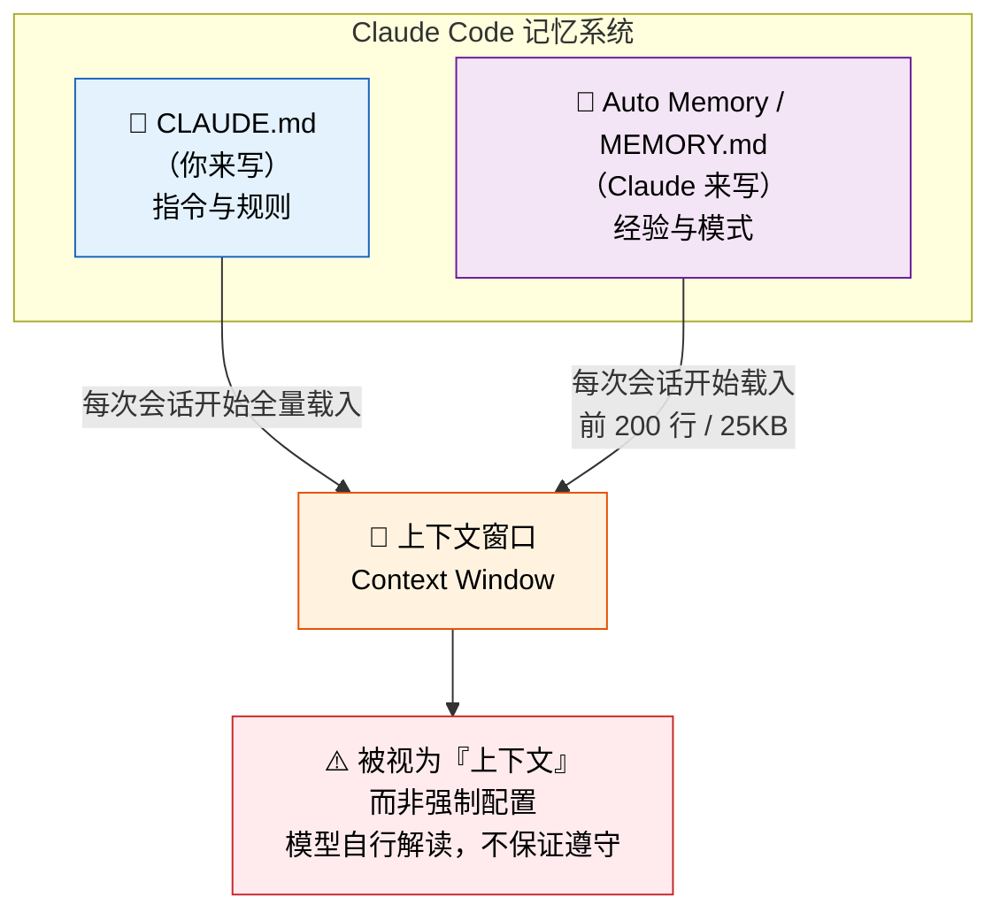
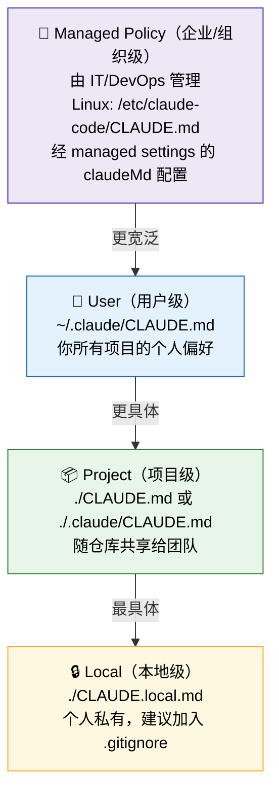
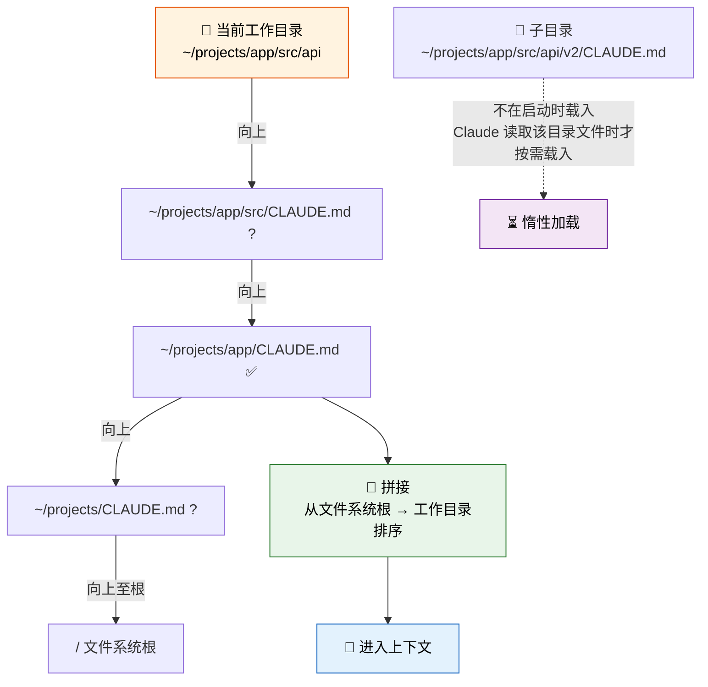
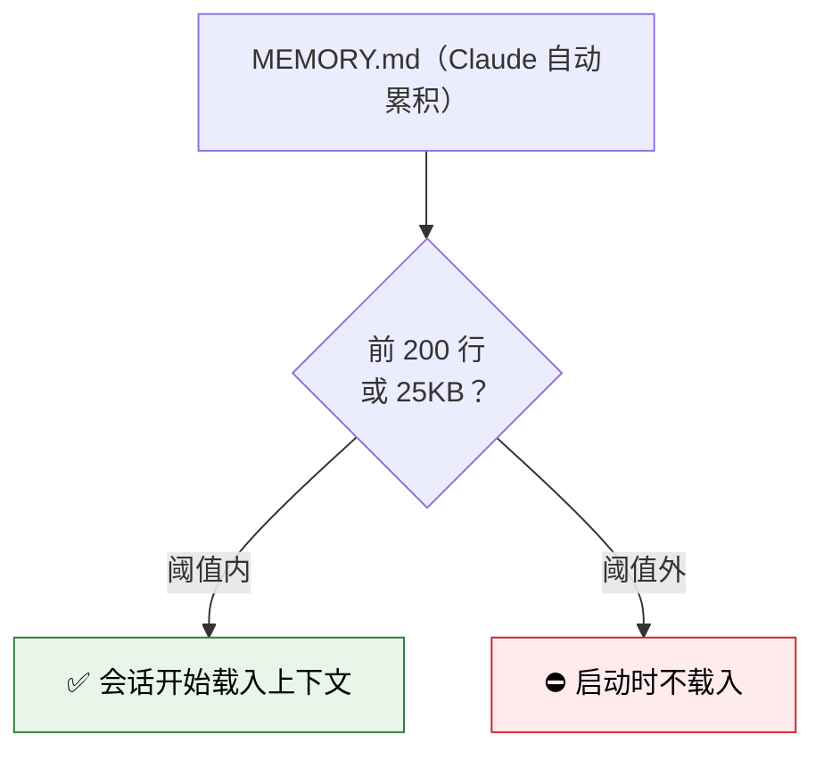
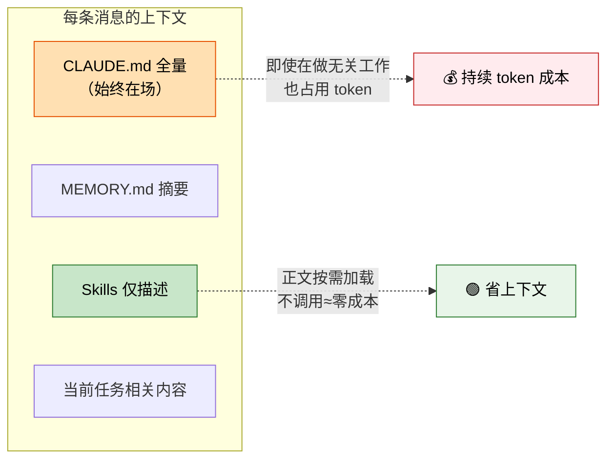
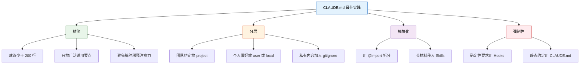
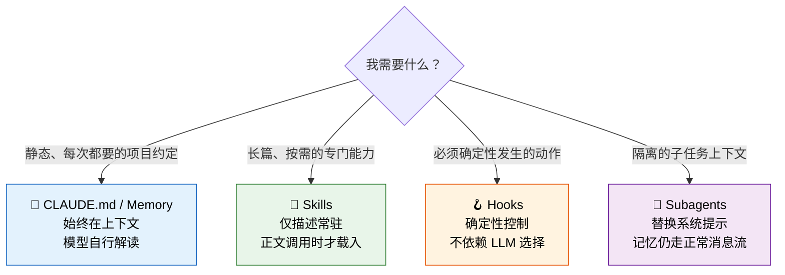
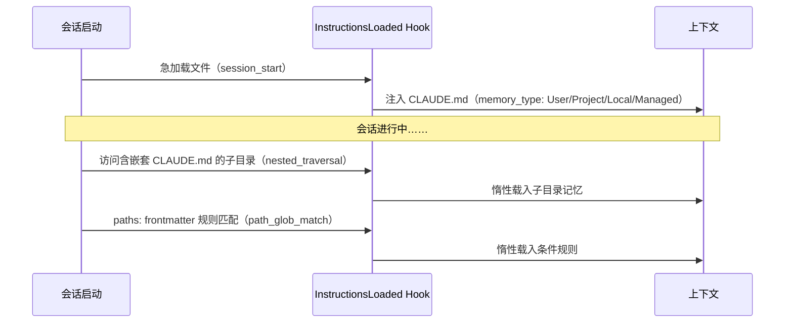

<div style="color: #666; font-style: italic; font-size: 0.9em; margin-bottom: 1em;">
本文是一份基于 Anthropic 官方一手文档、经对抗式核验整理的中文研究笔记。研究日期：2026-06-02；方法：5 路并行检索、15 篇来源、73 条断言抽取、25 条对抗式三票核验；来源性质：全部为 Anthropic 官方文档，置信度高。
</div>

## 一、核心结论（TL;DR）

- **两套互补机制**：Claude Code 的记忆 = 你手写的 **`CLAUDE.md`**（持久化指令）+ Claude 自己累积的 **auto memory / `MEMORY.md`**（跨会话自动记录经验）。两者都在**每次会话开始时载入**。
- **当作"上下文"而非"强制配置"**：模型会自行解读记忆内容，**不保证严格遵守**。需要确定性强制时，应改用 `PreToolUse` 钩子。
- **CLAUDE.md 有四个层级**（不是常见误传的"三层"）：`managed policy`（企业级）→ `user`（用户级）→ `project`（项目级）→ `local`（本地级），按**从宽到窄**顺序加载并**拼接**进上下文。
- **全量载入、按行计费**：CLAUDE.md 不论长短都被**完整**载入上下文窗口，其 token 在**每一条消息**上都被消耗——因此"保持精简"是第一性原则（建议 < 200 行）。
- **省上下文的替代品是 Skills**：Skills 的正文**仅在被调用时**才加载，适合存放长篇专门化材料。

---

## 二、整体架构：两套互补的记忆系统

官方原文：

> *"Claude Code has two complementary memory systems. Both are loaded at the start of every conversation. Claude treats them as context, not enforced configuration."*



| 维度 | `CLAUDE.md` | `Auto memory`（`MEMORY.md`） |
|------|-------------|------------------------------|
| **谁来写** | 你（人类） | Claude（自动） |
| **内容** | 指令、规则、约定 | 学到的经验、模式 |
| **载入时机** | 每次会话开始 | 每次会话开始 |
| **载入量** | 全量（不论长度） | 前 200 行 或 25KB（先到为准） |
| **性质** | 上下文（非强制） | 上下文（非强制） |
| **版本要求** | 一直支持 | 需 Claude Code **v2.1.59+**，默认开启 |

> 📌 **关键心智模型**：记忆是"提醒 Claude 的便签"，不是"约束 Claude 的法律"。要法律级别的强制，请用 Hooks。

---

## 三、CLAUDE.md 的四级层级

CLAUDE.md 存在于**四个**作用域，按"从最宽泛到最具体"（broadest → most specific）的顺序加载。**所有层级被拼接（concatenate），而非互相覆盖。**



| 作用域 | 路径 | 用途 | 共享性 |
|--------|------|------|--------|
| **Managed policy** | Linux `/etc/claude-code/CLAUDE.md`（经 managed settings `claudeMd`） | 组织级强制约定 | 全组织 |
| **User** | `~/.claude/CLAUDE.md` | 个人跨项目偏好 | 仅自己（全项目） |
| **Project** | `./CLAUDE.md` 或 `./.claude/CLAUDE.md` | 团队共享的项目约定 | 随仓库（团队） |
| **Local** | `./CLAUDE.local.md` | 个人项目级私有笔记 | 仅自己（建议 `.gitignore`） |

### 企业级记忆的特殊配置

企业/组织级记忆通过 **managed settings 中的 `claudeMd`** 配置：

> *"(Managed settings only) CLAUDE.md-style instructions injected as organization-managed memory. Only honored when set in managed or policy settings and ignored in user, project, and local settings."*

- 仅在 `managed` / `policy` 设置中生效，在 `user` / `project` / `local` 设置中**被忽略**。
- 配套的 `claudeMdExcludes` 可排除某些记忆文件，**但仅作用于 user/project/local 记忆——managed policy 文件无法被排除**。

---

## 四、工作机制：文件如何被发现与加载

Claude Code 通过**沿目录树向上行走（walking up the directory tree）**来发现 CLAUDE.md 文件：



官方原文：

> *"Claude Code reads CLAUDE.md files by walking up the directory tree from your current working directory ... All discovered files are concatenated into context rather than overriding each other. Across the directory tree, content is ordered from the filesystem root down to your working directory."*

**两条关键规则：**

1. **向上（parent）= 急加载**：从工作目录到根目录路径上的所有 CLAUDE.md / CLAUDE.local.md 都在启动时被发现并拼接。Monorepo 中父级约定会被自动拉入。
2. **向下（child）= 惰性加载**：子目录里的 CLAUDE.md **不在启动时加载**，只有当 Claude 实际读取该子目录中的文件时才按需载入。

> ⏱️ **载入时序**：在 context-window 文档的启动时间线中，`~/.claude/CLAUDE.md` 与项目 `CLAUDE.md` 都排在 "Your prompt"（你的首条消息）**之前**。结论：*"CLAUDE.md, memory, skills, and MCP tools are all in context before your first prompt."*（交付机制上，CLAUDE.md 作为系统提示之后的一条 user message 注入，而非系统提示本身的一部分——但不影响"首条 prompt 前已就绪"这一结论。）

---

## 五、`@import` 导入语法

CLAUDE.md 可用 `@path/to/import` 语法导入其它文件，把内容**模块化**：

```markdown
# 项目约定

参见架构说明 @docs/architecture.md
Git 工作流见 @docs/git-instructions.md

# 个人覆盖（不入库）
@~/.claude/my-project-instructions.md
```

```mermaid
graph LR
    A["CLAUDE.md"] -->|@docs/arch.md| B["docs/arch.md"]
    A -->|@~/.claude/override.md| C["~/.claude/override.md"]
    B -->|@deeper.md| D["第 2 跳"]
    D --> E["第 3 跳"]
    E --> F["第 4 跳"]
    F -.->|❌ 超过 4 跳| G["不再展开"]

    style A fill:#e3f2fd,stroke:#1565c0,color:#000
    style G fill:#ffebee,stroke:#c62828,color:#000
```

**规则要点：**

| 规则 | 说明 |
|------|------|
| 路径类型 | 相对路径与绝对路径**均可** |
| 递归 | 被导入文件可**再导入**其它文件 |
| 最大深度 | **4 跳（hops）** |
| 载入时机 | 在**启动时**与引用它的 CLAUDE.md 一起展开载入上下文 |
| 常见用法 | `@README.md`、`@package.json`、`@docs/git-instructions.md`、`@~/.claude/my-project-instructions.md` |

> 💡 `@import` 让你把"个人私有覆盖"放在 home 目录、把"团队共享部分"放在仓库里，既复用又互不污染。

---

## 六、Auto Memory（MEMORY.md）自动记忆

这是 Claude **自己写**的记忆——跨会话自动累积"学到的东西"。

- **默认开启**，需 Claude Code **v2.1.59+**。
- 启动时自动载入，但**只载入前 200 行或前 25KB（先到为准）**；**超出阈值的内容在会话开始时不加载**。



> 📝 这个 200 行 / 25KB 阈值的设计意图，与 CLAUDE.md 的"保持精简"如出一辙：**避免记忆无限膨胀挤占上下文**。

---

## 七、与上下文管理的关系

这是理解记忆系统**成本**的关键一节。

> *"Your CLAUDE.md file is loaded into context at session start. If it contains detailed instructions for specific workflows ... those tokens are present even when you're doing unrelated work."* — costs 文档
>
> *"CLAUDE.md files are loaded into the context window at the start of every session, consuming tokens ... loaded in full regardless of length."* — memory 文档



**两个推论：**

1. **Prompt caching 能降低重复 token 的费用，但不会把 CLAUDE.md 移出上下文**——它仍占用窗口空间。
2. **可自定义压缩（compaction）行为**：在 CLAUDE.md 中加一个 `Compact instructions` 小节，告诉 Claude 总结历史时优先保留什么：

   ```markdown
   # Compact instructions
   When you are using compact, please focus on test output and code changes
   ```

---

## 八、最佳实践

> *"CLAUDE.md is loaded every session, so only include things that apply broadly ... Keep it concise ... Bloated CLAUDE.md files cause Claude to ignore your actual instructions!"*



| 做法 | 理由 |
|------|------|
| **保持 < 200 行** | 每会话全量载入，臃肿会稀释注意力、推高成本 |
| **只放"广泛适用"的内容** | 专门化指令应按需加载，而非常驻 |
| **把长篇专门材料移入 Skills** | Skills 正文按需加载，"不用时几乎零成本" |
| **用 `@import` 模块化** | 复用 + 关注点分离 |
| **个人内容放 `CLAUDE.local.md` 并 gitignore** | 避免污染团队仓库 |
| **需要"必定执行"时改用 Hooks** | 记忆是上下文、不保证遵守；Hooks 才是确定性的 |

---

## 九、横向对比：Memory vs Skills vs Hooks vs Subagents



| 机制 | 加载行为 | 确定性 | 典型用途 |
|------|----------|--------|----------|
| **CLAUDE.md / Memory** | 全量常驻上下文 | 否（模型自行解读） | 静态、不变的项目约定 |
| **Skills** | 仅描述常驻；正文**调用时**才载入 | 否 | 长篇参考、专门化工作流 |
| **Hooks** | 脚本在特定事件触发 | **是**（确保动作发生） | 必须强制的检查/格式化/拦截 |
| **Subagents** | 自定义 system prompt **完全替换**默认提示 | — | 隔离的子任务 |

**官方给出的清晰分工：**

- **Skills vs Memory**：*"Unlike CLAUDE.md content, a skill's body loads only when it's used, so long reference material costs almost nothing until you need it."* 常规会话中只载入 skill 的**描述**让 Claude 知道有哪些可用，完整正文仅在被调用时加载。
- **Hooks vs Memory**：*"They provide deterministic control over Claude Code's behavior, ensuring certain actions always happen rather than relying on the LLM to choose to run them."* 反过来，*"For instructions that never change, prefer CLAUDE.md. It loads without running a script."* 而 *"To block an action regardless of what Claude decides, use a PreToolUse hook instead."*
- **Subagents vs Memory**：子代理的 system prompt **完全替换**默认 Claude Code 系统提示，**但 CLAUDE.md 与项目记忆仍通过正常消息流加载**——二者相互独立。注意：内置的 **Explore 与 Plan 代理会跳过 CLAUDE.md / 记忆**。

> ⚠️ **关于 MCP memory 与 Agent SDK memory 的对比**：本次研究的 24 条已核验断言中**未覆盖**这两项的对照证据（检索阶段受组织策略限制无法取得反证）。相关来源（如 platform 文档的 [Memory tool](https://platform.claude.com/docs/en/agents-and-tools/tool-use/memory-tool)、[MCP memory server](https://github.com/modelcontextprotocol/servers/tree/main/src/memory)）已列入来源清单，但其具体差异留作[未决问题](#十二未决问题)，不在本报告下结论，以保证严谨。

---

## 十、可观测性：InstructionsLoaded 钩子

Claude Code 在 CLAUDE.md 或 `.claude/rules/*.md` 文件被载入上下文时，会触发 **`InstructionsLoaded`** 钩子事件——这给了你"观察/干预记忆加载"的抓手。

> *"Fires when a CLAUDE.md or .claude/rules/*.md file is loaded into context. This event fires at session start for eagerly-loaded files and again later when files are lazily loaded ..."*



- **触发字段 `load_reason`**：`session_start` / `nested_traversal` / `path_glob_match` / `include` / `compact`
- **触发字段 `memory_type`**：`User` / `Project` / `Local` / `Managed`（对应四个层级）

---

## 十一、重要更正与注意事项

> 🔴 **被证伪的常见说法**：网上常说 CLAUDE.md "只有三个层级（user / project / local）"。本次研究以 **1–2 票否决**该说法——**实际是四层**，遗漏了最顶层的 **`managed policy`（企业级）**。

**其它注意事项（来自研究 caveats）：**

1. **来源单一性**：全部为 Anthropic 官方一手文档，无独立第三方交叉验证（检索阶段 WebSearch 因组织 Vertex AI 策略被阻断，无法检索反证）。对于"厂商描述自身产品行为"，官方文档已是权威来源。
2. **强时效性**：auto memory 等特性需 v2.1.59+，文档为 2026 年版本，特性可能随版本快速演变。
3. `llms.txt` 的精确 URL 一度返回 404，但其内容已被现行 memory 文档独立佐证。
4. 本报告由经核验的研究综合撰写；事实底座共 **14 条**核心发现（24 条确认断言合并去重而来）。

---

## 十二、未决问题

这些问题本次研究**未能取得已核验证据**，建议作为后续深入方向：

1. **MCP memory vs 内置记忆**：MCP memory 服务器（如官方 memory MCP / 知识图谱记忆）与 CLAUDE.md / auto memory 在持久化、跨会话/跨项目共享、检索机制上的具体差异？
2. **Agent SDK memory vs Claude Code 记忆**：在 API / 编程模型层面如何对应或区别？
3. **超阈值 auto memory 的检索**：MEMORY.md 前 200 行 / 25KB 之外、以及独立的 topic 文件，如何被按需检索调用？触发条件是什么？
4. **`.claude/rules/`**：含 `paths:` frontmatter 的条件规则与 CLAUDE.md 在加载优先级、合并/覆盖语义上的精确关系？它是否应被视为"第三种"记忆机制？

---

## 十三、来源清单

全部为 Anthropic 官方一手文档（primary）：

| # | 来源 | 角度 |
|---|------|------|
| 1 | [Memory — code.claude.com/docs/en/memory](https://code.claude.com/docs/en/memory) | 核心机制 |
| 2 | [Context window — /docs/en/context-window](https://code.claude.com/docs/en/context-window) | 载入时序/阈值 |
| 3 | [Best practices — /docs/en/best-practices](https://code.claude.com/docs/en/best-practices) | 实践/层级 |
| 4 | [Settings — /docs/en/settings](https://code.claude.com/docs/en/settings) | 企业级配置 |
| 5 | [Costs — /docs/en/costs](https://code.claude.com/docs/en/costs) | 上下文成本/压缩 |
| 6 | [Hooks — /docs/en/hooks](https://code.claude.com/docs/en/hooks) | InstructionsLoaded |
| 7 | [Hooks guide — /docs/en/hooks-guide](https://code.claude.com/docs/en/hooks-guide) | 确定性对比 |
| 8 | [Skills — /docs/en/skills](https://code.claude.com/docs/en/skills) | Skills 对比 |
| 9 | [Sub-agents — /docs/en/sub-agents](https://code.claude.com/docs/en/sub-agents) | 子代理对比 |
| 10 | [Common workflows — /docs/en/common-workflows](https://code.claude.com/docs/en/common-workflows) | 管理操作 |
| 11 | [llms.txt — /docs/en/llms.txt](https://code.claude.com/docs/en/llms.txt) | 概览 |
| 12 | [Memory tool — platform.claude.com](https://platform.claude.com/docs/en/agents-and-tools/tool-use/memory-tool) | 对比（未核验） |
| 13 | [MCP memory server — github](https://github.com/modelcontextprotocol/servers/tree/main/src/memory) | 对比（未核验） |
| 14 | [Context editing — platform.claude.com](https://platform.claude.com/docs/en/build-with-claude/context-editing) | 对比（未核验） |
| 15 | [Effective context engineering — anthropic.com](https://www.anthropic.com/engineering/effective-context-engineering-for-ai-agents) | 背景 |

---

<sub>📊 研究统计：5 个检索角度 ｜ 15 篇来源 ｜ 73 条断言抽取 ｜ 25 条三票对抗核验 ｜ 24 确认 / 1 证伪 ｜ 14 条综合发现 ｜ 97 个 agent 调用</sub>
