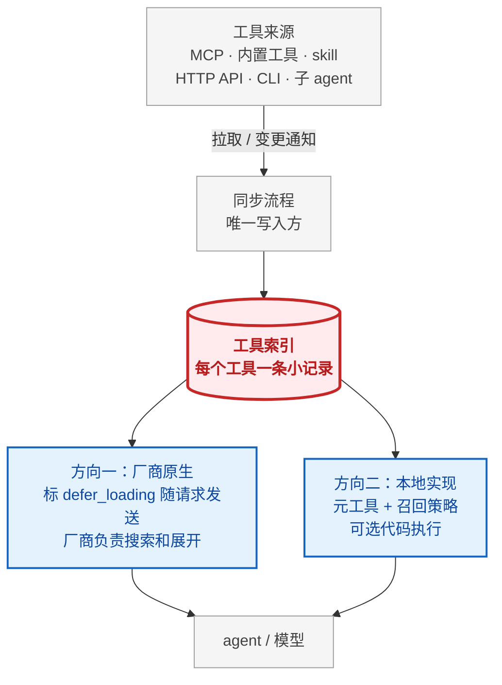
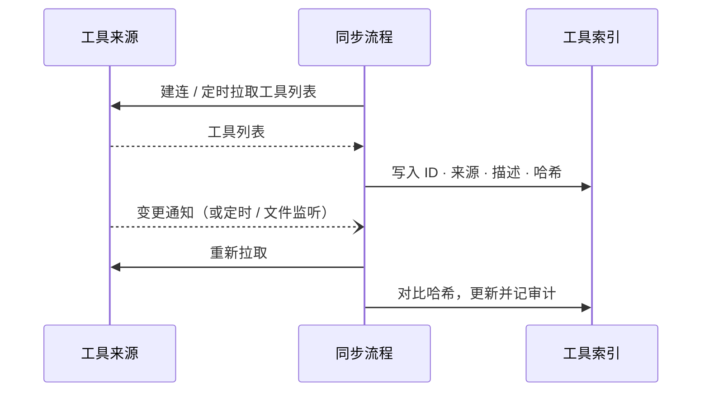
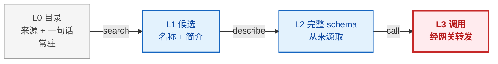
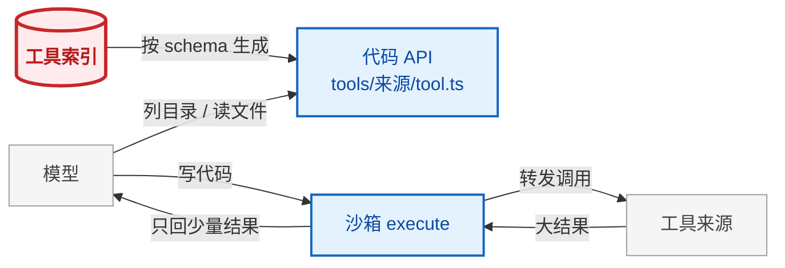

给 agent 接工具，最省事的写法是会话开始时把所有工具定义一次性放进上下文。工具只有十几个时这没有问题。接上五个 MCP server 之后，问题就出来了。Anthropic 举过一个例子，GitHub、Slack、Sentry、Grafana、Splunk 五个 server 一共 58 个工具，定义约 55K token，对话还没开始就用掉了[[N1]](#n1)。Cloudflare 的 API 有 2,500 个端点，全做成工具约需 117 万 token，没有哪个模型的上下文放得下[[N2]](#n2)。

业界已经收敛到同一个做法：**工具全集应该当成一个数据集来管理，agent 只通过一个固定的召回接口去查它。** 至于用厂商原生的 tool search、本地 BM25、向量检索还是代码执行，都只是这个接口背后可替换的实现。

本文先讲为什么必须这么做，再看业界现有的几种做法，然后给出架构，最后说代价。

---

## §1 问题，工具定义也是上下文预算

全量注入有三个成本，而且工具越多越严重。

**占上下文。** 上面那 55K token 是固定开销，每轮都要付。Anthropic 内部见过工具定义在优化前占 134K token[[N1]](#n1)。

**选不准。** 最常见的失败是选错工具和写错参数，名字相近的工具尤其容易混，比如 `notification-send-user` 和 `notification-send-channel`。Anthropic 自报的内部 MCP 评测里，开启 Tool Search 后 Opus 4 从 49% 升到 74%，Opus 4.5 从 79.5% 升到 88.1%[[N1]](#n1)。这是厂商自报数字，测试集没有公开，但方向很清楚：候选越少，选得越准。

**中间结果反复过模型。** 多步工作流里，每一步的输出都要回到模型，再作为下一步的输入发出去。Anthropic 的例子里，一个工作流改成代码执行后从约 150,000 token 降到约 2,000 token[[N3]](#n3)。

其他几家的数字也指向同一个方向。Claude 文档称 Tool Search 通常能把定义开销降 85% 以上[[N4]](#n4)；Cursor 称按需加载 MCP 工具后相关请求 token 减少 46.9%，并且发现多数内置工具只在不到 20% 的对话里用到，于是内置工具也改成了按需加载[[N5]](#n5)。

所以工具定义和系统提示一样，是要管的上下文预算。

---

## §2 业界的做法

「动态 MCP」这个说法主要来自 Docker，但问题和 MCP 无关。harness 内置工具、skill、HTTP API、CLI 命令、子 agent 都是工具来源，都有同样的问题。MCP 只是在协议层提供了现成的变更通知，所以常被拿来举例。

| 做法 | 机制 | 代表 | 局限 |
|---|---|---|---|
| 变更通知 | 来源方声明工具集合会变，变化时发 `notifications/tools/list_changed`，客户端重新拉 `tools/list` | MCP 规范 | 只告诉你变了，不决定该加载哪些 |
| 工具搜索 + 延迟加载 | 工具标 `defer_loading`，模型先搜目录，只展开需要的几个 | Anthropic Tool Search、OpenAI `tool_search`、Claude Code（仅 MCP 工具） | 多一次搜索；搜不到就用不上；依赖厂商 API |
| 运行时挂载来源 | 网关提供 `mcp-find` / `mcp-add` 元工具，会话中途增减 server | Docker MCP Gateway（实验性） | 运行时引入第三方工具，有信任问题 |
| 代码执行 | 工具变成代码 API，模型写代码在沙箱里调用 | Anthropic code execution with MCP、Cloudflare Code Mode | 要沙箱，审计对象变成模型写的代码 |
| harness 按需注入 | harness 自己决定何时注入哪些定义 | Cursor dynamic context discovery | 私有实现，不能互通 |

各家按需加载覆盖的工具范围并不一样，这一点容易混：

- **API 层不区分来源。** Anthropic Tool Search 和 OpenAI `tool_search` 的 `defer_loading` 标在任意函数工具上，MCP 工具只是其中一种；OpenAI 还能对整个 MCP server 一次性设置，但只有 gpt-5.4 及之后的模型支持[[N4]](#n4)[[N7]](#n7)。
- **Claude Code 目前只延迟 MCP 工具。** 它的文档写的是「MCP tools are deferred and discovered on demand」，Read、Bash 这类内置工具仍然开局全量加载。`ENABLE_TOOL_SEARCH=auto` 时，MCP 工具定义达到上下文窗口的 10% 才开启搜索；单个 server 可以设 `alwaysLoad` 常驻[[N8]](#n8)。
- **Cursor 走得更远。** 先对 MCP 工具按需加载，后来发现多数内置工具只在不到 20% 的对话里用到，内置工具也改成了按需加载[[N5]](#n5)。

所以「动态工具」这件事是从 MCP 开始的，因为第三方 server 最多、最不可控；但它的终点是全部工具集合。MCP 在其中的特殊之处只在协议层：2026-07-28 版规范规定工具集合不得因连接不同或作为其他请求的副作用而变化，可以随授权范围变化；变更通知只在客户端通过 `subscriptions/listen` 订阅后才下发[[N6]](#n6)。

这几种做法看起来各不相同，拆开看其实是同一件事的不同层：变更通知解决「索引怎么保持新鲜」，工具搜索解决「怎么召回」，代码执行解决「召回之后怎么调用」。把这几层分开，落地时就是下一节的两个方向。

---

## §3 两个方向，厂商原生 vs 本地实现

落地按需加载，有两条路：直接用模型厂商提供的原生能力，或者在 harness 里自己实现一套。两条路共用同一个底座，即工具索引和同步流程；区别在于召回和调用由谁来做。

### 3.1 共同底座：索引只存小记录

不管走哪个方向，工具从哪来、可不可信，都得自己管。索引里每个工具只存 ID、来源、一句话描述和版本哈希，完整 schema 留在来源方，用到时再取。同步流程在建连或定时拉取工具列表；收到变更通知（或没有通知的来源靠定时、文件监听）时重新拉取，对比哈希，更新记录并留审计。

这不是新发明。AWS AgentCore Gateway 预拉 `tools/list` 做缓存、`tools/call` 直达后端[[N9]](#n9)；STOA 的 ADR-051 是缓存优先加惰性发现[[N10]](#n10)；Aklivity 把工具分成 eager 和 cold 两层并加 TTL[[N11]](#n11)。

### 3.2 方向一：直接用厂商原生能力

Anthropic Tool Search 和 OpenAI `tool_search` 都已经上线。harness 把索引里的工具按定义发出去，非核心的标上 `defer_loading`，模型先搜、再展开需要的几个[[N4]](#n4)[[N7]](#n7)。Claude Code 和 Cursor 走的都是这条路。

好处是省事：没有额外往返，搜索由模型训练时就配合好的机制完成，搜到的定义作为对话内容追加，不破坏提示缓存前缀。代价是绑定厂商：要特定模型版本（OpenAI 要求 gpt-5.4 及以上），走网关时可能被拒，搜索策略不可调，换模型就得换一套。

### 3.3 方向二：本地实现一套

厂商不支持、要跨模型、或者要控制召回策略时，就在 harness 里自己做。核心是渐进披露：上下文里常驻一个很小的目录和几个固定元工具，模型按需逐层往下取。

常驻工具集合不变，提示缓存的前缀也就不会被打破。Dynamic ReAct 的 `search_app / search_tool / get_tool_info / call_tool` 和 Aklivity 的 search / describe / execute 都是这个形态[[N12]](#n12)。

召回策略是插件，随工具规模从便宜的往贵的升级：

| 策略 | 适用规模 | 参考 |
|---|---|---|
| 字符串 / 正则 / BM25 | 几十个工具，命名规范 | Anthropic Tool Search |
| 向量检索 | 几百上千个，说法差异大 | ScaleMCP、Semantic Tool Discovery[[N13]](#n13) |
| 分层检索 | 来源多，单个来源工具也多 | RAG-MCP、MCP-Zero[[N14]](#n14) |
| 主动请求 | 模型先描述需要什么工具 | MCP-Zero |
| 子 agent 检索 | 需要推理判断，成本最高 | — |

本地实现还有一个厂商原生给不了的选项：代码执行。召回之后的调用不再一次次过模型，而是同步时按 schema 把索引生成代码 API，模型读文件找到函数，写代码在沙箱里跑，只把少量结果带回上下文。

中间数据留在沙箱里，循环和条件写在代码里，敏感字段可以用占位符替换；跑通的代码还能存成 skill。Cloudflare 的 API 只暴露 `search()` 和 `execute()` 两个工具，靠 V8 隔离跑代码，把 2,500 个端点压到约 1,000 token[[N2]](#n2)。代价是要做沙箱、资源限制和监控。

本地实现的整体代价：多一次工具调用，准确率取决于策略，召回质量要自己评测。

### 3.4 怎么选

| | 厂商原生 | 本地实现 |
|---|---|---|
| 召回由谁做 | 厂商 API | harness 元工具 + 策略 |
| 额外往返 | 无 | 多一次 search / describe |
| 模型绑定 | 限定厂商和模型版本 | 任意模型 |
| 策略可调 | 否 | 是 |
| 代码执行 | 另配 | 可直接接 |
| 索引 · 同步 · 信任 | 自己维护 | 自己维护 |

两个方向不互斥。harness 对外暴露同一个召回接口，provider 支持就走原生，不支持就降级到本地；多步串联或数据量大时再走代码执行。

---

## §4 代价，动态加载带来的三个问题

**安全。** Invariant Labs 在 2025 年 4 月披露了工具投毒（Tool Poisoning）：恶意 MCP server 在工具描述里藏指令，用户看不到，模型会照着执行，比如读取本地密钥后外传[[N15]](#n15)。动态加载会放大这个问题。agent 自己从目录里挑工具，等于让模型参与信任决策；来源被加载后还可以通过变更通知改描述，先正常后变恶意（rug pull）。Docker 的做法是只从自家可信 Catalog 里找，并在容器里跑[[N16]](#n16)。工程上至少要做到：来源走白名单，描述固定版本或校验哈希，描述变更时提示用户，权限最小化。上面架构里同步流程是索引的唯一写入方，哈希和审计正好在这里做。

**缓存失效。** 提示缓存按前缀匹配。Anthropic 的拼接顺序是 `tools → system → messages`，任何一层有变化，这一层和之后各层的缓存都会失效。文档的失效表里，修改工具定义（名称、描述、参数）一项，三层全部失效[[N17]](#n17)。所以只要改了 `tools` 数组或 system prompt，缓存必然失效，跟客户端怎么实现无关。对话尾部追加内容则不影响已有缓存，只有新增部分按写入计费。因此「收到变更通知就整体重发工具列表」和「把新工具写进 system prompt」这两种做法，每次都要重付一遍完整前缀。想保住缓存，新工具只能往对话尾部加。

往尾部加的代价是 schema 识别。厂商原生方案里，追加的是 `tool_reference`，API 在交给模型前把它展开成完整定义，模型训练时就见过这个格式。strict 模式的约束语法按工具全集构建，调用参数仍受 schema 约束[[N4]](#n4)。

Anthropic 还把这个能力单独开放成了 API：中途工具变更（mid-conversation tool changes，beta）[[N18]](#n18)。在对话中途追加一条 `role: "system"` 消息，里面放 `tool_addition` 或 `tool_removal` 块，就能从这一轮起上架或下架某个工具，<strong><code>tools</code> 数组和之前的消息原样不动，缓存照常命中</strong>。`tool_addition` 有两种用法：按引用上架一个已在 `tools` 里声明、带 `defer_loading` 的工具；或者带上完整定义（`tool_definition`），引入一个会话开始时还不存在的工具。后一种不依赖内置搜索，召回逻辑可以完全在本地，搜到之后用 `tool_addition` 交给模型，得到的是正式工具，调用走原生 `tool_use`。

用不上这类 API 的场景（其他厂商、或旧模型）才需要退回到纯文本方案。这时 schema 只是 `tool_result` 里的一段文本，模型要在对话中间把它当接口说明来读。会话越长，这段文本离当前轮越远，模型越容易忽略它或记错参数。而且这个工具不在 `tools` 里，模型只能通过 `call_tool(name, args)` 这样的代理去调用，参数没有约束解码，只能由 harness 校验后报错重试。对应的工程做法有三条：`describe` 的结果紧贴在调用前返回；`call_tool` 严格按 schema 校验，失败时把 schema 一起带回给模型；高频工具升级为常驻。

**可复现性。** 同一个任务，这次搜到工具 A，下次搜到工具 B，评测和排障都变难。描述写得差的工具可能永远搜不到。代码执行则把行为放进模型临时写的代码里，审计时要看代码本身，只看调用日志不够。所以每轮实际注入了哪些工具要记录下来，召回命中率也应该进评测。

---

## §5 结论

- 先测一下现有工具定义的 token 占用。超过上下文的约 10%（Claude Code 的默认阈值），就值得做延迟加载。
- 不管走哪个方向，先建好工具索引和同步流程，同步流程是唯一写入方。
- 方向一，厂商原生：模型固定、provider 支持 tool search 时首选，接入成本最低。
- 方向二，本地实现：要跨模型、要调召回策略、或要接代码执行时用。规模到几百上千，或者中间数据量大，再上代码执行。
- 少数高频核心工具常驻，其余按需加载。Anthropic 和 Cursor 都是这样做的。
- 工具的名称、描述和 namespace 要为「被搜索」来写。
- 动态加载第三方工具，本质上是在运行时引入第三方代码和提示词，应该和依赖管理同等对待。

---

## 参考资料

1. Anthropic Engineering, *Introducing advanced tool use*. [anthropic.com/engineering/advanced-tool-use](https://www.anthropic.com/engineering/advanced-tool-use)
2. Cloudflare, *Code Mode MCP*. [blog.cloudflare.com/code-mode-mcp](https://blog.cloudflare.com/code-mode-mcp)；Cloudflare Connect 2026, *Code Mode: fit 2,500 API endpoints into 1,000 tokens*. [cloudflare.com/connect/2026/session/code-mode-fit-2-500-api-endpoints-into-1-000-tokens](https://www.cloudflare.com/connect/2026/session/code-mode-fit-2-500-api-endpoints-into-1-000-tokens)
3. Anthropic, *Code execution with MCP*. [anthropic.com/research/code-execution-with-mcp](https://www.anthropic.com/research/code-execution-with-mcp)
4. Claude Docs, *Tool search tool*. [platform.claude.com/docs/en/agents-and-tools/tool-use/tool-search-tool](https://platform.claude.com/docs/en/agents-and-tools/tool-use/tool-search-tool)
5. Cursor, *Dynamic context discovery*. [cursor.com/blog/dynamic-context-discovery](https://cursor.com/blog/dynamic-context-discovery)；Cursor, *Improved token efficiency*. [cursor.com/blog/improved-token-efficiency](https://cursor.com/blog/improved-token-efficiency)
6. Model Context Protocol, *Specification 2026-07-28: Tools*. [modelcontextprotocol.io/specification/2026-07-28/server/tools](https://modelcontextprotocol.io/specification/2026-07-28/server/tools)
7. OpenAI, *Tool search*. [developers.openai.com/api/docs/guides/tools-tool-search](https://developers.openai.com/api/docs/guides/tools-tool-search)
8. Claude Code Docs, *MCP* 与 *Environment variables*. [code.claude.com/docs/en/mcp](https://code.claude.com/docs/en/mcp)；[code.claude.com/docs/en/env-vars](https://code.claude.com/docs/en/env-vars)
9. AWS, *MCP Targets in AgentCore Gateway, Part 1*. [builder.aws.com/content/3FKw7fSAYcTOVF0OdJzzZdg7PXw](https://builder.aws.com/content/3FKw7fSAYcTOVF0OdJzzZdg7PXw/mcp-targets-in-agentcore-gateway-part-1-how-agents-discover-tools)
10. STOA, *ADR-051 Lazy MCP Discovery*. [docs.gostoa.dev/docs/architecture/adr/adr-051-lazy-mcp-discovery](https://docs.gostoa.dev/docs/architecture/adr/adr-051-lazy-mcp-discovery)
11. Aklivity, *MCP Gateway: Tool Discovery*. [docs.aklivity.io/latest/ai-gateway/mcp-gateway/tool-discovery](https://docs.aklivity.io/latest/ai-gateway/mcp-gateway/tool-discovery/)
12. *Dynamic ReAct*, arXiv 2509.20386. [arxiv.org/html/2509.20386v1](https://arxiv.org/html/2509.20386v1)
13. *ScaleMCP*, arXiv 2505.06416. [arxiv.org/abs/2505.06416](https://arxiv.org/abs/2505.06416)；*Semantic Tool Discovery for MCP*, arXiv 2603.20313. [arxiv.org/html/2603.20313v1](https://arxiv.org/html/2603.20313v1)
14. *MCP-Zero*, arXiv 2506.01056. [arxiv.org/html/2506.01056v4](https://arxiv.org/html/2506.01056v4)
15. Invariant Labs, *MCP Security Notification: Tool Poisoning Attacks*. [invariantlabs.ai/blog/mcp-security-notification](https://invariantlabs.ai/blog/mcp-security-notification)
16. Docker Docs, *Dynamic MCP*. [docs.docker.com/ai/mcp-catalog-and-toolkit/dynamic-mcp](https://docs.docker.com/ai/mcp-catalog-and-toolkit/dynamic-mcp)
17. Claude Docs, *Prompt caching: What invalidates the cache*. [platform.claude.com/docs/en/build-with-claude/prompt-caching](https://platform.claude.com/docs/en/build-with-claude/prompt-caching#what-invalidates-the-cache)；*Tool use with prompt caching*. [platform.claude.com/docs/en/agents-and-tools/tool-use/tool-use-with-prompt-caching](https://platform.claude.com/docs/en/agents-and-tools/tool-use/tool-use-with-prompt-caching)
18. Claude Docs, *Mid-conversation system messages: Mid-conversation tool changes*. [platform.claude.com/docs/en/build-with-claude/mid-conversation-system-messages](https://platform.claude.com/docs/en/build-with-claude/mid-conversation-system-messages#mid-conversation-tool-changes)
