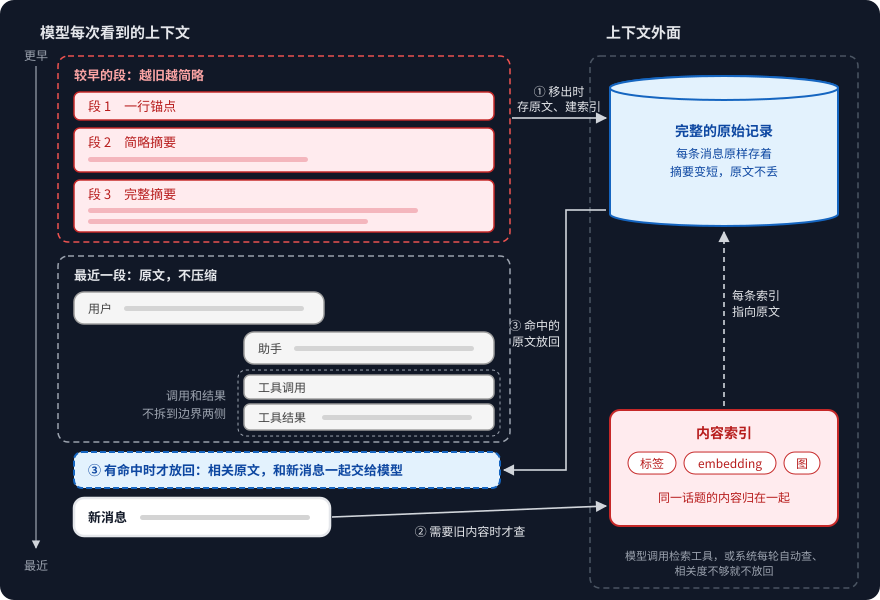
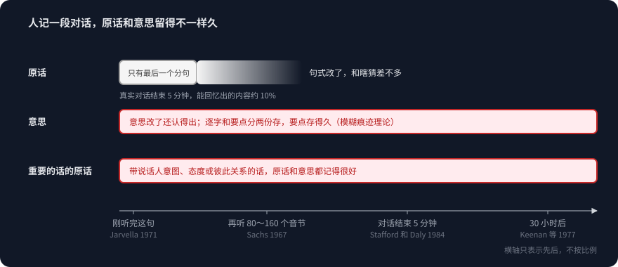
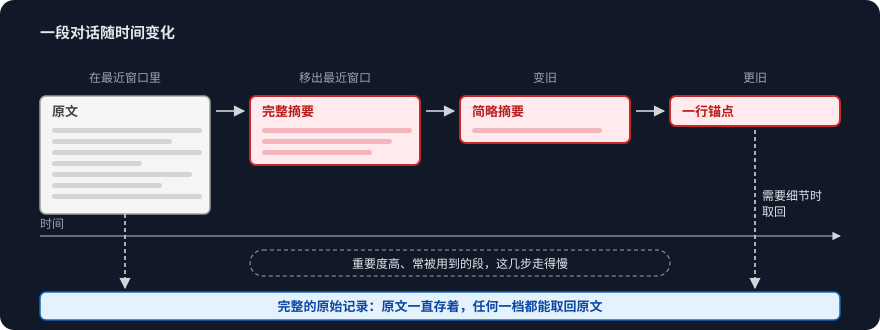
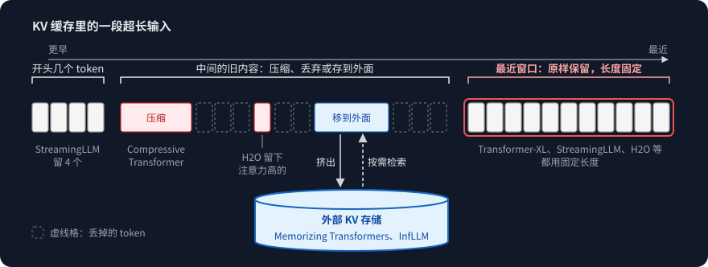
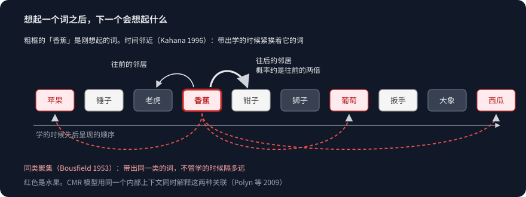
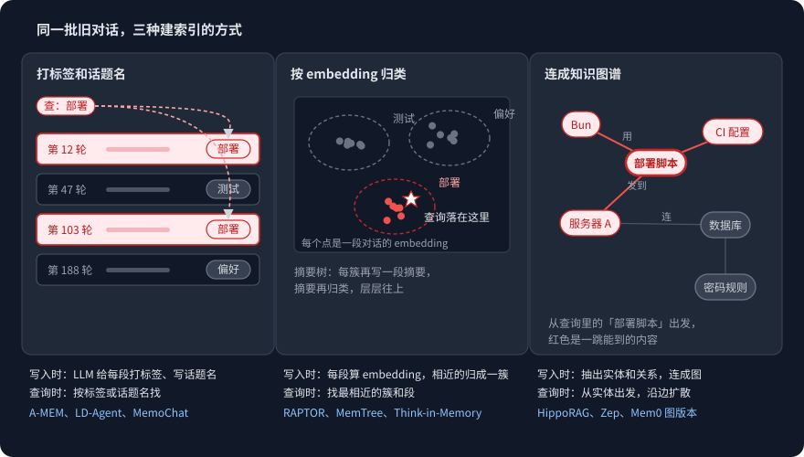
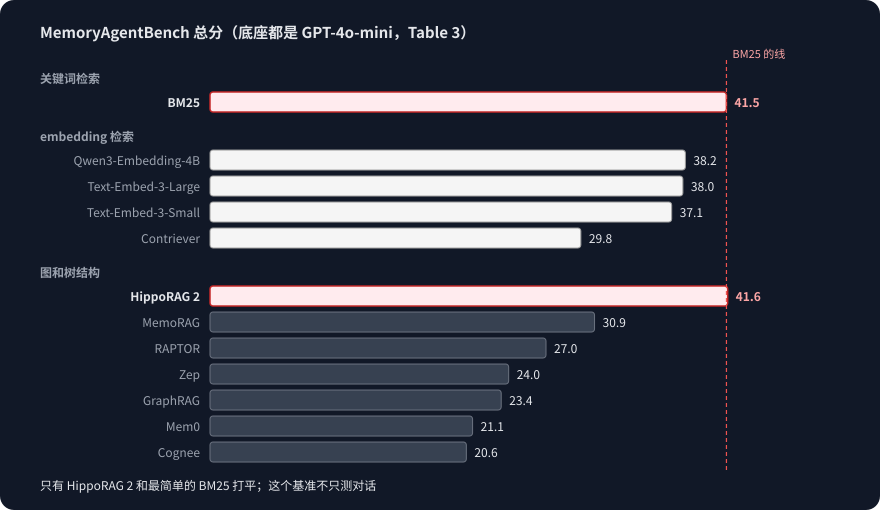
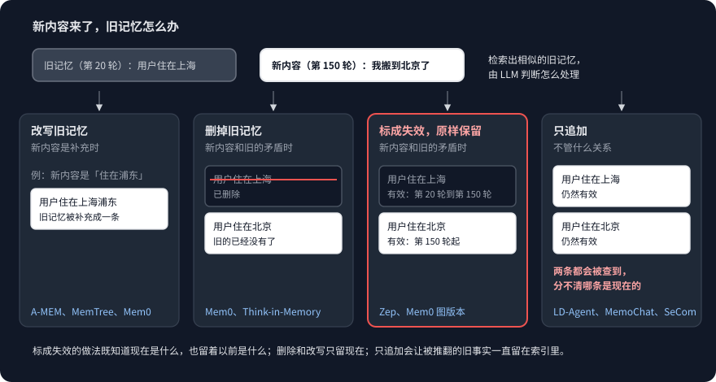
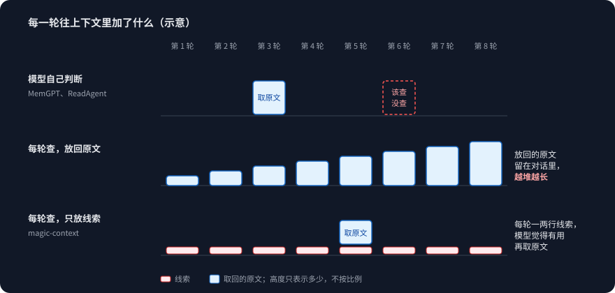
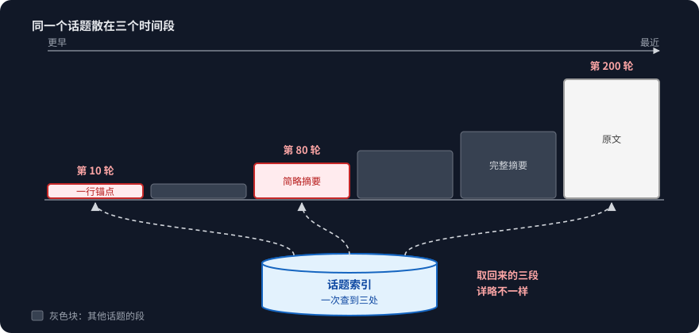

本文内容由 AI 协助生成，资料截至 2026-11-28，出处见文中链接和文末清单。

结论：一段很长的对话，旧内容要解决两个问题。一是留多详细，按时间处理：最近的原话完整留着，更早的只剩要点，原文存在外面。二是怎么找回来，按内容处理：给旧内容打标签、做 embedding 或者连成图，让分散在不同时间的同一件事能一起查到。

人的记忆在两条线上都有对应的机制。Transformer 的长上下文方法主要在第一条线上，Agent 记忆系统两条线都有。两条线合起来时，有两个问题还没解决好：同一个话题散在不同时间段，按时间各自变简略，按内容又要一起取回；旧事实被新事实推翻后，只靠变简略改不掉它，要在索引上标出来。

这篇是《[Agent 上下文卸载](/2026/11/24/agent-context-offloading/)》的延伸。那篇讲工程上怎么腾上下文、怎么算缓存账，这篇讲旧内容以什么形式留下来、怎么找回来。跨会话的长期记忆系统（Letta、Mem0、Zep 这类）的产品对比见《[Agent Memory 前沿调研](/2026/05/21/agent-memory-frontier-survey/)》，这里只讲它们的索引机制。

---

## 1. 两个问题

一段几百轮的对话，上下文窗口装不下，或者装得下但太贵、太乱。同一个用户分几十次聊，问题也一样，只是对话被切成了几段，第 5 节的很多系统就是为这种跨会话场景设计的。旧内容要回答两个问题：

| 问题 | 按什么处理 | 典型做法 |
|---|---|---|
| 留多详细 | 时间：越旧越简略，最近的原样保留 | 切段、多档摘要、按年龄衰减、保护最近一段原文、原文可取回 |
| 怎么找回来 | 内容：相关的内容放在一起，一次查到 | 打标签和关键词、embedding 聚类、知识图谱和链接 |

比如同一个话题在第 10 轮、第 80 轮、第 200 轮各聊过一次。按时间切段，它会落进三个不同的段，各自变简略；只有按内容建了索引，才能一次把三处都查出来。反过来，只建内容索引、不做时间压缩，上下文还是会被塞满。

两个问题互不替代：时间压缩管上下文放得下，内容索引管需要时找得到。

两条线落到一个系统里，大致是这样：旧内容移出最近窗口时，原文存档、建好索引，上下文里只留摘要；之后需要旧内容时，才去查索引，把命中的原文取回来，和新消息一起交给模型。什么时候查、放回多少，各系统做法不同，见 5.6。

## 2. 人怎么记一段长对话

人听一段长对话也记不住每一句。心理学实验测过人会忘掉什么、留下什么、怎么切分、怎么取回。

### 2.1 原话很快就忘，意思留得久

- [Sachs（1967）](https://link.springer.com/article/10.3758/BF03208784)让被试听一段话，在原句之后插入 0、80 或 160 个音节的其他内容，再测他们能不能认出句子改过没有。插入 80 到 160 个音节后，被试几乎认不出句式上的改动，和瞎猜差不多，但意思上的改动仍然能认出来。
- [Jarvella（1971）](https://doi.org/10.1016/s0022-5371(71)80040-3)发现，人能逐字回忆的只有刚听到的这一句，而且往往只有最后一个分句，他后来的[综述](https://link.springer.com/content/pdf/10.1007/978-1-4684-2535-2_19.pdf)也是这样总结的。
- 真实对话也是这样。[Stafford 和 Daly（1984）](https://doi.org/10.1111/j.1468-2958.1984.tb00024.x)发现，对话结束才 5 分钟，人只能回忆出说过内容的约 10%。
- 但重要的话例外。[Keenan、MacWhinney 和 Mayhew（1977）](https://doi.org/10.1016/S0022-5371(77)80018-2)在一次午餐讨论会 30 小时后测参与者的记忆。带有说话人意图、态度或彼此关系的话，原话和意思都记得很好；不带这些的话，原话基本记不住。
- 模糊痕迹理论（fuzzy-trace theory）把这些现象归结为：人同时存两份记忆，一份是逐字的，一份是要点，两份的存活时间不同（[Brainerd 和 Reyna 2004](https://doi.org/10.1016/j.dr.2004.08.005)）。

对应到系统设计：越旧的内容只留越简略的摘要；原话能留多久，要看它重不重要。

### 2.2 按事件切分

事件切分理论（event segmentation theory）认为，人一边经历一边预测接下来会发生什么。预测突然出错的地方，人就感到一件事结束了、另一件开始了，记忆也按这些边界组织（[Zacks 等 2007](https://pubmed.ncbi.nlm.nih.gov/17338600/)）。

对应到系统设计：切段的边界放在一件事做完、目标变了的地方，不按固定长度切。

### 2.3 越旧越淡，用得多的留得久

- 遗忘曲线最早由 Ebbinghaus 在 1885 年测出。[Murre 和 Dros（2015）](https://journals.plos.org/plosone/article?id=10.1371/journal.pone.0120644)用一名被试、70 小时的学习复现了这条曲线，分别在 20 分钟、1 小时、9 小时、1 天、2 天和 31 天后测试，结果和原始数据相近。
- [Anderson 和 Schooler（1991）](https://doi.org/10.1111/j.1467-9280.1991.tb00174.x)统计了环境里信息重复出现的规律，发现一条信息以后用得上的概率，取决于它以前出现的频率、新近程度和出现模式。他们认为人的记忆就是按这个规律调出来的。认知架构 ACT-R 里「激活值随时间衰减、每用一次就提升」的设定，依据就是这个规律。

对应到系统设计：衰减速度不必固定，用得多的衰减慢一些，再加上 2.1 说的重要度。

### 2.4 脑子里放线索，细节放在外面

- 工作记忆容量很小，[Cowan（2001）](https://pubmed.ncbi.nlm.nih.gov/11515286/)估计平均只有 4 个组块左右。
- 熟手怎么绕开这个限制？[Ericsson 和 Kintsch（1995）](https://pubmed.ncbi.nlm.nih.gov/7740089/)提出了长时工作记忆：信息存在长时记忆里，工作记忆里只放检索线索，靠线索直接取回细节。
- 普通人也会把细节交给外部：记笔记、设提醒，这叫认知卸载（cognitive offloading），即借助身体动作或外部工具减轻记忆负担（[Risko 和 Gilbert 2016](https://pubmed.ncbi.nlm.nih.gov/27542527/)）。
- [Sparrow 等（2011）](https://pubmed.ncbi.nlm.nih.gov/21764755/)发现，人预期以后还能查到某条信息时，对信息本身记得更差，对去哪里查记得更好。要注意，这篇论文的第一个实验（Stroop 启动效应）在 Camerer 等 2018 年的[复现项目](https://doi.org/10.1038/s41562-018-0399-z)里没有复现成功，效应量约为原文的 14%（[补充材料](https://www.felixholzmeister.com/resources/supplements/camerer_etal_2018__sm.pdf)）。「记住去哪里查」那部分没有被复现项目检验过。

对应到系统设计：上下文里的摘要要带着能找回原文的线索。两条线在这里接上：时间线留下的摘要是线索，内容线上的索引决定顺着哪条线索去查。

### 2.5 最近的内容记得最清楚

自由回忆实验里，列表最后几项记得特别好，这叫新近效应（recency effect）。[Glanzer 和 Cunitz（1966）](https://psychologyrocks.org/wp-content/uploads/2019/07/glanzer1966.pdf)让被试听完列表后先出声计数，再回忆。计数 10 秒就去掉了大部分新近效应，30 秒后完全消失，列表开头几项的回忆不受影响。

对应到系统设计：最近的一段原样留着，更早的才压缩。人的逐字窗口以句子和分句为单位（见 2.1），所以保留的单位要结构完整，比如不把一次工具调用和它的结果拆到边界两侧。

## 3. Agent 记忆系统：按时间压缩

Agent 系统里，一段对话移出最近窗口后，会一档一档变短，原文另外存着，任何时候都能取回。

### 3.1 重要度和遗忘曲线

- [Generative Agents](https://arxiv.org/abs/2304.03442)（UIST 2023）让 LLM 给每条记忆打 1 到 10 分的重要度。检索时把新近程度、重要度和相关度加在一起排序，相关度是记忆和查询 embedding 的余弦相似度。新近程度按「上次被检索后过了几个游戏小时」指数衰减，衰减因子 0.995。最近事件的重要度之和超过 150，就触发一次反思。
- [MemoryBank](https://arxiv.org/abs/2305.10250)（AAAI 2024）直接用遗忘曲线 R = e^(−t/S) 算一条记忆还保留多少。记忆每被召回一次，S 加 1，t 清零。

两者的衰减都只决定检索排第几，或者这条记忆留不留，不决定显示多详细。

### 3.2 最近原文加摘要，原文可取回

- [MemGPT](https://arxiv.org/abs/2310.08560) 把主上下文里的消息排成先进先出的队列，队首放一段递归摘要。论文举的例子是：占用到窗口 70% 时插入「内存压力」警告，让模型自己把要紧内容存走；到 100% 时挤出一批消息（例如占窗口 50%），重新生成摘要。被挤出的原文永久存着，模型调用函数就能取回。
- LangChain 的 `ConversationSummaryBufferMemory` 固定保留 2000 token 的原文（[源码](https://github.com/langchain-ai/langchain/blob/4ac61670b283897dca3ff9aaba0a5eed80389b3d/libs/langchain/langchain/memory/summary_buffer.py?plain=1#L13)）。超出时从最旧的消息起逐条弹出，和旧摘要一起交给 LLM 生成新摘要（[源码](https://github.com/langchain-ai/langchain/blob/4ac61670b283897dca3ff9aaba0a5eed80389b3d/libs/langchain/langchain/memory/summary_buffer.py?plain=1#L62-L73)）。弹出的原文就丢了。

这两种做法的最近窗口都是固定值，或者到阈值就整批挤出；旧内容只有一档摘要，没有多档详略。

### 3.3 切段、摘要、按需查原文

- [ReadAgent](https://arxiv.org/abs/2402.09727)（ICML 2024）让 LLM 自己决定在哪里分页，把每页压成一段要点（gist），需要细节时由模型主动查回原页，论文报告有效上下文扩大了 3.5 到 20 倍。它只有一档要点，没有重要度，也不随时间衰减，而且是为读一篇长文档设计的，不是为一直往下聊的对话。
- [HiAgent](https://arxiv.org/abs/2408.09559)（ACL 2025）以子目标为单位管理记忆：一个子目标做完，就把它的动作和观察换成摘要，只保留当前子目标的原始步骤。

切段、摘要、按需查原文这三步已经有现成的做法，切段边界也按事件和子目标来定，和 2.2 的事件切分一致。

### 3.4 模型内部也是这样留旧内容

同样的问题在模型内部也有：Transformer 处理超长输入时，KV 缓存装不下全部内容，也要决定旧内容留多少。这一层压缩的是 KV 和隐状态，人读不了，也不能按需展开成文字，但安排和上面的系统一样：开头留几个 token，最近一段原样保留，中间的压缩、丢弃，或者存到外面按需检索。

| 工作 | 做法 | 对应第 2 节的哪一条 |
|---|---|---|
| [Transformer-XL](https://arxiv.org/abs/1901.02860)（ACL 2019） | 缓存上一段的隐状态接着用，长度固定 | 最近一段原样留着（2.5） |
| [Compressive Transformer](https://arxiv.org/abs/1911.05507)（ICLR 2020） | 最近的记忆原样保存，被挤出的最旧部分按压缩率 c 压进压缩记忆，PG-19 用 c=2，Enwik8 用 c=3，WikiText-103 用 c=4 | 最近一段原样留着（2.5）；越旧越简略（2.1） |
| [StreamingLLM](https://arxiv.org/abs/2309.17453)（ICLR 2024） | 保留开头 4 个 token（attention sink）加一个滚动窗口，论文里的配置是 4+1020 | 最近一段原样留着（2.5） |
| [H2O](https://arxiv.org/abs/2306.14048)（NeurIPS 2023） | KV 缓存一半留最近的 token，一半留累计注意力最高的 token | 最近一段原样留着（2.5）；重要的留得久（2.1） |
| [EM-LLM](https://arxiv.org/abs/2407.09450)（ICLR 2025） | 按「意外程度」把 token 序列切成事件，再按相似度和时间邻近检索事件 | 按事件切分（2.2）；按线索取回（2.4） |
| [Memorizing Transformers](https://arxiv.org/abs/2203.08913)（ICLR 2022）、[InfLLM](https://arxiv.org/abs/2402.04617) | 被挤出的 KV 存在外面，按需检索回来 | 细节放在外面，按线索取回（2.4） |

这些方法里，最近窗口的长度都是固定的超参，或者总预算的固定比例。StreamingLLM 给的依据是「4 个开头 token 一般就够」，滚动窗口就是总预算减去这 4 个。能动态变化的只有预算在层或注意力头之间怎么分。

模型内部的做法和人的记忆、Agent 记忆系统是同一种安排：最近一段原样保留，更早的压缩或存到外面。但最近窗口都是固定长度，没有一项随上下文占用伸缩。

### 3.5 时间线上少有人做的两点

- 用重要度和年龄从几档摘要里挑一档。 前面的重要度和衰减只用来排检索顺序（Generative Agents），或者决定留不留（MemoryBank）；第 5 节的多档摘要（RAPTOR、MemGAS）按查询挑档。每段预先写好几档、渲染时按年龄和重要度挑一档的做法，我们只在开源插件 [magic-context](https://github.com/cortexkit/magic-context/blob/11a19167bbb0752cc4d1a710e977264dfdac366f/docs/architecture/historian.md?plain=1#L92-L102) 里见到。好处是渲染不用调模型，同一组段每次渲染出来都一样，不会让 prompt 缓存失效。
- 最近窗口随上下文占用伸缩。 3.1 到 3.4 的方法里，最近窗口都是固定长度或固定比例。上下文空的时候留长一点、满的时候留短一点，这种做法在论文里没找到，我们也只在 magic-context 里见到。

## 4. 人怎么按内容找回记忆

人的记忆也按内容组织：相关的东西会被一起想起来，不管它们是什么时候记住的。

### 4.1 同类的东西一起想起来

- [Bousfield（1953）](https://doi.org/10.1080/00221309.1953.9710088)的实验里，词表包含几个类别的词，呈现时类别是打乱的。自由回忆时，被试倾向于把同一类的词连在一起说出来，这叫类别聚类（category clustering）。回忆的顺序跟着语义走，不跟着呈现的顺序走。
- [Collins 和 Loftus（1975）](https://doi.org/10.1037/0033-295X.82.6.407)的扩散激活理论把这个现象模型化：概念是网络里的节点，想起一个概念，激活就沿连线扩散到相关的概念。

对应到系统设计：相关的内容要能一起取回，不管它们是在哪一轮说的。5.3 的图检索让相关性沿着边扩散，和扩散激活的思路很像。

### 4.2 想不起来，多半是缺线索

- [Tulving 和 Pearlstone（1966）](https://doi.org/10.1016/S0022-5371(66)80048-8)让被试学一串分好类的词，回忆时一组给类别名作提示，另一组不给。有提示的一组回忆得更多，词表越长，差距越大。作者的解释是，没想起来的词多数还在记忆里，只是缺少提取线索：记忆「可得」（available），但不「可达」（accessible）。
- [Tulving 和 Thomson（1973）](https://doi.org/10.1037/h0020071)的编码特异性原则更进一步：一个线索管不管用，取决于它在存的时候有没有和目标一起存进去。

对应到系统设计：索引要在写入时就建好，标签和关键词要和以后会怎么问对得上。

### 4.3 想起一件事，会带出前后的事

[Kahana（1996）](https://doi.org/10.3758/BF03197276)分析自由回忆的顺序发现，回忆出一个词后，下一个词往往来自学习时紧挨着它的位置，正向（往后）的概率约是反向的两倍。这叫时间邻近效应。[Howard 和 Kahana（2002）](https://doi.org/10.1006/jmps.2001.1388)的时间上下文模型用「回忆时取回当时的上下文」解释了它。[Polyn、Norman 和 Kahana（2009）](https://doi.org/10.1037/a0014420)的 CMR 模型把时间和语义放进同一个框架：回忆由一个内部上下文驱动，这个上下文同时带着语义特征和「在哪、什么时候学的」，所以语义聚类、时间聚类和来源聚类会同时出现。

所以在人的记忆里，时间和内容两条线是一起起作用的。对应到系统设计：检索时除了看内容像不像，还可以把前后相邻的内容一起带出来。

### 4.4 海马存的是索引

[Teyler 和 DiScenna（1986）](https://pubmed.ncbi.nlm.nih.gov/3008780/)提出海马索引理论：海马不存经历的内容本身，只存一份索引，记录这次经历激活了新皮层的哪些区域；重新激活索引，就能调出当时的整个皮层模式。[Teyler 和 Rudy（2007）](https://pubmed.ncbi.nlm.nih.gov/17696170/)补充说，只要用部分线索激活索引，就能调出整个情景。第 5 节的 HippoRAG 就是照这个理论设计的。

对应到系统设计：索引只存指向原文的线索，原文另外存。这和 2.4 的「脑子里放线索，细节放在外面」是同一个思路。

### 4.5 一个线索挂太多东西，就不灵了

[Watkins 和 Watkins（1975）](https://doi.org/10.1037/0278-7393.1.4.442)提出线索过载原则：一个提取线索下挂的条目越多，其中每一条被想起来的概率就越低。

对应到系统设计：一个标签或聚类下面挂的内容太多，用它召回时，每一条都更难找准。

## 5. Agent 记忆系统：按内容索引

Agent 记忆系统按内容建索引的做法分三类：给记忆打标签和关键词，用 embedding 聚类，把内容连成图。

### 5.1 标签、关键词和笔记

- [A-MEM](https://arxiv.org/abs/2502.12110)（NeurIPS 2025）照卡片笔记法（Zettelkasten）组织记忆。每条记忆写成一张笔记，除了原文，还有 LLM 生成的关键词、标签、一段上下文描述和指向其他笔记的链接。新笔记写入时，先用 embedding 找出最相近的几条旧笔记，由 LLM 判断要不要和它们建链接、要不要更新它们的关键词和描述（§3.2–3.3）。在 LoCoMo 的多跳问题上，去掉链接和更新时 F1 是 9.65，只去掉更新是 21.35，完整版是 27.02（Table 3，GPT-4o-mini）。
- [LD-Agent](https://arxiv.org/abs/2406.05925)（NAACL 2025）每段会话结束后写一条事件摘要，同时把对话里的名词收进话题库。检索分数是语义相似度加话题词重叠度，再乘一个随时间衰减的系数（§3.2.1）。
- [MemoChat](https://arxiv.org/abs/2308.08239) 让模型把对话按话题切开，每段写一个话题名和摘要。检索时把话题列表给模型，由模型挑出相关的话题，不算向量相似度（§3.2）。
- [LongMemEval](https://arxiv.org/abs/2410.10813)（ICLR 2025）测了「用什么当索引的键」。把从内容里抽出的用户事实拼进键里，召回率平均高 9.4%，最终问答准确率平均高 5.4%；只用压缩后的形式当键反而更差（§5.3，Table 3）。另一个做法是按事件日期建索引，查询时先由 LLM 推出时间范围再过滤，时间类问题的召回率平均高 11.3%（以轮为单位存时，Table 4）。

### 5.2 embedding 聚类和话题分组

- [RAPTOR](https://arxiv.org/abs/2401.18059)（ICLR 2024）把文本块做 embedding，再软聚类（一个块可以属于几个簇），每个簇交给 LLM 写摘要，摘要再聚类、再摘要，建成一棵多层的摘要树。检索时把所有层拉平一起比相似度，效果比逐层往下找好。
- [MemTree](https://arxiv.org/abs/2410.14052) 逐条插入：新内容从根节点往下走，每层和子节点比 embedding 相似度，够相似就往下，都不够就挂成新叶子；插入后，路径上的父节点摘要由 LLM 重写（§3.1–3.2）。
- [Think-in-Memory](https://arxiv.org/abs/2311.08719) 每轮回复后让模型写一句归纳出的「想法」，用局部敏感哈希把相似的想法分到同一组。组内支持插入、遗忘（比如删掉互相矛盾的）和合并（§3.2–3.4）。
- [SeCom](https://arxiv.org/abs/2502.05589)（ICLR 2025）按话题把对话切成连贯的段，作为检索单位，再用 LLMLingua-2 压缩去噪。在 LoCoMo 上，按段存比按轮、按整个会话存都好（Table 1），结论是记忆单元的粒度会影响效果。
- [MemGAS](https://arxiv.org/abs/2505.19549) 给每段对话同时存几种粒度的记忆单元，检索时按查询挑粒度。

### 5.3 图和链接

- [HippoRAG](https://arxiv.org/abs/2405.14831)（NeurIPS 2024）照海马索引理论设计（见 4.4）。建索引时，LLM 从每段文字里抽出三元组，组成知识图谱，再在相近的名词之间补同义边。查询时，先把查询里的实体对到图上的节点，再跑个性化 PageRank，让相关性沿着边扩散，一步检索就能做多跳推理（§2.2–2.3）。[HippoRAG 2](https://arxiv.org/abs/2502.14802)（ICML 2025）把原文段落也放进图里，测的是语料不断增长的场景，没有测长对话；作者把长对话列为以后的工作。
- [Zep](https://arxiv.org/abs/2501.13956) 把记忆建成带时间的知识图谱，分三层：原始消息一字不改，实体和事实之间的边，以及按社区写的摘要。每条事实边记两条时间线：事实什么时候为真，什么时候存进来。新事实和旧事实矛盾时，旧边不删，只把它的失效时间设成新事实生效的时间（§2.2.3）。
- [Mem0](https://arxiv.org/abs/2504.19413) 抽出候选事实后，先检索相似的旧记忆，再由 LLM 选择新增、更新、删除或不动。它的图版本（Mem0^g）遇到过时的关系时，标成失效而不是直接删掉。在 LoCoMo 上，图版本的总分略高（68.44 对 66.88），但多跳问题反而更低（47.19 对 51.15，Table 1、2）。

### 5.4 三类索引比下来

[MemoryAgentBench](https://arxiv.org/abs/2507.05257)（ICLR 2026）把三类检索放在一张表里比：关键词检索（BM25，按查询词在文档里出现的次数和词的稀有程度打分，不看语义）、embedding 检索、图和树结构的检索（RAPTOR、HippoRAG 2、Mem0、Zep 等）。以 GPT-4o-mini 为底座，总分 HippoRAG 2 是 41.6，BM25 是 41.5，embedding 检索最好的是 38.2，Zep 是 24.0，Mem0 是 21.1（Table 3）。图和树结构的方法里，只有 HippoRAG 2 和最简单的关键词检索打平。要注意，这个基准的测试数据不全是对话。

索引结构做得越复杂，效果不一定越好，BM25 这样的关键词检索应该先作为基线跑一遍。

### 5.5 什么时候建索引，旧记忆改不改

新内容进来时，多数系统会先检索出相似的旧记忆，再决定旧的那条怎么处理。

| 做法 | 什么时候建索引 | 新内容来了，旧记忆怎么办 |
|---|---|---|
| A-MEM | 写入时打标签、建链接 | 更新旧笔记的关键词和描述 |
| MemTree | 写入时插进树 | 重写路径上的父节点摘要 |
| Think-in-Memory | 写入时按哈希分组 | 合并相似的，删掉矛盾的 |
| Mem0 | 写入时抽事实 | 更新或删除旧记忆；图版本标成失效 |
| Zep | 写入时建图 | 旧事实标上失效时间，原样保留 |
| HippoRAG、Generative Agents 的反思 | 写入时建图或写反思 | 只加新节点、新指针，旧记忆不动 |
| LD-Agent、MemoChat、SeCom | 写入时抽话题或切段 | 只追加 |
| RAPTOR | 对整批语料一次性建树 | 不处理增量 |

这些系统大多在写入时就建好索引。新内容来了，旧记忆有四种处理：改写、删除、标成失效、只追加（旧的不动）。只追加的系统，被推翻的旧事实会一直留在索引里。

### 5.6 什么时候查，放回多少

索引建好以后，还要决定什么时候查，查到的放回多少，放回的留多久。查得太少，模型想不起该想起的；放回太多，上下文又被撑长，对话越长，候选越多，这个问题越明显。

多放不一定更好。[Lost in the Middle](https://arxiv.org/abs/2307.03172)（TACL 2023）把答案所在的段落放在 20 篇文档里的不同位置，模型的表现呈 U 形：答案在开头或结尾时最好，在中间时明显变差。GPT-3.5-Turbo 在答案位于中间时，甚至比不给任何文档时还差（不给文档是 56.1%）。

「什么时候查」有三种做法：

| 做法 | 例子 | 代价 |
|---|---|---|
| 模型自己判断，需要时调用检索 | MemGPT、ReadAgent | 模型不知道自己忘了什么，就不会去查 |
| 每轮自动查，过了阈值才放回 | [magic-context](https://github.com/cortexkit/magic-context/blob/11a19167bbb0752cc4d1a710e977264dfdac366f/CONFIGURATION.md?plain=1#L816-L845) 每条用户消息都在后台查一次，最高相似度过 0.6 才附上提示，少于 20 个字符的消息不查 | 每轮多一次检索；阈值低了会带进噪音 |
| 先判断该不该查 | [FLARE](https://arxiv.org/abs/2305.06983)（EMNLP 2023）在生成的句子里有低置信度的词时才查；[Self-RAG](https://arxiv.org/abs/2310.11511) 训练模型自己输出「要不要检索」；[Adaptive-RAG](https://arxiv.org/abs/2403.14403)（NAACL 2024）用一个小分类器按问题难度选不查、查一次或查多轮 | 多一步判断，有的要专门训练 |

「放回多少、留多久」也有几种处理：

- **每次只放有限的量。** MemGPT 的检索结果分页返回，一次只取一页，避免一次检索就撑爆上下文。
- **放回的内容会留在对话里。** MemGPT 的检索结果是函数调用的返回值，和普通消息一样留在先进先出的队列里，直到被挤出去。查得越多，这部分占得越多。
- **只放线索，不放原文。** magic-context 自动查到的不是原文，而是几条压缩过的关键词片段，后面附一句「需要的话再查全文」。模型觉得有用，再自己调用检索取原文；不相关就忽略。它的文档也说明了阈值为什么设得宽：误报的代价很小，因为模型会忽略不相关的提示。

每轮自动查和模型自己查可以合起来用：每轮自动查，但只放回一两行线索，原文由模型决定要不要取。这样每轮只多几十个 token，也不依赖模型自己记得去查。这和 2.4 的「脑子里放线索」、4.4 的「索引只存指向原文的线索」是同一个思路。

## 6. 两条线合起来

### 6.1 两条线的对照

| 部件 | 人的记忆 | 模型内部 | Agent 记忆系统 |
|---|---|---|---|
| 切段 | 按预测出错的地方切成事件（Zacks） | EM-LLM 按意外程度切 | ReadAgent 让模型分页；HiAgent 按子目标；SeCom 按话题 |
| 越旧越简略 | 原话很快忘，意思留得久（Sachs、Jarvella） | Compressive Transformer 越旧压得越狠 | RAPTOR、MemGAS 有多档，但按查询挑 |
| 重要度调节 | 重要的话原话也记得住（Keenan）；ACT-R 按使用提升激活 | H2O 按累计注意力保留 | Generative Agents、MemoryBank 用于检索排序和去留 |
| 保护最近一段 | 逐字窗口约一句话；新近效应几十秒内消失 | 各方法都留固定长度的最近窗口 | LangChain 固定 2000 token；MemGPT 到阈值整批挤出 |
| 原文可取回 | 工作记忆放线索，细节在长时记忆或外部（Ericsson 和 Kintsch、认知卸载） | Memorizing Transformers、InfLLM 检索被挤出的 KV | MemGPT 函数调用；ReadAgent 查原页 |
| 按内容归类 | 类别聚类（Bousfield）；扩散激活（Collins 和 Loftus） | Memorizing Transformers、InfLLM、EM-LLM 按相似度检索，但不归类 | 标签（A-MEM、LD-Agent）；聚类（RAPTOR、MemTree）；图（HippoRAG、Zep） |
| 带出前后内容 | 时间邻近效应（Kahana） | EM-LLM 取回事件时带上前后的邻居 | 较少，多数检索只返回命中的条目 |

### 6.2 同一个话题，时间上散着

按时间切段，同一个话题会散在几个段里，每段按自己的年龄变简略。第 10 轮的讨论可能已经只剩一行，第 200 轮的还是原文。内容索引能把三处一起找到，但取回来的三段详略不一样。

人的记忆在这里是两条线一起起作用的：CMR 模型里，同一个内部上下文既带语义也带时间（见 4.3）。Agent 系统里，Generative Agents 和 LD-Agent 在检索打分时把新近程度和相关度合在一起算，但摘要留多详细和内容怎么索引，多数系统还是分开管的。几个可以考虑的做法，我们没有见到系统实现过：

- 一段被内容检索查回原文，就提高它的重要度，让它的摘要变简略得慢一点。这和 ACT-R「用一次就提升」的设定一致；MemoryBank 也是召回一次就让记忆保留得更久，但它只管留不留，不管摘要留多详细。代价是重要度一变，已经显示出来的摘要也要跟着变，会让 prompt 缓存失效，只能等下一次重建上下文时生效。
- 取回一段时，像 EM-LLM 那样把它前后相邻的段也带上，补上时间邻近这一路。
- 同一话题的几段共用一个话题标签，衰减时一起考虑，而不是各自变简略。

### 6.3 旧事实被新事实推翻

一条旧事实被推翻后，只靠变简略改不掉它：旧摘要只会越来越短，但内容不会因为后来的事实变了而改正。内容索引这条线上有现成的处理办法：Zep 给旧事实标失效时间，Mem0 更新或删除旧记忆，Think-in-Memory 删掉矛盾的想法。但效果还不好，MemoryAgentBench 里「旧事实被新事实覆盖」的多跳任务，所有方法最好也只有 28%。

旧事实被推翻这件事，要在内容索引上处理：时间压缩只会让旧摘要变短，不会让它变对。

### 6.4 评测给的提醒

- [LongMemEval](https://arxiv.org/abs/2410.10813) 发现，商用聊天助手和长上下文模型在持续交互里的准确率会下降 30%。存储时按轮存比按整个会话存好；把事实拼进索引的键，比直接用原文当键效果好（见 5.1）。
- [MemoryAgentBench](https://arxiv.org/abs/2507.05257) 发现，查精确细节时检索占优，整体理解和边做边学时完整的长上下文最好。

两项评测指向同一件事：压缩过的内容代替不了原文。索引适合当入口，精确细节要回原文查。

### 6.5 类比在哪里不成立

- **人会改写记忆，系统存的是原文。** 人回忆时会重构，会出错，原话忘了之后往往不知道自己忘了，也就不会去查。由模型自己决定查不查的系统也有同样的问题（5.6）。系统可以把原文一字不改地存着，但摘要和标签是模型写的，也可能写错，所以原文必须能取回来。
- **人的索引改不了，系统的可以重建。** 人在存的时候就把线索和内容绑在一起，事后改不了（4.2）。系统可以换 embedding 模型、重新打标签、重新建图。
- **embedding 只有一路语义。** CMR 模型里，语义关联来自长期积累，来源和时间关联来自这次经历本身。embedding 的相似度来自训练语料，和这段对话在什么时候、什么场合说的无关，相当于只有长期语义这一路。
- **窗口的尺度不同。** 人的逐字窗口是一两句话、几十秒。系统的最近窗口按 token 算，从一千左右（StreamingLLM 的 1020）到近十万 token。

---

## 出处与版本

- **认知科学**：
  - Sachs 1967，*Perception & Psychophysics* 2:437–442，[Springer](https://link.springer.com/article/10.3758/BF03208784)
  - Jarvella 1971，*Journal of Verbal Learning and Verbal Behavior* 10:409–416，[DOI](https://doi.org/10.1016/s0022-5371(71)80040-3)
  - Stafford 和 Daly 1984，*Human Communication Research* 10:379–402，[DOI](https://doi.org/10.1111/j.1468-2958.1984.tb00024.x)
  - Keenan、MacWhinney 和 Mayhew 1977，*Journal of Verbal Learning and Verbal Behavior* 16:549–560，[DOI](https://doi.org/10.1016/S0022-5371(77)80018-2)
  - Brainerd 和 Reyna 2004，*Developmental Review* 24:396–439，[DOI](https://doi.org/10.1016/j.dr.2004.08.005)
  - Zacks 等 2007，*Psychological Bulletin* 133:273–293，[PubMed](https://pubmed.ncbi.nlm.nih.gov/17338600/)
  - Murre 和 Dros 2015，*PLOS ONE* 10:e0120644，[PLOS](https://journals.plos.org/plosone/article?id=10.1371/journal.pone.0120644)
  - Anderson 和 Schooler 1991，*Psychological Science* 2:396–408，[DOI](https://doi.org/10.1111/j.1467-9280.1991.tb00174.x)
  - Cowan 2001，*Behavioral and Brain Sciences* 24:87–114，[PubMed](https://pubmed.ncbi.nlm.nih.gov/11515286/)
  - Ericsson 和 Kintsch 1995，*Psychological Review* 102:211–245，[PubMed](https://pubmed.ncbi.nlm.nih.gov/7740089/)
  - Risko 和 Gilbert 2016，*Trends in Cognitive Sciences* 20:676–688，[PubMed](https://pubmed.ncbi.nlm.nih.gov/27542527/)
  - Sparrow、Liu 和 Wegner 2011，*Science* 333:776–778，[PubMed](https://pubmed.ncbi.nlm.nih.gov/21764755/)；复现见 Camerer 等 2018，*Nature Human Behaviour* 2:637–644，[DOI](https://doi.org/10.1038/s41562-018-0399-z)
  - Glanzer 和 Cunitz 1966，*Journal of Verbal Learning and Verbal Behavior* 5:351–360，[DOI](https://doi.org/10.1016/S0022-5371(66)80044-0)
  - Bousfield 1953，*The Journal of General Psychology* 49:229–240，[DOI](https://doi.org/10.1080/00221309.1953.9710088)
  - Tulving 和 Pearlstone 1966，*Journal of Verbal Learning and Verbal Behavior* 5:381–391，[DOI](https://doi.org/10.1016/S0022-5371(66)80048-8)
  - Tulving 和 Thomson 1973，*Psychological Review* 80:352–373，[DOI](https://doi.org/10.1037/h0020071)
  - Collins 和 Loftus 1975，*Psychological Review* 82:407–428，[DOI](https://doi.org/10.1037/0033-295X.82.6.407)
  - Kahana 1996，*Memory & Cognition* 24:103–109，[DOI](https://doi.org/10.3758/BF03197276)
  - Howard 和 Kahana 2002，*Journal of Mathematical Psychology* 46:269–299，[DOI](https://doi.org/10.1006/jmps.2001.1388)
  - Polyn、Norman 和 Kahana 2009，*Psychological Review* 116:129–156，[DOI](https://doi.org/10.1037/a0014420)
  - Teyler 和 DiScenna 1986，*Behavioral Neuroscience* 100:147–154，[PubMed](https://pubmed.ncbi.nlm.nih.gov/3008780/)
  - Teyler 和 Rudy 2007，*Hippocampus* 17:1158–1169，[PubMed](https://pubmed.ncbi.nlm.nih.gov/17696170/)
  - Watkins 和 Watkins 1975，*Journal of Experimental Psychology: Human Learning and Memory* 1:442–452，[DOI](https://doi.org/10.1037/0278-7393.1.4.442)
- **模型结构与评测**：Transformer-XL、Compressive Transformer、StreamingLLM、H2O、EM-LLM、Memorizing Transformers、InfLLM、Lost in the Middle、LongMemEval、MemoryAgentBench，链接见正文，会议名取自 arXiv 备注、论文页眉或会议页面。
- **Agent 记忆系统**：Generative Agents、MemoryBank、MemGPT、ReadAgent、HiAgent、A-MEM、LD-Agent、MemoChat、RAPTOR、MemTree、Think-in-Memory、SeCom、MemGAS、HippoRAG、HippoRAG 2、Zep、Mem0，以及检索时机相关的 FLARE、Self-RAG、Adaptive-RAG，链接见正文；没写会议名的，是我们没能确认。LangChain 源码固定在 v0.1.0 的提交 `4ac6167`。
- **magic-context**：[cortexkit/magic-context](https://github.com/cortexkit/magic-context)，提交 `11a1916`。
