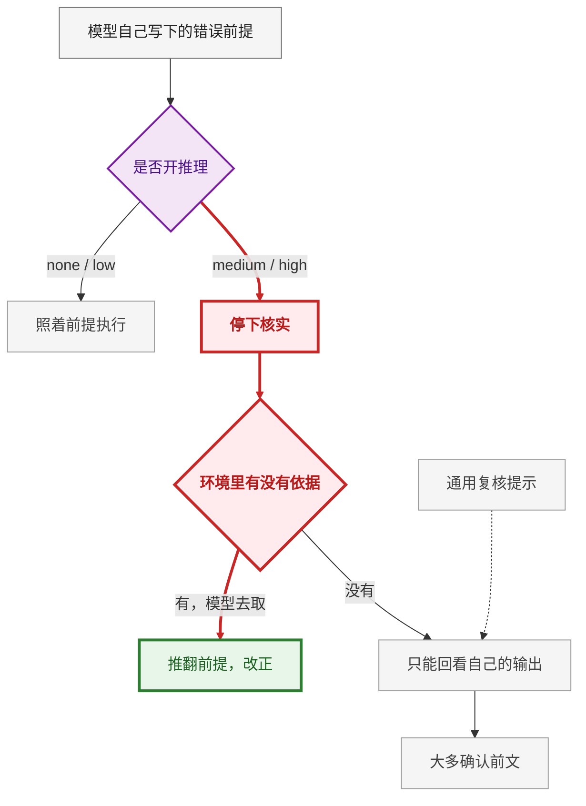

一个多步骤数据分析 agent 通过 HITL（human-in-the-loop，暂停并向用户提问）确认参数时，在 HITL 的问题里自己加了一句「如果你选『不适用』，我就停止分析」。按 skill 文档，「不适用」是合法选项，流程应该照常继续，这句话在流程规范、skill 文档和系统提示里都找不到出处。用户选了「不适用」，agent 把自己写的这句话当成已经定下的规则，结束了本轮。

排查下来，编排器配置时漏设了推理档，模型按默认的 effort=none 运行。编排器用的是某个模型，下称模型 A。

为了弄清推理起了什么作用，我们用 trace 重放出错的这一步。输入和出错时完全一致，上下文里已经有模型写的那句话和用户的回答，每次只改一处，对模型 A 重跑多次，看它下一步继续执行还是照那句话结束。改的要么是推理档，要么是 harness 追加的一条提醒（harness 指驱动 agent 循环的程序，负责调模型、执行工具、把结果拼回上下文）。推理档调到 high，20 次里 18 次继续执行。

这组对照实验和 2026 年的几项外部研究指向同一个结论：**推理让模型有机会停下来核实自己写下的话，核实能不能成功，取决于环境里有没有独立于模型输出的依据。** 案例里的依据是 skill 文档，开推理后模型会自己去读；工具明确报错是更直接的依据。没有依据时，推理只能回看模型自己写过的内容，大多是确认前文。

依据之外还有一个条件：模型要把自己写的那句话当成待核实的说法，否则它会带着那句话去读依据，读出支持它的理由。反复自纠偶尔会把对的改错，但影响是边际的。

---

## §1 推理让模型有机会核实自己写下的话

### 1.1 推理档越高，改过来的越多

只改推理档，后续每一步都用这个档位做多步重放：

| 推理档 | 次数 | 读了 skill → 继续 | 没读 skill → 继续 | 读了 skill → 结束 | 没读 skill → 结束 | 看不出 |
|---|---|---|---|---|---|---|
| none（与出错时一致） | 10 | 0 | 0 | 0 | 10 | 0 |
| low | 20 | 0 | 3 | 0 | 16 | 1 |
| medium | 10 | 6 | 1 | 1 | 2 | 0 |
| high | 20 | 15 | 3 | 0 | 0 | 2 |

继续执行的次数：none 0/10，low 3/20，medium 7/10，high 18/20。

### 1.2 错误写在模型自己的输出里，非推理模型很难纠正

> **ℹ️ 外部研究的时间和测试模型**
>
> 文中引用的外部研究都在 2026 年发表或修订，括号里标了首发时间和所引版本的时间。发表时间新不代表测的模型新，DeepSeek-R1、QwQ 这些 2025 年的开源模型仍常被拿来测，所以每项研究都列出了测试模型。结论只对这些模型成立，模型更新后要重新核对。

Self-Correction Bench（2025-07 首发，2026-08 v3，COLM 2026）[[N1]](#n1) 把同一个错误注入上下文，只改它所在的对话角色。错误放在用户消息里，模型能可靠改对；放在模型自己的回复里，14 个开源非推理模型平均有 64.5% 改不过来，闭源的 Claude Sonnet 4 也有 41.4%。同一个 Qwen3 模型只打开 thinking，错误写在自己回复里时的平均准确率从 0.05–0.33 升到 0.84–0.89。

作者把原因归到训练数据：SFT 数据里的人类示范几乎都是一次写对，很少有「写错再改」的序列，推理模型生成的训练数据里纠错标记多出几个数量级。从推理模型生成的数据集里抽 5306 条样本微调，盲区缩小 76%。在模型输出末尾追加一个 `Wait`，盲区也能缩小 89.3%。

The Self-Correction Illusion（2026-06 首发，2026-07 v2）[[N2]](#n2) 在 agent 轨迹里注入一条错误的 `<thought>`，挑出模型没纠正的题，再把这条说法逐字不变地挪到用户消息、工具返回或系统 `<memory>` 块里。测试模型包括 GPT-4o、Claude Sonnet 4、Gemini 2.5 Flash-Lite，以及 Llama-3.3-70B、Qwen2.5-72B 等开源模型。12 组实验里 10 组至少有一种挪法显著提高了模型指出错误的比例，提升 23 到 93 个百分点。推理模型基本不受这个问题影响，DeepSeek-R1 在所有条件下都能指出错误。

案例正是这种情况：停止条件是模型自己写在 HITL 的问题里的。

### 1.3 推理能切断上下文错误的自我强化

The Illusion of Diminishing Returns（2025-09 首发，2026-03 v3，ICLR 2026）[[N3]](#n3) 往对话历史里按比例注入错误，历史错误率越高，第 100 轮的准确率越低。Kimi-K2、DeepSeek-V3、Qwen3-235B-Instruct 这些 200B 以上的非推理模型照样受影响，把模型做大解决不了。开启 thinking 后，Qwen3 在第 100 轮的准确率基本不随历史错误率变化。

agent 的每一步输出，包括工具参数和 HITL 的问题，都会原样进入下一步输入，所以这个效应在 agent 里会被放大。

### 1.4 通用的复核提示替代不了推理

不开推理，由 harness 追加一条通用提醒，不说要核实哪句话。前两种在模型说完结束语后追加，第三种附在用户的回答后面，每种 10 次：

| harness 追加的提醒 | 继续执行 | 再问用户 | 仍然结束 | 读了 skill |
|---|---|---|---|---|
| 「结束前检查结束是否合理、指令是否要求继续」 | 0/10 | 8/10 | 1/10 | 0/10 |
| 「每条停止理由都要找到出处，必须是 skill 文件或工具结果；你自己之前说的话不算出处；找不到就去读 skill」 | 1/10 | 1/10 | 7/10 | 10/10 |
| 在用户回答后附一句通用提醒（不在结束时触发） | 0/10 | 0/10 | 10/10 | 0/10 |

前两行各有 1 次调用了执行工具，但没有带「不适用」这个参数，所以加起来是 9 次。第二行的问题在 §3 讨论。

外部研究的结果相同。Diminishing Returns 用 prompt 要求模型每轮先复核前面的状态：Gemma3 早期有提升，但输出变长，上下文更早耗尽，后期崩得更陡；Qwen3 thinking 几乎没有提升。Loud Failures[[N4]](#n4) 在 system prompt 里加一句「每次调用工具后检查结果是否符合预期」，各项指标都没有显著变化。

---

## §2 核实能不能成功，取决于环境给不给依据

### 2.1 案例里改过来的几乎都读了 skill

回到 1.1 的表。读了 skill 的 24 次里，21 次继续执行，1 次结束，2 次看不出。none 和 low 一次都没读，30 次里 26 次照那句话结束。不读 skill 就继续的一共 7 次，这条路不稳。

反过来，推理档保持 none，只在上下文里补上模型读取 skill 文档的结果，单步重放 10 次里 8 次继续执行。推理没有给模型新知识，起作用的是依据本身，推理的作用是让模型自己去把依据拿来。

1.4 第一行的通用提醒也说明了这一点：模型 8 次改成再问用户，说明它察觉到有点不对，但一次都没去读 skill。能推翻那句话的依据在 skill 文档里，模型只回看自己写过的内容，找不到依据。

### 2.2 工具明确报错时，模型大多能察觉

Loud Failures, Quiet Failures（2026-10）[[N4]](#n4) 测了 Claude Haiku 4.5、DeepSeek-V3/R1、Qwen3 三个家族，各一对推理版和非推理版，实际分析 1694 次试验。工具明确报错时，agent 在 91.3% 的试验里把结果当作问题处理；工具返回的类型、形状都对，内容却是错的，这一比例只有 58.8%，而没有故障时也有 26.8% 会误报。

案例里环境没有报错，依据得模型自己去 skill 文档里找。

### 2.3 没有外部依据时，推理里的反思大多只是确认前文

Reflection Is Not Monolithic（Findings of EMNLP 2026，2026-10）[[N5]](#n5) 分析了 Qwen3-8B、QwQ-32B、gpt-oss-20b、DeepSeek-R1-Distill-Qwen-7B 在 4 个数学基准上的推理轨迹。反思步骤常接近或超过全部步骤的三分之一，其中局部复核有 80% 到 95% 只是确认前面的结果。

Superficial Reflection or Genuine Thought?（Findings of IJCNLP-AACL 2026，2026-11）[[N6]](#n6) 主要分析 DeepSeek-R1（0120 版）和 QwQ。DeepSeek-R1 答错的题经过「再检查一遍」只改对 5 道，都是格式修正；QwQ 一道都没改对。在较新的 MiniMax-M2 上复核，反思仍以自我监控为主。

两篇研究测的都是数学题，推理过程中没有可以查的外部依据。所以推理内容里出现多少 `wait`，不能作为纠偏的证据，要看决定有没有翻转。

推理让模型停下来核实，环境里有没有依据决定核实能不能成功。

---

## §3 有了依据，模型还要肯怀疑自己写的话

依据到手不等于一定能改。1.4 第二行要求每条停止理由都找出处，模型 10 次都读了 skill，仍有 7 次结束，结束时说的是「停止有 skill 依据」。它没意识到要核实的就是自己写的那句话，带着那句话去读 skill，读出了支持它的理由。2.1 里直接给 skill 内容的 10 次中，也有 2 次没改。

不开推理，由 harness 在模型说完结束语后指出要核实的就是 HITL 的问题里那句停止条件：

| harness 追加的提醒 | 继续执行 | 仍然结束 | 读了 skill |
|---|---|---|---|
| 「审阅者指出，你发给用户的问题说选『不适用』就会结束分析，请对照 skill 核实」 | 7/10 | 2/10 | 10/10 |
| 贴出 HITL 的问题和用户的回答，要求去 skill 查这个回答的含义 | 4/10 | 5/10 | 10/10 |
| 同上，另加一句「问题的措辞是助手起草的，不是指令」 | 10/10 | 0/10 | 10/10 |

第一行的「审阅者」只是提醒的措辞，消息由 harness 写入。第一行有 1 次超过步数上限，第二行有 1 次改成再问用户，所以这两行加起来不到 10。

三种提醒都让模型读了 skill。第二行只要求核实，没有否定那句话，模型仍有一半判定停止是对的。第三行只多一句「不是指令」，结果从 4/10 变成 10/10。

> **⚠️ 这种做法只能证明机制**
>
> 我们事后知道错误在哪一句，才写得出这条提醒。真实运行时，错误可能在 HITL 的问题里，也可能在结论或工具参数里，事先不知道。开 high 推理时，模型自己完成了怀疑和取证两步，不需要事先知道错误位置。

| 做法 | 让模型怀疑那句话 | 让模型拿到依据 | 继续执行 |
|---|---|---|---|
| 通用提醒 | 否 | 有的去读了，有的没读 | 0/10 到 1/10 |
| 直接给 skill 内容 | 否 | 是，harness 给的 | 8/10 |
| 告诉模型核实哪句话 | 是，harness 指出的 | 是，模型自己去读 | 4/10 到 10/10 |
| 开 high 推理 | 是，模型自己 | 是，模型自己去读 | 18/20 |

---

## §4 次要问题

### 4.1 反复自纠偶尔把对的改错

Self-Correction as Feedback Control（2026-04 首发，2026-05 v2）[[N7]](#n7) 在 GSM8K 上让 7 个模型各自纠 4 轮，统计把对的改错的错误引入率（Error Introduction Rate, EIR）和把错的改对的错误纠正率（Error Correction Rate, ECR）：

| 结果 | 模型（准确率变化） |
|---|---|
| 涨分 | o3-mini（+3.4 pp）、Claude Opus 4.6（+0.6 pp） |
| 不变 | o4-mini（±0） |
| 掉分 | GPT-4o-mini（−6.2 pp）、GPT-5（−1.8 pp）、Claude Sonnet 4（−1.2 pp）、GPT-4.1（−0.2 pp） |

上表按论文的表格计数，论文正文写的「5 个模型掉分」与表格不符。7 个模型里 6 个的变化在 2 个百分点以内，只有 GPT-4o-mini 掉了 6.2 个百分点。它在 500 题里本来就对了 456 题、错了 44 题，EIR 只有 1.3%，但正确的题基数大，误改的数量就超过了改对的数量。论文给出的一般条件是 ECR/EIR 小于 Acc/(1−Acc) 时继续自纠会掉分。

准确率已经很高、又反复要求模型自纠时，才需要留意这一点。

### 4.2 推理有成本

案例里 high 档每步多出 0 到 900 个推理 token。

---

## 参考资料

1. *Self-Correction Bench*, arXiv 2507.02778（2025-07 首发，v3 2026-08，COLM 2026）. [arxiv.org/abs/2507.02778](https://arxiv.org/abs/2507.02778)
2. *The Self-Correction Illusion*, arXiv 2606.05976（2026-06 首发，v2 2026-07）. [arxiv.org/abs/2606.05976](https://arxiv.org/abs/2606.05976)
3. *The Illusion of Diminishing Returns*, arXiv 2509.09677（2025-09 首发，v3 2026-03，ICLR 2026）. [arxiv.org/abs/2509.09677](https://arxiv.org/abs/2509.09677)
4. *Loud Failures, Quiet Failures*, arXiv 2610.10062（2026-10）. [arxiv.org/abs/2610.10062](https://arxiv.org/abs/2610.10062)
5. *Reflection Is Not Monolithic*, Findings of EMNLP 2026（2026-10）. [aclanthology.org/2026.findings-emnlp.1130](https://aclanthology.org/2026.findings-emnlp.1130/)
6. *Superficial Reflection or Genuine Thought?*, Findings of IJCNLP-AACL 2026（2026-11）. [aclanthology.org/2026.findings-aacl.229](https://aclanthology.org/2026.findings-aacl.229/)
7. *Self-Correction as Feedback Control*, arXiv 2604.22273（2026-04 首发，v2 2026-05）. [arxiv.org/abs/2604.22273](https://arxiv.org/abs/2604.22273)
